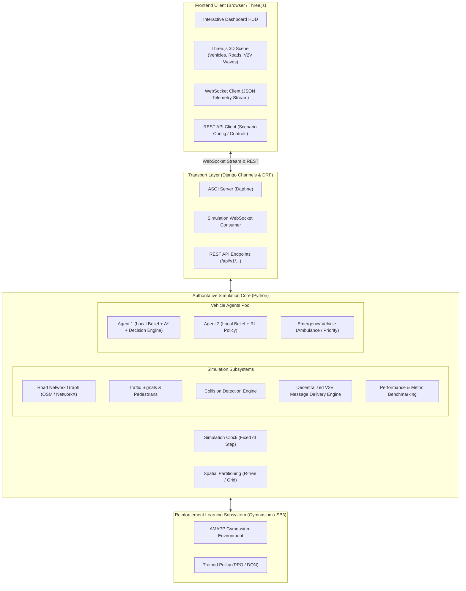

# ARCHITECTURE: Adaptive Multi-Agent Path Planning for Autonomous Vehicles

## 1. System Overview

The **Adaptive Multi-Agent Path Planning (AMAPP)** simulation platform is a decentralized multi-agent autonomous vehicle research environment. It simulates autonomous vehicles navigating real-world or synthetic road networks with dynamic traffic, pedestrians, signalized intersections, emergency vehicles, and decentralized Vehicle-to-Vehicle (V2V) communications under realistic channel constraints (range attenuation, delay, packet loss).

The architecture enforces strict separation between:
1. **Authoritative Backend Simulation Engine:** Owns ground-truth state, simulation time, spatial indices, message routing, collision detection, and traffic dynamics.
2. **Decentralized Agent Decision Policies:** Each autonomous vehicle maintains a private local world model (belief state) constructed solely from its sensors and received V2V messages, independently computing route adaptations and collision avoidance maneuvers.
3. **Real-time 3D Visualization Client:** A web-based Three.js application communicating over WebSockets to render vehicle movements, communication waves, hazard beacons, and metrics HUD without inventing simulation state.



---

## 2. Core Architectural Principles

### 2.1 Backend Authority vs. Decentralized Agent Autonomy
- **Ground Truth vs. Agent Observation:** The central engine manages physical updates, spatial coordinates, collision verification, and message delivery latency. However, individual agents do **not** have access to the global simulation state.
- **Local Belief State:** Each agent $i$ maintains its own private `LocalKnowledgeBase`:
  $$\mathcal{K}_i(t) = \{\text{direct sensor observations}\} \cup \{\text{valid V2V messages received}\} \cup \{\text{static map fragment}\}$$
- **Independent Decisions:** An agent plans routes and takes tactical avoidance actions using solely $\mathcal{K}_i(t)$. When an accident alert is received via V2V, the agent evaluates whether to reroute based on its internal utility/cost function or RL policy.

### 2.2 Deterministic Execution & Reproducibility
- The simulation loop steps forward with a discrete, fixed timestep $\Delta t$ (e.g., $0.1\,\text{s}$).
- All pseudorandom generators (agent spawn locations, packet loss probability, pedestrian crossing triggers) are parameterized by a master seed $\mathcal{S}$.
- A given seed and scenario file produces bit-identical simulation trajectories across runs.

### 2.3 Layered Modularity & Low Coupling
Components interact via strict Python interfaces and dataclasses, preventing direct dependencies between the visualization layer, web framework, and pure simulation physics.

---

## 3. Subsystem Breakdown

### 3.1 Simulation Engine & Clock (`sim_engine/`)
- **Clock & Ticker:** Manages simulation time $t$, stepping rate (ticks per second), pause/resume/step-forward state.
- **Agent Lifecycle Manager:** Spawns agents at specified origins with assigned target destinations, tracking completion or collision status.
- **Spatial Index:** Accelerates nearest-neighbor and range queries (used for collision proximity, line-of-sight, and V2V communication radius detection).

### 3.2 Road Graph & Real-World Map Integration (`map_engine/`)
- **NetworkX DiGraph Representation:** Road network modeled as a directed multigraph $G = (V, E)$, where nodes $V$ represent intersections and edges $E$ represent directed lanes/road segments with attributes (length, speed limit, lanes, coordinates).
- **OpenStreetMap (OSM) Ingestion:** Ingests `.osm` XML files or utilizes OSMnx to query bounding boxes, parsing road geometries, lanes, traffic signal locations, and crosswalks.
- **Deterministic Local Fallback Grid:** Includes an offline synthetic grid scenario with multiple intersections, lane varieties, and obstacles so full simulations and test suites run without external network calls.

### 3.3 Vehicle Agents & Kinematics (`agents/`)
- **Kinematic Model:** Implements bicycle or point-mass kinematic equations governing position $(x, y)$, heading angle $\theta$, velocity $v$, and acceleration $a$.
- **Agent Types:**
  - *Standard Autonomous Vehicles (AV):* Follow lane centerlines, obey traffic rules, communicate with neighbors.
  - *Emergency Vehicles (EV):* Ambulances or police vehicles with activated priority beacons and sirens.
- **Agent Decision Pipeline:**
  1. *Perceive:* Query onboard sensors (forward radar/LiDAR range $R_{\text{sens}}$).
  2. *Communicate:* Send and receive V2V packets within radius $R_{\text{comm}}$.
  3. *Update Belief:* Merge new information into local knowledge graph.
  4. *Plan:* Evaluate path efficiency; trigger A* or RL re-route if road cost changes.
  5. *Act:* Compute acceleration and steering angle $\mathbf{u} = [a, \delta]^T$.

### 3.4 V2V Communication Protocol & Network Emulation (`v2v/`)
- **Decentralized Topology:** Peer-to-peer multi-hop message exchange without relying on a centralized traffic control server.
- **Message Types:**
  - `BEACON`: Periodic broadcast of agent state (ID, position, velocity, heading, intent).
  - `HAZARD_ALERT`: Event-driven broadcast notifying of accidents, road closures, or stopped vehicles.
  - `EMERGENCY_PRIORITY`: Broadcast from emergency vehicles requesting lane clearance.
  - `COOPERATIVE_MANEUVER`: Negotiation between agents at unsignalized intersections or merges.
- **Channel Degradation Simulation:**
  - *Range Cutoff:* Messages only deliver if Euclidean distance $d(i, j) \le R_{\text{comm}}$.
  - *Packet Loss:* Configurable packet loss rate $P_{\text{loss}} \in [0.0, 1.0]$.
  - *Transmission Latency:* Message queue introduces latency $\tau_{\text{delay}}$ (in ticks).
  - *Fallback Behavior:* If communication is degraded or lost, agents smoothly revert to conservative sensor-only driving.

### 3.5 Path Planning & Adaptive Rerouting (`planning/`)
- **Global Path Planning:** Evaluates optimal paths using A* / Dijkstra over graph $G$.
- **Dynamic Cost Matrix:** Edge cost function incorporates real-time parameters:
  $$\text{Cost}(e) = \frac{\text{Length}(e)}{v_{\text{limit}}(e)} \times \left(1 + \alpha \cdot \text{Congestion}(e) + \beta \cdot \text{HazardLevel}(e)\right)$$
- **Adaptive Rerouting Trigger:** Triggered dynamically upon receiving confirmed V2V hazard alerts or detecting persistent downstream blockages.

### 3.6 Safety, Collision Avoidance & Traffic Elements (`safety/`)
- **Collision Detection:** Bounding box and circle intersection tests calculating Time-to-Collision (TTC):
  $$\text{TTC} = \frac{d_{\text{rel}}}{v_{\text{rel}}}$$
- **Avoidance Protocols:** Longitudinal safe headway maintenance (Intelligent Driver Model - IDM), yielding at merges, emergency braking.
- **Traffic Signals & Crosswalks:** Multi-phase traffic light state machines, pedestrian crossing behaviors, and strict pedestrian yielding rules.
- **Emergency Vehicle Priority:** Non-emergency vehicles yield right-of-way by shifting to outer lanes or decelerating when an emergency beacon is detected.

### 3.7 AI & Reinforcement Learning Subsystem (`ai_engine/`)
- **Gymnasium Interface (`gym_env/`):** Standard RL environment providing:
  - *Observation Space:* Normalized vector or grid encoding ego-vehicle speed, distance to leaders, V2V hazard flags, lane indices, and upcoming path curvature.
  - *Action Space:* Discrete (e.g., maintain route, reroute option 1, reroute option 2, decelerate, lane change) or Continuous acceleration/steering.
  - *Reward Function:* Positive reward for reaching destination and maintaining efficiency; penalties for collisions, near-misses, speeding, red-light violations, and failing to yield to emergency vehicles.
- **Stable-Baselines3 Integration:** Trained PPO / DQN policy loaded by agent decision controllers.

### 3.8 Backend Web & Transport Layer (`backend/`)
- **Django Core:** Configuration, administrative interface, scenario persistence, and static asset serving.
- **Django REST Framework (DRF):** Endpoints for scenario discovery, launching simulation runs, query metrics, and exporting benchmark logs.
- **Django Channels (ASGI):** WebSocket protocol handling streaming simulation frames at configurable tick frequencies ($10 - 30\,\text{Hz}$) to connected visualization clients.

### 3.9 Visualization & Frontend Client (`frontend/`)
- **Three.js Scene Graph:** Renders real-world road network geometry, lane dividers, buildings, and textured vehicle 3D models.
- **Visual Effects:** Dynamic spherical pulses representing V2V communication ranges, color-coded hazard warning indicators, emergency vehicle beacon flashes.
- **Interactive HUD:** Live metrics panel displaying global simulation clock, active vehicle counts, collision counters, packet delivery ratios, and individual agent inspection drawers.

---

## 4. Communication & Data Contracts

### 4.1 WebSocket Telemetry Frame (Backend $\rightarrow$ Frontend)
```json
{
  "type": "SIMULATION_FRAME",
  "tick": 1420,
  "sim_time_sec": 142.0,
  "vehicles": [
    {
      "id": "veh_001",
      "type": "STANDARD",
      "x": 124.5,
      "y": 0.0,
      "z": -86.2,
      "heading": 1.57,
      "speed": 12.4,
      "state": "NAVIGATING",
      "comm_radius": 50.0,
      "active_route": ["node_12", "node_15", "node_22"]
    },
    {
      "id": "ev_001",
      "type": "EMERGENCY",
      "x": 110.2,
      "y": 0.0,
      "z": -86.2,
      "heading": 1.57,
      "speed": 18.0,
      "siren_active": true,
      "comm_radius": 100.0
    }
  ],
  "pedestrians": [
    {
      "id": "ped_004",
      "x": 130.0,
      "y": 0.0,
      "z": -84.0,
      "state": "CROSSING"
    }
  ],
  "traffic_signals": [
    {
      "junction_id": "junc_04",
      "phase": "GREEN",
      "time_remaining": 8.5
    }
  ],
  "v2v_events": [
    {
      "sender_id": "veh_001",
      "message_type": "HAZARD_ALERT",
      "payload": {"hazard": "ROAD_BLOCKED", "node": "node_15"},
      "radius": 50.0
    }
  ],
  "metrics": {
    "active_agents": 24,
    "completed_agents": 12,
    "collision_count": 0,
    "packet_delivery_rate": 0.94
  }
}
```

### 4.2 WebSocket Command Frame (Frontend $\rightarrow$ Backend)
```json
{
  "action": "CONTROL_SIMULATION",
  "command": "PAUSE" // "PLAY", "PAUSE", "STEP", "RESET", "INJECT_HAZARD"
}
```

---

## 5. Directory Structure Strategy

```text
Adaptive-Multi-Agent-Path-Planning/
├── .github/
│   └── workflows/
│       └── ci.yml                 # GitHub Actions CI workflow
├── docs/
│   ├── progress/
│   │   └── PHASE_00.md            # Phase 0 execution report
│   ├── decisions/
│   │   └── ADR-001-modular-simulation-architecture.md
│   ├── API.md                     # REST and WebSocket specifications
│   └── TESTING.md                 # Testing standards and coverage
├── sim_engine/                    # Pure Python authoritative simulation core
│   ├── __init__.py
│   ├── core/                      # Clock, engine loop, event queue
│   ├── map/                       # Graph representation, OSM parser, local grid
│   ├── agents/                    # Kinematics, vehicle models, agent state
│   ├── v2v/                       # V2V protocol, channel noise, proximity
│   ├── planning/                  # A*, Dijkstra, dynamic cost matrices
│   ├── safety/                    # Collision detection, IDM, yielding, traffic lights
│   ├── pedestrians/               # Pedestrian movement and crosswalk rules
│   └── benchmarks/                # Performance evaluators, metrics collector
├── rl_engine/                     # Reinforcement learning components
│   ├── envs/                      # Gymnasium multi-agent environment
│   ├── policies/                  # Route selection models & custom networks
│   └── training/                  # SB3 training scripts and evaluation routines
├── backend/                       # Django & DRF application
│   ├── manage.py
│   ├── config/                    # Django project settings, ASGI, routing
│   ├── api/                       # DRF serializers, viewsets, endpoints
│   └── channels/                  # WebSocket consumers and broadcast logic
├── frontend/                      # Three.js + TypeScript dashboard
│   ├── package.json
│   ├── tsconfig.json
│   ├── vite.config.ts
│   └── src/
│       ├── main.ts
│       ├── scene/                 # Three.js scene, camera, lights, meshes
│       ├── network/               # WebSocket & REST managers
│       └── ui/                    # Dashboard HUD, telemetry indicators
├── tests/                         # Comprehensive automated test suites
│   ├── unit/                      # Isolated unit tests for all modules
│   ├── integration/               # Multi-agent interaction & communication tests
│   └── scenarios/                 # Deterministic regression scenarios
├── data/                          # Map fixtures and scenarios
│   ├── synthetic/                 # Local fallback grid graphs
│   └── osm/                       # Real-world OSM sample extracts
├── .gitignore
├── ARCHITECTURE.md
├── PROJECT_STATUS.md
├── REQUIREMENTS_TRACEABILITY.md
└── README.md
```
