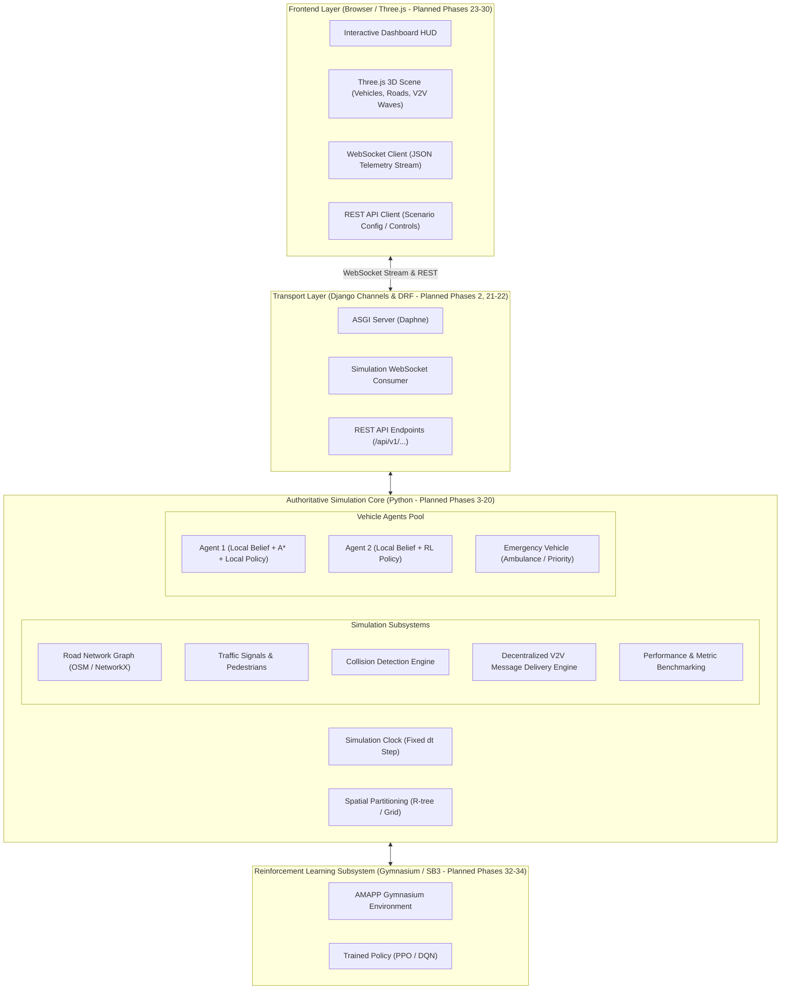
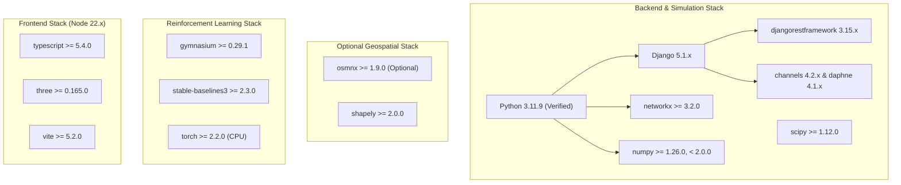

# ARCHITECTURE: Adaptive Multi-Agent Path Planning for Autonomous Vehicles (AMAPP)

> **Document Status:** Implementation Blueprint (Phase 01)  
> **Component Implementation Status:** **PROPOSED / SPECIFICATION ONLY** (No runtime application code implemented yet)

---

## 1. System Overview & Component Status

The **Adaptive Multi-Agent Path Planning (AMAPP)** simulation platform is a decentralized multi-agent autonomous vehicle research environment. It simulates autonomous vehicles navigating real-world or synthetic road networks with dynamic traffic, pedestrians, signalized intersections, emergency vehicles, and decentralized Vehicle-to-Vehicle (V2V) communications under realistic channel constraints (range attenuation, delay, packet loss).

### Component Status Summary
- **Backend Scaffold & Health API (`backend/`, `apps.core`):** **IMPLEMENTED & TESTED** in Phase 02 (Django 5.1.x, DRF 3.15.x, ASGI/WSGI entrypoints, `GET /api/v1/health/`, automated pytest suite passing).
- **Simulation Domain Layer (`backend/apps/core/domain/`):** **IMPLEMENTED & TESTED** in Phase 03 (Typed dataclasses for 10 domain models, 3 immutable value types, 9 enumerations, validation boundaries, and JSON serialization contracts).
- **Simulation Core & Subsystems (`sim_engine/*`):** **PLANNED ARCHITECTURAL BLUEPRINTS** (Phases 4–20).
- **Transport Streaming & Advanced REST (`backend/channels/`, etc.):** **PLANNED** (Phases 21–22).
- **Reinforcement Learning (`rl_engine/*`):** **PLANNED** (Phases 32–34).
- **Frontend Dashboard (`frontend/*`):** **PLANNED** (Phases 23–30).

---

## 2. Core Architectural Principles

### 2.1 Authoritative Simulation Core vs. Decentralized Agent Autonomy
A fundamental requirement of AMAPP is the strict separation between global ground truth and local agent perception:

1. **Global Ground-Truth State ($\mathcal{S}_{\text{global}}$):**
   - Maintained exclusively by the authoritative simulation engine (`sim_engine/`).
   - Contains exact 2D/3D coordinates $(x, y, z)$, true heading $\theta$, actual velocity $v$, active obstacles, actual collision events, signal phases, and message packet positions in flight.
   - **Agents have NO direct access to $\mathcal{S}_{\text{global}}$.**

2. **Direct Local Observations ($\mathcal{O}_i(t)$):**
   - Emulates onboard vehicle sensors (radar/LiDAR range $R_{\text{sens}}$, forward-facing camera, lane sensors).
   - Generates observations strictly within line-of-sight and physical sensor horizons.

3. **Received V2V Messages ($\mathcal{M}_i(t)$):**
   - Peer-to-peer messages received from neighboring agents within communication radius $R_{\text{comm}}$, subject to simulated transmission latency, packet loss, and message expiration.

4. **Private Local Knowledge Base / Belief State ($\mathcal{K}_i(t)$):**
   - Each vehicle maintains its own private belief state:
     $$\mathcal{K}_i(t) = \mathcal{O}_i(t) \cup \mathcal{M}_i(t) \cup \mathcal{G}_{\text{static\_map}}$$
   - Each agent independently computes its route adaptation, collision avoidance, and yielding maneuvers using solely its local belief $\mathcal{K}_i(t)$.
   - **The simulation scheduler/engine manages physical stepping and message transport, but NEVER secretly computes or overrides route decisions for agents.**

### 2.2 Deterministic Execution & Reproducibility
- The simulation loop advances using a discrete, fixed timestep $\Delta t = 0.1\,\text{s}$ (10 Hz).
- All stochastic processes (agent spawn distributions, packet loss triggers, pedestrian crossings) are governed by explicit, seedable pseudorandom generators (`RandomState(seed)`).
- Identical scenario configurations and seeds produce bit-identical simulation trajectories.

### 2.3 Headless Testability & Layer Decoupling
- The core simulation engine is 100% pure Python and has zero runtime dependencies on Django, Channels, WebSockets, or browser DOM.
- It can be initialized, stepped, inspected, and benchmarked headlessly via automated `pytest` suites and Gymnasium RL environments in milliseconds.

---

## 3. Subsystem Layer Specifications

### 3.0 Domain Layer & Simulation Contracts (`backend/apps/core/domain/` — IMPLEMENTED & TESTED in Phase 03)
- **Decoupled Architecture:** Pure Python typed dataclasses completely decoupled from Django ORM database tables and migrations.
- **10 Core Domain Entities:**
  - `RoadNode`: Unique identifier, planar `Position2D`, optional WGS84 `GeoCoordinate`, metadata attributes.
  - `RoadEdge`: Unique identifier, start/end node references (self-loops prohibited), length ($m > 0$), speed limit ($m/s > 0$), lane count ($\ge 1$).
  - `Route`: Unique identifier, ordered sequence of at least 2 node IDs, optional edge sequence, cached distance and duration metrics.
  - `Vehicle`: Unique identifier, 2D position, speed ($0 \le v \le v_{\max}$), heading normalized to $[0, 2\pi)$, state enum, classification enum, physical dimensions.
  - `Pedestrian`: Unique identifier, 2D position, state enum (WAITING, CROSSING, SAFE), speed bounds, optional crossing crosswalk node.
  - `TrafficSignal`: Unique identifier, controlling intersection node reference, signal phase (RED, YELLOW, GREEN), cycle duration and remaining phase duration.
  - `Obstacle`: Unique identifier, 2D position, obstacle type enum, physical footprint dimensions, optional edge reference.
  - `Incident`: Unique identifier, 2D position, incident type enum, severity enum, resolution status enum, reporting timestamp.
  - `V2VMessage`: Unique packet ID, sender ID, optional target recipient (None for broadcast), message type enum, emission timestamp, expiration timestamp, sender position, structured payload.
  - `SimulationConfig`: Discrete timestep duration ($\Delta t \in [0.001, 2.0]\,s$), deterministic random seed, communication radius ($m$), time horizon, vehicle capacity limit.
- **3 Value Types (Immutable `frozen=True`):** `Position2D`, `GeoCoordinate`, `Dimensions2D`.
- **Validation Boundaries:** Invariants enforced strictly at construction (`__post_init__`), raising `DomainValidationError`.
- **Serialization:** Full JSON round-trip serialization (`to_dict`, `from_dict`, `to_json`, `from_json`) with enum string mappings and clear error handling via `SerializationError`.

### 3.1 Simulation Core (`sim_engine/core/` — Planned Phase 8)
- **Responsibilities:** Fixed-step execution loop, authoritative world state coordinator, agent lifecycle (spawn, active, arrival, removal), event queue management, spatial partitioning.
- **Clock Execution Model:**
  - `step(dt)`: Advances world time by fixed $\Delta t$.
  - Execution pipeline:
    1. Update traffic signals and pedestrian states.
    2. Route and deliver in-flight V2V packets whose latency period has elapsed.
    3. Invoke each vehicle agent's `perceive_and_act(dt)` independently.
    4. Validate vehicle kinematic updates and enforce speed/acceleration bounds.
    5. Perform authoritative collision detection and near-miss logging.
    6. Update metrics and construct immutable telemetry frame snapshot.

### 3.2 Vehicle Agents & Kinematics (`sim_engine/agents/` — Planned Phases 7, 9, 10)
- **Responsibilities:** Independent vehicle lifecycle, kinematic motion model along lane centerlines, acceleration/braking bounds, intersection queues, local decision interface.
- **Kinematic Model:** Continuous longitudinal progression along directed graph edges $e = (u, v)$ with distance along edge $s \in [0, \text{length}(e)]$, lateral lane offset, velocity $v$, and acceleration $a \in [a_{\min}, a_{\max}]$.
- **Agent Types:**
  - `StandardAV`: Regular autonomous vehicle adhering to traffic rules, speed limits, and cooperative V2V protocols.
  - `EmergencyVehicle`: Priority vehicle (e.g., ambulance) broadcasting sirens and emergency priority tokens.

### 3.3 Road Graph & Map Engine (`sim_engine/map/` — Planned Phases 4, 5)
- **Responsibilities:** Directed multigraph representation $G = (V, E)$ using NetworkX; node coordinates, edge lengths, speed limits, lane counts, turn restrictions.
- **Dual Graph Support:**
  - *Deterministic Local Grid (Phase 4):* Synthetic grid scenario with multiple connected intersections, alternative routes, signalized junctions, and crosswalks. Requires no internet access.
  - *OpenStreetMap Ingestion (Phase 5):* Optional module using OSMnx to download and parse bounding-box XML road networks, normalizing nodes and edges into the internal graph schema.

### 3.4 Route Planning & Adaptive Rerouting (`sim_engine/planning/` — Planned Phases 6, 15)
- **Responsibilities:** Shortest-path routing via NetworkX and A*; dynamic edge travel cost evaluation; adaptive rerouting on hazard detection.
- **Edge Cost Formulation:**
  $$\text{Cost}(e) = \frac{\text{Length}(e)}{v_{\text{limit}}(e)} \times \left(1 + \alpha \cdot \text{CongestionFactor}(e) + \beta \cdot \text{HazardWeight}(e)\right)$$
- **Oscillation Prevention:** Rerouting is evaluated with an improvement threshold $\Delta C_{\text{threshold}}$ and a re-planning cooldown period $\tau_{\text{cooldown}}$ to avoid route thrashing.

### 3.5 V2V Communication Subsystem (`sim_engine/v2v/` — Planned Phases 11–14)
- **Responsibilities:** Peer-to-peer message protocol, spatial proximity detection ($d \le R_{\text{comm}}$), transmission latency, packet loss ($P_{\text{loss}}$), message expiration, and deduplication.
- **Message Types:**
  - `BEACON`: Periodic broadcast (ID, position, speed, heading).
  - `HAZARD_ALERT`: Event-driven alert (incident location, closure, congestion level).
  - `EMERGENCY_PRIORITY`: Priority corridor clearance beacon.
- **Failure Handling (Phase 14):** When packets are dropped or peers disconnect, agents fall back to local sensor observations and conservative headway following.

### 3.6 Safety, Collisions & Traffic Rules (`sim_engine/safety/` — Planned Phases 16–18)
- **Responsibilities:** Bounding-box and circle intersection checks, Time-To-Collision (TTC) calculations, Intelligent Driver Model (IDM) car-following, pedestrian crosswalk yielding, signal phase obedience, emergency corridor formation.

### 3.7 AI & Reinforcement Learning (`sim_engine/policies/` & `rl_engine/` — Planned Phases 19, 32–34)
- **Interpretable Decision Policy (Phase 19):** Transparent, weighted scoring baseline evaluating travel time, congestion, risk, and communication confidence:
  $$\text{Score}(\text{route}) = w_1 \cdot \text{Time} + w_2 \cdot \text{Congestion} + w_3 \cdot \text{Risk} - w_4 \cdot \text{Confidence}$$
- **Gymnasium Environment (Phase 32):** Standard RL interface providing bounded vector observations and discrete/continuous action spaces for route selection.
- **Stable-Baselines3 Model (Phases 33–34):** PPO agent trained on route selection with bounded training budget, fully decoupled from the baseline policy.

### 3.8 Web Backend & Transport (`backend/` — Planned Phases 2, 21–22, 35)
- **Responsibilities:** Django REST Framework API for scenario discovery, simulation lifecycle control (play/pause/step/reset), metrics querying, and experiment history persistence.
- **Django Channels (ASGI / Daphne):** Streams authoritative simulation snapshots and V2V events over WebSockets at bounded frequencies (10–30 Hz).

### 3.9 Frontend & Visualization (`frontend/` — Planned Phases 23–30)
- **Responsibilities:** TypeScript + Three.js application rendering 3D road networks, vehicles, pedestrians, traffic signals, communication range rings, and hazard indicators.
- **Strict Rendering Boundary:** The frontend never computes physics or invents simulation state; it strictly interpolates authoritative state received from WebSockets.

---

## 4. Top-Level Module Blueprint

| Module Path | Responsibility | Intro Phase | Dependencies | Public Contract | Test Suite | Forbidden Dependencies |
| `backend/apps/core/domain/` | Typed domain dataclasses, value objects, enums, units, validation, serialization | Phase 03 (IMPLEMENTED & TESTED) | Python Standard Library (`dataclasses`, `enum`, `typing`, `json`, `math`) | 10 Domain Models (`Vehicle`, `RoadNode`, `RoadEdge`, `Route`, `Pedestrian`, `TrafficSignal`, `Obstacle`, `Incident`, `V2VMessage`, `SimulationConfig`), 3 Value Types (`Position2D`, `GeoCoordinate`, `Dimensions2D`), `to_dict`, `from_dict`, `to_json`, `from_json` | `backend/apps/core/tests/test_domain_*.py` | Must NOT depend on Django ORM, Channels, or external geometry packages |
| `sim_engine/map/` | Road graph representation, OSM parser, synthetic grid | Phase 04 | NetworkX, NumPy, optional OSMnx | `RoadGraph`, `SyntheticGridGenerator`, `OSMImporter` | `tests/unit/test_road_graph.py` | Must NOT depend on vehicle agents or web layer |
| `sim_engine/planning/` | A* baseline, dynamic cost fields, adaptive rerouting | Phase 06 | NetworkX, `sim_engine/map/` | `AStarPlanner`, `DynamicCostField`, `RouteEvaluator` | `tests/unit/test_planning.py` | Must NOT depend on global simulation scheduler |
| `sim_engine/agents/` | Vehicle kinematics, agent lifecycle, belief state | Phase 07 | `sim_engine/domain/`, NumPy | `VehicleAgent`, `LocalKnowledgeBase`, `KinematicModel` | `tests/unit/test_agents.py` | Must NOT access global simulation state directly |
| `sim_engine/core/` | Authoritative simulation clock, stepping loop, world state | Phase 08 | All `sim_engine/` subsystems | `SimulationEngine`, `SimulationClock`, `WorldState` | `tests/unit/test_sim_engine.py` | Must NOT depend on Django views or WebSocket consumers |
| `sim_engine/v2v/` | Message validation, proximity detection, channel noise | Phase 11 | `sim_engine/domain/`, SciPy/NumPy | `V2VChannel`, `ProximityDetector`, `MessageDispatcher` | `tests/unit/test_v2v.py` | Must NOT modify agent routes directly |
| `sim_engine/safety/` | Collision detection, IDM, signals, pedestrian yielding | Phase 16 | `sim_engine/domain/`, NumPy | `CollisionDetector`, `IDMController`, `TrafficSignalController` | `tests/unit/test_safety.py` | Must NOT depend on frontend rendering |
| `backend/` | Django project, settings, ASGI/WSGI, health check API (scaffold: Phase 02; full APIs: Phase 21) | Phase 02, 21 | Django, DRF, Channels, Daphne | Health check (`/api/v1/health/`), future REST API & WebSockets | `backend/apps/core/tests/test_health.py` | Core simulation must run without `backend/` |
| `rl_engine/` | Gymnasium environment, SB3 PPO training, model evaluation | Phase 32 | Gymnasium, Stable-Baselines3, PyTorch | `AMAPPEnv`, `train_ppo()`, `evaluate_policy()` | `tests/unit/test_gym_env.py` | Core simulation must function if SB3 is absent |
| `frontend/` | TypeScript + Three.js 3D dashboard & HUD | Phase 23 | Node.js, Vite, Three.js | Browser UI, WebSocket client, Canvas renderer | Frontend test runner (Vitest/ESLint) | Must NOT compute authoritative vehicle movements |

---

## 5. Dependency Strategy & Compatibility Matrix

### Dependency Groupings & Version Pinning Strategy

1. **Core Simulation & Numerical Computing (Phases 3–20):**
   - `python`: 3.11.9 (Verified host runtime)
   - `networkx`: ~3.3 (Graph topology, A* algorithm)
   - `numpy`: ~1.26.4 (Spatial coordinates, vector math, bounded < 2.0.0 for library stability)
   - `scipy`: ~1.13.0 (Spatial distance computations, KDTree proximity queries)

2. **Web Backend & Transport (Phases 2, 21–22):**
   - `django`: ~5.1.2 (LTS/current stable release)
   - `djangorestframework`: ~3.15.2 (REST serializers, views)
   - `channels`: ~4.2.0 (ASGI WebSocket routing)
   - `daphne`: ~4.1.2 (ASGI production server)
   - `channels-redis`: ~4.2.0 (Optional Redis channel layer, with in-memory fallback)

3. **Optional Geospatial (Phase 5):**
   - `osmnx`: ~1.9.4
   - `shapely`: ~2.0.4
   - *Compatibility Guard:* OSMnx requires underlying C-libraries (GEOS/GDAL). Phase 5 will implement strict defensive imports: if OSMnx is uninstalled or fails on Windows, the system transparently utilizes the deterministic synthetic grid without crashing.

4. **Reinforcement Learning (Phases 32–34):**
   - `gymnasium`: ~0.29.1
   - `stable-baselines3`: ~2.3.2
   - `torch`: ~2.2.2+cpu (CPU-only build to keep installation lightweight and CI fast)

5. **Testing & Code Quality (Phases 1–40):**
   - `pytest`: ~8.2.0
   - `pytest-cov`: ~5.0.0
   - `pytest-django`: ~4.8.0
   - `pytest-asyncio`: ~0.23.6
   - `ruff`: ~0.4.4

6. **Frontend Stack (Phases 23–30):**
   - Node.js: 22.18.0 (Verified host runtime)
   - npm: 10.9.3
   - `three`: ~0.165.0
   - `@types/three`: ~0.165.0
   - `vite`: ~5.2.11
   - `typescript`: ~5.4.5
   - `eslint`: ~8.57.0

---

## 6. Technical Risks & Mitigation Strategies

| Risk ID | Description | Severity | Mitigation Strategy |
|---|---|---|---|
| **TR-01** | Geospatial dependency installation failures (GDAL/GEOS with OSMnx on Windows) | Medium | Make OSMnx strictly optional via dynamic import guards; provide a complete offline synthetic grid as primary fallback. |
| **TR-02** | PyTorch / SB3 CI runtime weight and build slowdown | Medium | Use CPU-only PyTorch wheels; confine model training to isolated bounded jobs (Phase 33), using small observation spaces. |
| **TR-03** | High-frequency WebSocket streaming saturating browser thread | High | Decouple simulation tick rate from client frame rate; implement snapshot throttling (10–20 Hz) and client-side interpolation. |
| **TR-04** | Route oscillation during multi-agent dynamic rerouting | High | Implement re-planning cooldown timers, hysteresis margins ($\Delta C > 15\%$), and staggered update intervals. |
| **TR-05** | State desynchronization between backend physics and frontend 3D rendering | Critical | Backend is authoritative for all coordinates, states, and collisions. Frontend strictly interpolates backend snapshots and never creates collision events. |
| **TR-06** | Flaky or non-deterministic tests in CI | High | Mandate fixed pseudorandom seeds across all unit, integration, and scenario tests; avoid wall-clock sleeps. |
