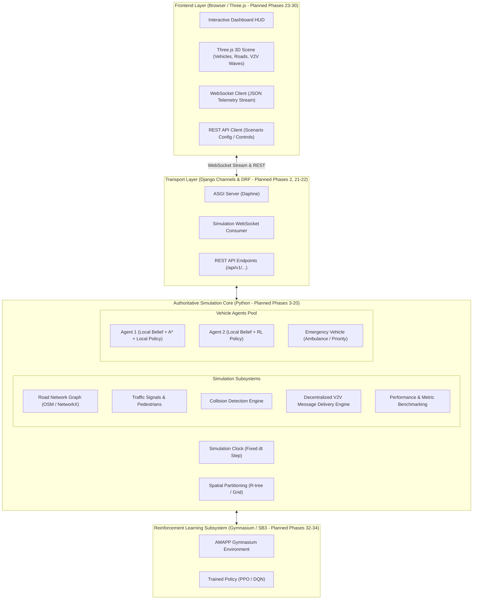
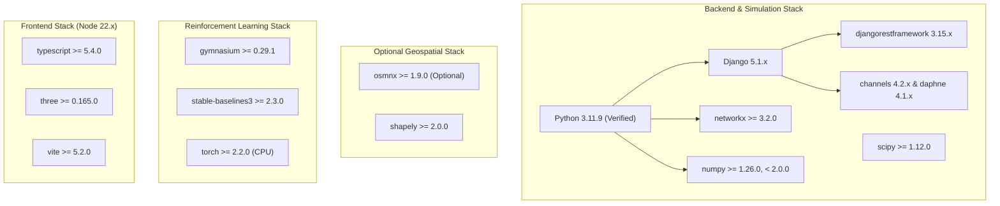
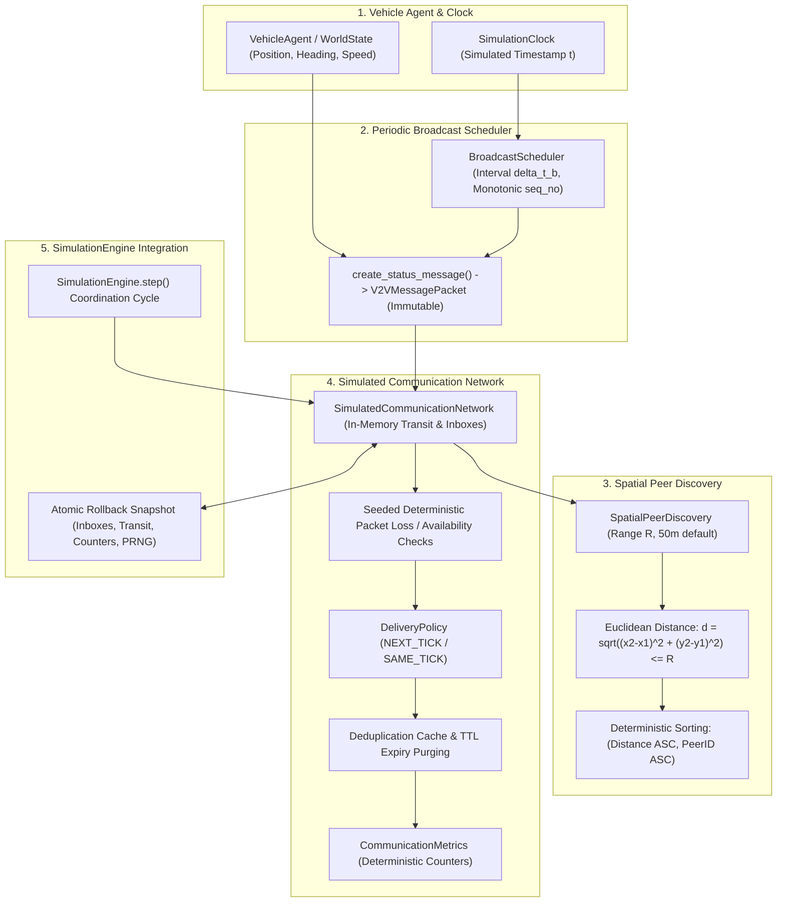
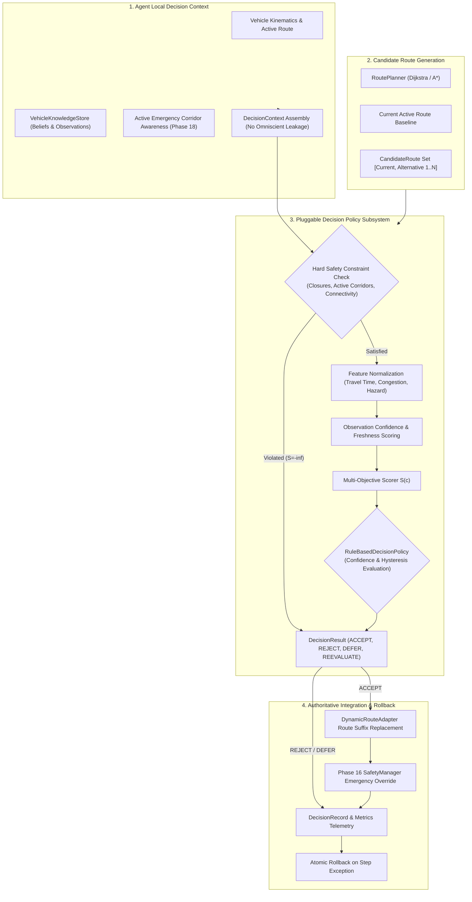
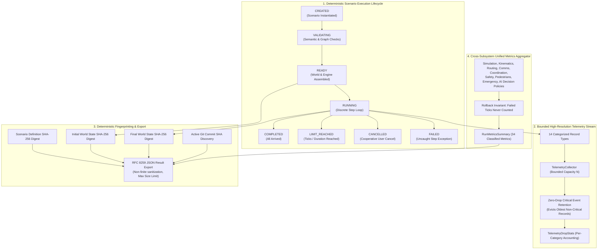

# ARCHITECTURE: Adaptive Multi-Agent Path Planning for Autonomous Vehicles (AMAPP)

> **Document Status:** Implementation Blueprint (Phase 01)  
> **Component Implementation Status:** **PROPOSED / SPECIFICATION ONLY** (No runtime application code implemented yet)

---

## 1. System Overview & Component Status

The **Adaptive Multi-Agent Path Planning (AMAPP)** simulation platform is a decentralized multi-agent autonomous vehicle research environment. It simulates autonomous vehicles navigating real-world or synthetic road networks with dynamic traffic, pedestrians, signalized intersections, emergency vehicles, and decentralized Vehicle-to-Vehicle (V2V) communications under realistic channel constraints (range attenuation, delay, packet loss).



### Component Status Summary
- **Backend Scaffold & Health API (`backend/`, `apps.core`):** **IMPLEMENTED & TESTED** in Phase 02 (Django 5.1.x, DRF 3.15.x, ASGI/WSGI entrypoints, `GET /api/v1/health/`, automated pytest suite passing).
- **Simulation Domain Layer (`backend/apps/core/domain/`):** **IMPLEMENTED & TESTED** in Phase 03 (Typed dataclasses for 10 domain models, 3 immutable value types, 9 enumerations, validation boundaries, and JSON serialization contracts).
- **Road Graph & Synthetic City (`backend/apps/core/graph/`):** **IMPLEMENTED & TESTED** in Phase 04 (`RoadGraph` wrapping NetworkX `DiGraph`, `CityGridConfig`, `generate_synthetic_city_grid`, weak/strong connectivity analysis, traffic signal integration, 151 tests passing).
- **OSM Acquisition & Normalization (`backend/apps/core/graph/`):** **IMPLEMENTED & TESTED** in Phase 05 (`BoundingBox`, `LocalPlanarProjector`, `normalize_osm_graph`, `import_osm_road_network`, 211 tests passing).
- **Route Planning Baseline (`backend/apps/core/routing/`):** **IMPLEMENTED & TESTED** in Phase 06 (`RoutePlanner`, Dijkstra, custom A*, distance/travel-time cost modes, closed edges, 257 tests passing).
- **Vehicle Kinematics & Agent Lifecycle (`backend/apps/core/kinematics/`):** **IMPLEMENTED & TESTED** in Phase 07 (`VehicleAgent`, constant-acceleration motion, lifecycle states, route following, 318 tests passing).
- **Simulation Clock & World State (`backend/apps/core/simulation/`):** **IMPLEMENTED & TESTED** in Phase 08 (`SimulationClock`, `WorldState`, `SimulationEngine`, atomic rollback, pause/resume/single-step, 377 tests passing).
- **Traffic Signals & Intersection Management (`backend/apps/core/signals/`):** **IMPLEMENTED & TESTED** in Phase 09 (`TrafficSignalController`, cyclic phase progression, spatial edge lookup, 441 tests passing).
- **Scenario Orchestration & Configuration (`backend/apps/core/scenarios/`):** **IMPLEMENTED & TESTED** in Phase 10 (`ScenarioDefinition`, `ScenarioBuilder`, `ScenarioRunner`, deterministic replay, 485 tests passing).
- **V2V Protocol & Dynamic Neighbor Tables (`backend/apps/core/communication/`):** **IMPLEMENTED & TESTED** in Phase 11 & 12 (`V2VMessagePacket`, `SpatialPeerDiscovery`, `SimulatedCommunicationNetwork`, `BroadcastScheduler`, `NeighborTable`, `NeighborManager`, 624 tests passing).
- **Decentralized V2V Coordination (`backend/apps/core/coordination/`):** **IMPLEMENTED & TESTED** in Phase 13 (`CongestionReport`, `RoadClosureReport`, `HazardReport`, `VehicleKnowledgeStore`, `InformationFusion`, `DisseminationManager`, `CoordinationManager`, order-invariant belief fusion, multi-hop dissemination, atomic rollback, 676 tests passing).
- **Communication Failures and Latency Recovery (`backend/apps/core/communication/`):** **IMPLEMENTED & TESTED** in Phase 14 (Multi-tick transit queues, deterministic latency, distance loss, Gilbert-Elliott burst loss, outages, links, partitions, 709 tests passing).
- **Adaptive Rerouting & Dynamic Route Adjustment (`backend/apps/core/routing/`):** **IMPLEMENTED & TESTED** in Phase 15 (`DynamicEdgeCostEvaluator`, `DynamicRouteAdapter`, `AdaptiveRoutingConfig`, `AdaptiveRoutingMetrics`, safe route suffix replacement, hysteresis & cooldown, engine integration & rollback, 760 tests passing).
- **Simulation Execution Lifecycle, Telemetry & Export (`backend/apps/core/scenarios/`, `telemetry/`):** **IMPLEMENTED & TESTED** in Phase 20 (8-state FSM, cooperative cancellation, SHA-256 fingerprints, bounded telemetry stream, metrics aggregator, RFC 8259 JSON export, 1,007 tests passing).
- **Django REST API Layer (`backend/apps/core/api/`):** **IMPLEMENTED & TESTED** in Phase 21 (REST endpoints under `/api/v1/`: scenario CRUD/validation, run lifecycle, discrete stepping, cancellation, telemetry, metrics, export, custom exception taxonomy, 1,053 tests passing).
- **Transport Streaming (WebSockets via Django Channels):** **IMPLEMENTED & TESTED** in Phase 22 (WebSocket endpoint `/ws/v1/runs/{run_id}/`, Channels 4 + Daphne ASGI, 21 event types, bounded backpressure, replay, 1,095 tests passing).
- **Frontend Dashboard & 3D Simulation Viewer (`frontend/`):** **IMPLEMENTED & TESTED** in Phase 23 (React 18, TypeScript, Three.js 3D viewport, REST API & WebSocket clients, metrics panel, event feed, 35 frontend tests passing).
- **3D City and Road Rendering Pipeline (`frontend/src/features/scene3d/geometry.ts`):** **IMPLEMENTED & TESTED** in Phase 24 (Multi-lane markings, junction pads, zebra crosswalks, sidewalks/curbs, deterministic procedural buildings via Mulberry32 PRNG, day/night lighting modes, dual perspective/orthographic cameras, 62 frontend tests).
- **Vehicle and Pedestrian Models, Animation & Temporal Interpolation (`frontend/src/features/scene3d/`):** **IMPLEMENTED & TESTED** in Phase 25 (Low-poly vehicle models, articulated walking pedestrian avatars, subtle emergency beacons, bounded temporal interpolation buffer with shortest-path heading lerp, 107 frontend tests).
- **Interactive Simulation Playback, Timeline, and Step Controls (`frontend/src/features/playback/`, `apps.core.api`):** **IMPLEMENTED & TESTED** in Phase 26 (Play/Pause/Resume, single/multi-step forward, speed multipliers 0.5x-5x, bounded history buffer, timeline scrubber, live vs. review separation, concurrent step protection 409 Conflict, 126 frontend tests, 1,097 backend tests).
- **V2V Communication Links, Message Animations, and Network-State Overlays (`frontend/src/features/scene3d/v2vOverlay.ts`, `v2vAdapter.ts`, `types/v2v.ts`):** **IMPLEMENTED & TESTED** in Phase 27 (Active/stale links from authoritative neighbor tables, canonical link deduplication, verified range disc around inspected vehicles, bounded message transit pulse queue with pause-freezing, network degradation overlays, accessible HUD toggles and collapsible legend, 147 frontend tests, 1,097 backend tests).
- **Adaptive Routing Visualization, Route Alternatives & Explanations (`frontend/src/features/scene3d/routeOverlay.ts`, `routeAdapter.ts`, `types/routing.ts`):** **IMPLEMENTED & TESTED** in Phase 28 (Active routes at $y=0.12\text{m}$, baseline planned paths, candidate alternative paths, 3D reroute markers, decision reasons, cost comparisons, EntityInspector routing telemetry, HUD toggles, collapsible legend, 166 frontend tests, 1,097 backend tests).
- **Interactive Traffic Incident Injection & Scenario Controls (`backend/apps/core/incidents/`, `frontend/src/features/simulation/IncidentControlPanel.tsx`, `scene3d/incidentOverlay.ts`):** **IMPLEMENTED & TESTED** in Phase 29 (Authoritative incident injection, road closures, congestion, obstacles, signal overrides, REST API `/runs/{id}/incidents/`, WebSocket events, 3D overlays at $y=0.10\text{m}$, historical playback immutability, 183 frontend tests, 1,112 backend tests).
- **Reinforcement Learning (`rl_engine/*`):** **PLANNED** (Phases 32–34).

---

## 2. Core Architectural Principles

### 2.1 Authoritative Simulation Core vs. Decentralized Agent Autonomy
A fundamental requirement of AMAPP is the strict separation between global ground truth and local agent perception:

1. **Global Ground-Truth State ($\mathcal{S}_{\text{global}}$):**
   - Maintained exclusively by the authoritative simulation engine (`sim_engine/`).
   - Contains exact 2D/3D coordinates $(x, y, z)$, true heading $\theta$, actual velocity $v$, active obstacles, actual collision events, signal phases, and message packet positions in flight.
   - **Agents have NO direct access to $\mathcal{S}_{\text{global}}$.**

2. **Direct Local Observations ($\mathcal{O}_i(t)$):**
   - Emulates onboard vehicle sensors (radar/LiDAR range $R_{\text{sens}}$, forward-facing camera, lane sensors).
   - Generates observations strictly within line-of-sight and physical sensor horizons.

3. **Received V2V Messages ($\mathcal{M}_i(t)$):**
   - Peer-to-peer messages received from neighboring agents within communication radius $R_{\text{comm}}$, subject to simulated transmission latency, packet loss, and message expiration.

4. **Private Local Knowledge Base / Belief State ($\mathcal{K}_i(t)$):**
   - Each vehicle maintains its own private belief state:
     $$\mathcal{K}_i(t) = \mathcal{O}_i(t) \cup \mathcal{M}_i(t) \cup \mathcal{G}_{\text{static\_map}}$$
   - Each agent independently computes its route adaptation, collision avoidance, and yielding maneuvers using solely its local belief $\mathcal{K}_i(t)$.
   - **The simulation scheduler/engine manages physical stepping and message transport, but NEVER secretly computes or overrides route decisions for agents.**

### 2.2 Deterministic Execution & Reproducibility
- The simulation loop advances using a discrete, fixed timestep $\Delta t = 0.1\,\text{s}$ (10 Hz).
- All stochastic processes (agent spawn distributions, packet loss triggers, pedestrian crossings) are governed by explicit, seedable pseudorandom generators (`RandomState(seed)`).
- Identical scenario configurations and seeds produce bit-identical simulation trajectories.

### 2.3 Headless Testability & Layer Decoupling
- The core simulation engine is 100% pure Python and has zero runtime dependencies on Django, Channels, WebSockets, or browser DOM.
- It can be initialized, stepped, inspected, and benchmarked headlessly via automated `pytest` suites and Gymnasium RL environments in milliseconds.

---

## 3. Subsystem Layer Specifications

### 3.0 Domain Layer & Simulation Contracts (`backend/apps/core/domain/` — IMPLEMENTED & TESTED in Phase 03)
- **Decoupled Architecture:** Pure Python typed dataclasses completely decoupled from Django ORM database tables and migrations.
- **10 Core Domain Entities:**
  - `RoadNode`: Unique identifier, planar `Position2D`, optional WGS84 `GeoCoordinate`, metadata attributes.
  - `RoadEdge`: Unique identifier, start/end node references (self-loops prohibited), length ($m > 0$), speed limit ($m/s > 0$), lane count ($\ge 1$).
  - `Route`: Unique identifier, ordered sequence of at least 2 node IDs, optional edge sequence, cached distance and duration metrics.
  - `Vehicle`: Unique identifier, 2D position, speed ($0 \le v \le v_{\max}$), heading normalized to $[0, 2\pi)$, state enum, classification enum, physical dimensions.
  - `Pedestrian`: Unique identifier, 2D position, state enum (WAITING, CROSSING, SAFE), speed bounds, optional crossing crosswalk node.
  - `TrafficSignal`: Unique identifier, controlling intersection node reference, signal phase (RED, YELLOW, GREEN), cycle duration and remaining phase duration.
  - `Obstacle`: Unique identifier, 2D position, obstacle type enum, physical footprint dimensions, optional edge reference.
  - `Incident`: Unique identifier, 2D position, incident type enum, severity enum, resolution status enum, reporting timestamp.
  - `V2VMessage`: Unique packet ID, sender ID, optional target recipient (None for broadcast), message type enum, emission timestamp, expiration timestamp, sender position, structured payload.
  - `SimulationConfig`: Discrete timestep duration ($\Delta t \in [0.001, 2.0]\,s$), deterministic random seed, communication radius ($m$), time horizon, vehicle capacity limit.
- **3 Value Types (Immutable `frozen=True`):** `Position2D`, `GeoCoordinate`, `Dimensions2D`.
- **Validation Boundaries:** Invariants enforced strictly at construction (`__post_init__`), raising `DomainValidationError`.
- **Serialization:** Full JSON round-trip serialization (`to_dict`, `from_dict`, `to_json`, `from_json`) with enum string mappings and clear error handling via `SerializationError`.

### 3.1 Simulation Core (`backend/apps/core/simulation/` — IMPLEMENTED & TESTED in Phase 08)
- **Phase 8 Implementation Status:** **COMPLETED & TESTED**. The simulation core coordinates discrete time progression, world-state ownership, multi-agent stepping, and atomic rollback guarantees.
- **Module Architecture (`backend/apps/core/simulation/`):**
  - `clock.py`: Authoritative discrete simulation clock (`SimulationClock`) tracking integer tick count $k$ and fixed step duration $\Delta t \in [0.0001, 10.0]\,\text{s}$. Eliminates floating-point drift by deriving simulated time as $t = \text{round}(k \cdot \Delta t, 9)$. Independent of wall-clock time.
  - `world.py`: Centralized container (`WorldState`) owning the `RoadGraph`, authoritative `SimulationClock`, and registered `VehicleAgent` instances. Enforces unique agent identifiers (`DuplicateAgentIdError`), validates agent-graph compatibility (`IncompatibleAgentGraphError`), enumerates agents in stable identifier order (`sorted by vehicle.id`), captures initial registration baselines, and restores state on reset.
  - `engine.py`: Execution sequencer (`SimulationEngine`) coordinating clock ticks and vehicle stepping. Ensures identical $\Delta t$ distribution across all agents, provides idempotent pause/resume, allows explicit single-stepping while paused, and enforces atomic rollback on stepping failures.
  - `models.py`: Value objects and snapshot models (`EngineStatus`, `VehicleSnapshot`, `WorldSnapshot`, `TickResult`).
  - `exceptions.py`: Typed exception hierarchy (`SimulationError`, `InvalidTimeStepError`, `ClockStateError`, `DuplicateAgentIdError`, `AgentNotFoundError`, `IncompatibleAgentGraphError`, `EngineStateError`, `TickExecutionError`).
- **Atomic Tick Semantics & Rollback Guarantees:**
  - Before advancing agents, pre-tick rollback snapshots of all registered agents are captured.
  - If any agent raises an exception during stepping, all agents revert immediately to their pre-tick state, the clock does not advance, and the engine enters `FAILED` status, preventing partial or corrupted simulation states.
- **Single-Step & Paused Execution:**
  - When paused, calling `step()` acts as an explicit single-step advancing exactly one tick while maintaining the engine's paused status. Calling `run()` while paused raises `EngineStateError`.
- **Reset Invariants:**
  - `reset()` restores clock tick count to 0, elapsed time to 0.0, engine status to `INITIALIZED`, and restores all agents to their baseline registration states without recreating the road graph.
- **Strict Boundary Decoupling:**
  - Does NOT yet implement vehicle stopping/braking behavior at red lights (Phase 16), scenario scheduling (Phase 10), V2V messaging (Phase 11), or collision avoidance (Phase 16).

### 3.2 Traffic Signals and Intersection Management (`backend/apps/core/signals/` — IMPLEMENTED & TESTED in Phase 09)
- **Phase 9 Implementation Status:** **COMPLETED & TESTED**. The traffic signal subsystem provides deterministic, clock-synchronized intersection control and approach-edge queries.
- **Module Architecture (`backend/apps/core/signals/`):**
  - `models.py`: Validated cycle configurations (`SignalCycleConfig`), immutable point-in-time snapshots (`SignalSnapshot`), and vehicle query contracts (`SignalQueryResult`).
  - `controller.py`: State machine (`TrafficSignalController`) executing deterministic cyclic transitions ($\text{RED} \to \text{GREEN} \to \text{YELLOW} \to \text{RED}$) synchronized with authoritative simulation clock.
  - `exceptions.py`: Signal error hierarchy (`SignalError`, `InvalidSignalCycleError`, `DuplicateSignalError`, `SignalNotFoundError`, `InvalidIntersectionAssociationError`).
- **Timing & Progression Mathematics:**
  - Cycle period $T = d_{\text{red}} + d_{\text{green}} + d_{\text{yellow}}$.
  - Instantaneous phase position $\tau = (t_{\text{sim}} + t_{\text{offset}}) \pmod T$, eliminating accumulated floating-point drift.
  - Strictly cyclic non-overlapping half-open intervals: $\text{RED} \in [0, d_{\text{red}})$, $\text{GREEN} \in [d_{\text{red}}, d_{\text{red}} + d_{\text{green}})$, $\text{YELLOW} \in [d_{\text{red}} + d_{\text{green}}, T)$.
- **Intersection & Approach Associations:**
  - Signals govern specific intersection nodes and incoming road approach edges ($e \in \text{incoming}(n)$).
  - Validation ensures controlled edges terminate at the signal's node and graph consistency is maintained.
- **Engine & WorldState Integration:**
  - `WorldState` manages a centralized signal registry, $O(1)$ lookups by signal ID, node ID, and incoming edge ID, auto-registers signals from `RoadGraph`, captures snapshots, and executes resets.
  - `SimulationEngine` advances signals on clock ticks, includes `signal_states` in `TickResult`, provides atomic rollback alongside vehicles upon stepping errors, and exposes `query_signal` and `query_signal_for_edge` APIs.
- **Strict Boundary Decoupling:**
  - Does NOT implement vehicle stopping/braking behavior at red lights (Phase 16), intersection collision resolution, or adaptive signal timing.

### 3.3 Vehicle Kinematics & Agent Lifecycle (`backend/apps/core/kinematics/` — IMPLEMENTED & TESTED in Phase 07)
- **Responsibilities:** Individual vehicle lifecycle, deterministic point-mass kinematic motion along planned routes, speed and acceleration limits, heading orientation updates, segment transitions, overshoot prevention, and pure mathematical integration.
- **Module Architecture (`backend/apps/core/kinematics/`):**
  - `models.py`: Validated configuration (`KinematicsConfig`) and step result contract (`MotionStepResult`).
  - `motion.py`: Pure mathematical integration (`integrate_motion`), heading calculation (`compute_heading`), and planar interpolation (`interpolate_position`).
  - `vehicle_agent.py`: Individual vehicle lifecycle and route-following coordinator (`VehicleAgent`).
  - `exceptions.py`: Typed exceptions (`KinematicsError`, `InvalidKinematicsConfigError`, `InvalidMotionInputError`, `InvalidRouteError`, `InvalidLifecycleTransitionError`).
- **Kinematic Motion Model:**
  - *Equations of Motion:*
    $$v(t) = v_0 + a \Delta t$$
    $$d(t) = v_0 \Delta t + \frac{1}{2} a \Delta t^2$$
  - *Acceleration & Braking Limits:* Applied acceleration is clamped to $[-b_{\max}, a_{\max}]$:
    $$a_{\text{applied}} = \max(-config.\text{max\_deceleration\_mps2}, \min(a_{\text{cmd}}, config.\text{max\_acceleration\_mps2}))$$
  - *Mid-Step Stopping:* If braking stops the vehicle mid-step ($t_{\text{stop}} = v_0 / |a_{\text{applied}}| < \Delta t$), distance is clamped to $d = \frac{v_0^2}{2 |a_{\text{applied}}|}$ and speed becomes $0.0$; no reverse motion occurs.
  - *Mid-Step Speed Capping:* If accelerating reaches $v_{\text{cap}}$ mid-step ($t_{\text{sat}} < \Delta t$), motion integrates acceleration up to $t_{\text{sat}}$ and constant-speed cruise for the remainder.
  - *Destination Arrival & Overshoot Prevention:* Distance is clamped by remaining route distance ($d \le d_{\text{rem}}$). Reaching destination transitions vehicle to `ARRIVED` and brings speed to $0.0$.
  - *Multi-Segment Progression:* Large time steps traverse intermediate segment endpoints without losing traveled distance.
- **Lifecycle State Machine:**
  - `IDLE`: Initial parked state. Stepping produces zero movement. Starting requires an assigned route.
  - `EN_ROUTE`: Actively advancing along route segments.
  - `BLOCKED` / `STOPPED`: Paused/waiting state. Speed is $0.0$. Position and progress along segment are preserved. Stepping produces zero movement. Calling `resume()` restores `EN_ROUTE`.
  - `ARRIVED`: Final destination reached. Speed is $0.0$. Repeated stepping produces zero movement. Resuming requires explicit `reset()`.
- **Explicit Boundaries:** Operates on an individual vehicle without a global clock, collision avoidance, traffic signal obedience, or multi-agent negotiation (deferred to Phases 8, 9, 11, 16).

### 3.3 Road Graph & Synthetic City Generator (`backend/apps/core/graph/` — IMPLEMENTED & TESTED in Phase 04)
- **Responsibilities:** Directed road network graph representation $G = (V, E)$ wrapping NetworkX (`nx.DiGraph`); authoritative storage of typed `RoadNode` and `RoadEdge` domain entities; deterministic synthetic city grid generation; topological queries and reachability analysis.
- **Implementation Components:**
  - `RoadGraph`: Wrapper around `nx.DiGraph` enforcing unique node/edge IDs, valid endpoints, directed forward/reverse edge separation, self-loop prevention, traffic signal indexing, and export to JSON-compatible dictionary structures.
  - `CityGridConfig`: Validated parameter set defining grid rows, columns, inter-intersection spacing in meters, base speed limits in m/s, lane counts, traffic signal locations, and deterministic pseudorandom seed.
  - `generate_synthetic_city_grid`: Deterministic city network generator producing connected road grids with planar Cartesian coordinates, edge lengths agreeing with Euclidean node spacing, alternative paths, and signalized internal junctions. Fully offline with zero external network or map service dependencies.
- **Topological Invariants & Connectivity:**
  - *Weak Connectivity:* Underlying undirected graph is connected.
  - *Strong Connectivity:* Every intersection is mutually reachable via directed paths (guaranteed in bidirectional grid mode).
  - *Alternative Paths:* Grid topology provides multiple distinct paths between non-adjacent intersections for dynamic rerouting.

### 3.4 OpenStreetMap Import & Normalization (`backend/apps/core/graph/` — IMPLEMENTED & TESTED in Phase 05)
- **Responsibilities:** Geographic bounding-box acquisition via OSMnx, WGS84-to-planar Cartesian coordinate projection, normalization into `RoadNode` and `RoadEdge` domain entities, directed road topology preservation, and deterministic offline fallback to synthetic city grids.
- **Implementation Components:**
  - `BoundingBox`: Strictly validated geographic bounding box with coordinate range checks ($[-90, 90]$, $[-180, 180]$), orientation verification (`north > south`, `east > west`), and area span limits ($\le 0.25^\circ$).
  - `LocalPlanarProjector`: Conformal equirectangular planar projection converting WGS84 $(\text{lat}, \text{lon})$ to local Cartesian meters $(\text{Position2D})$ relative to the southwest origin $(x \ge 0, y \ge 0)$ with bidirectional round-trip support.
  - `normalize_osm_graph`: Normalizes external NetworkX `MultiDiGraph` into internal `RoadGraph`. Generates deterministic IDs (`osm_node_{id}`, `osm_edge_{u}_{v}`), computes Euclidean lengths, parses speed limits and lane counts, separates one-way from bidirectional ways, and skips self-loops and duplicate parallel edges.
  - `acquire_osm_graph`: Defensive acquisition adapter querying Overpass via OSMnx with timeout and error classification (`OSMTimeoutError`, `OSMServiceUnavailableError`, `OSMEmptyGraphError`, `OSMNotInstalledError`).
  - `import_osm_road_network`: High-level orchestration service. If acquisition fails or OSMnx is absent and `allow_fallback=True`, seamlessly falls back to a deterministic synthetic city grid, preserving error diagnostics in structured metadata.
- **Fallback Policy:** Invalid geographic bounds immediately raise `InvalidBoundingBoxError` and are never disguised by synthetic fallback. Synthetic fallback is engaged only when acquisition/dependency errors occur and fallback is explicitly enabled.

### 3.5 Route Planning Baseline & Adaptive Rerouting (`backend/apps/core/routing/` — Phase 6 IMPLEMENTED; Phase 15 Planned)
- **Phase 6 Implementation Status:** **COMPLETED & TESTED**. The baseline route planning subsystem operates over the directed `RoadGraph` abstraction, supporting both Dijkstra and custom A* search, distance and travel-time objectives, non-mutating edge closures, and typed result contracts.
- **Module Architecture (`backend/apps/core/routing/`):**
  - `costs.py`: Pure cost computation (`calculate_edge_cost`, `calculate_route_metrics`, `is_edge_traversable`).
  - `heuristics.py`: Admissibility analyzer (`check_heuristic_admissibility`) and heuristic builder (`get_heuristic_function`).
  - `dijkstra.py`: Authoritative Dijkstra search (`dijkstra_search`) with deterministic tie-breaking.
  - `astar.py`: Custom A* priority queue search (`astar_search`) with stale entry pruning and secondary tie-breaking.
  - `planner.py`: High-level facade (`RoutePlanner`, `find_route`) caching admissibility checks.
  - `models.py`: Value objects (`CostMode`, `RoutingAlgorithm`, `RoutingRequest`, `RoutingResult`).
  - `exceptions.py`: Typed hierarchy (`RoutingError`, `RoutingNodeNotFoundError`, `NoPathFoundError`, `InvalidRoutingRequestError`).
- **Cost Formulation & Units:**
  1. *Shortest Distance:* $\text{Cost}_{\text{dist}}(e) = e.\text{length\_m}$ [meters].
  2. *Fastest Travel Time:* $\text{Cost}_{\text{time}}(e) = e.\text{length\_m} / e.\text{speed\_limit\_mps}$ [seconds].
- **Heuristic Admissibility & Consistency:**
  - *Distance Heuristic:* $h_{\text{dist}}(n) = \text{EuclideanDistance}(n, \text{dest})$. Admissible when $e.\text{length\_m} \ge \text{EuclideanDistance}(u, v) - 10^{-5}$ for all edges.
  - *Travel Time Heuristic:* $h_{\text{time}}(n) = \text{EuclideanDistance}(n, \text{dest}) / V_{\max}$ where $V_{\max} = \max_{e \in E}(e.\text{speed\_limit\_mps})$.
  - *Safety Fallback ($h=0$):* If the graph violates Euclidean edge bounds or has non-positive speed limits, `get_heuristic_function` automatically falls back to $h=0.0$, guaranteeing search optimality without failure.
- **Road Closures:** Closed edge IDs are filtered during search without mutating `RoadGraph`. Unknown closed edge IDs are safely ignored.
- **Start == Destination Policy:** Returning $0.0$ cost, $0$ expanded nodes, and `route=None` to preserve `Route` domain invariants ($\ge 2$ nodes).
- **Future Adaptive Rerouting (Phase 15):** Dynamic congestion factors, incident penalty weights, and re-planning cooldown timers will be layered over this baseline in Phase 15.

### 3.6 V2V Communication & Dynamic Neighbor Subsystem (`backend/apps/core/communication/` — Implemented in Phases 11 & 12)
- **Responsibilities:** Peer-to-peer and broadcast message protocol, spatial proximity detection ($d \le R_{\text{comm}}$), transmission latency, packet loss ($P_{\text{loss}}$), message expiration, deduplication, dynamic neighbor tables, heartbeats, and neighbor loss detection.
- **Physical Peer vs. Known Neighbor Semantics:**
  - *Physical Peer:* A vehicle currently located within spatial transmission radius $R_{\text{comm}}$ of another vehicle.
  - *Discovered Peer:* A vehicle detected by spatial proximity query ($d \le R_{\text{comm}}$).
  - *Known Neighbor:* A vehicle from which the local vehicle has received a valid, verified message. Physical proximity alone does NOT populate a neighbor record without valid communication.
  - *Stale Neighbor:* A previously known neighbor whose latest accepted heartbeat timestamp exceeds timeout ($t_{\text{now}} - t_{\text{last\_hb}} \ge T_{\text{timeout}}$).
  - *Removed Neighbor:* A stale neighbor that has exceeded the configured grace period ($T_{\text{timeout}} + T_{\text{grace}}$) and is purged from the table.
- **Message Types:**
  - `HEARTBEAT`: Periodic status broadcast serving as periodic heartbeat (telemetry, position, speed, heading, sequence number).
  - `HAZARD_ALERT`: Event-driven alert (incident location, closure, congestion level; Phase 13).
  - `EMERGENCY_PRIORITY`: Priority corridor clearance beacon (Phase 18).
- **Engine Tick Sequencing & Rollback Guarantees:**
  - Network advancement moves transit packets to inboxes for `NEXT_TICK` delivery.
  - Receiver inboxes are ingested into local neighbor tables; distance is calculated from local vehicle coordinates at reception time.
  - Heartbeat maintenance detects stale neighbors and purges expired entries deterministically.
  - Periodic status broadcasts execute.
  - Atomic rollback: A failed engine tick restores pre-tick neighbor tables, sequence counters, transit queues, and metrics without double-counting.


### 3.7 Collision Detection, Safe Separation, and Avoidance Subsystem (`backend/apps/core/safety/` — IMPLEMENTED & TESTED in Phase 16)
- **Responsibilities:** Deterministic vehicle-to-vehicle collision detection, minimum safe separation checking, Time-To-Collision (TTC) estimation, multi-tier risk classification, controlled deceleration/emergency braking overrides, conservative conflict resolution, and atomic rollback integration.
- **Module Architecture (`backend/apps/core/safety/`):**
  - `geometry.py`: 2D Oriented Bounding Box (`OrientedBoundingBox2D`) defined by center $(x, y)$, length, width, and heading angle $\theta$. Exact polygon separation distance (`compute_obb_separation_distance`) and Separating Axis Theorem overlap testing (`check_obb_overlap_sat`) with configurable boundary touching semantics.
  - `detection.py`: Relative motion analysis (`compute_closing_speed`), safe separation policy (`compute_safe_separation_distance`), Time-To-Collision estimation (`estimate_time_to_collision`), risk classification (`classify_collision_risk`), and canonical sorted pair evaluation (`CollisionDetector`).
  - `policy.py`: Safety policy decision-maker (`SafetyPolicy`) resolving multiple candidate braking requests conservatively (selecting the strongest deceleration magnitude within kinematic constraints).
  - `metrics.py`: Deterministic safety metrics (`SafetyMetrics`) tracking pair checks, collisions, near-misses, TTC violations, separation violations, and control overrides.
  - `manager.py`: High-level facade (`SafetyManager`) coordinating pairwise detection, policy resolution, vehicle override application, structured event logging (`SafetyEvent`), and atomic state rollback.
  - `models.py`: Enums (`CollisionRiskLevel`, `SafetyActionType`, `SafetyEventType`), configuration (`SafetyConfig`), and event records (`SafetyEvent`, `VehiclePairCollision`, `VehicleControlOverride`).
  - `exceptions.py`: Typed error hierarchy (`SafetyError`, `InvalidSafetyConfigError`, `GeometryValidationError`, `ControlApplicationError`).
- **Mathematical Formulations & Units:**
  1. *Oriented Bounding Box (OBB) & SAT Overlap:*
     Each vehicle is represented by a rectangle centered at $(x, y)$ with length $L$, width $W$, and heading $\theta$.
     Four projection axes are tested (normal to box edges). Two boxes overlap if and only if their 1D projected intervals overlap on all four axes.
  2. *Closing Speed:*
     $$v_{\text{closing}} = -(\mathbf{v}_B - \mathbf{v}_A) \cdot \frac{\mathbf{p}_B - \mathbf{p}_A}{\|\mathbf{p}_B - \mathbf{p}_A\|}$$
     strictly positive ($> 0$) only when vehicles are closing separation distance.
  3. *Minimum Safe Separation Distance:*
     $$d_{\text{safe}} = d_0 + v_{\text{rel}}^{+} T_r + \frac{v^2}{2 a_{\text{brake}}}$$
     where $d_0$ is static buffer (default 3.0m), $v_{\text{rel}}^{+} = \max(0, v_{\text{closing}})$, $T_r$ is response time (default 0.5s), and $a_{\text{brake}}$ is reference deceleration capability (default 4.0 m/s$^2$).
  4. *Time-To-Collision (TTC):*
     $$\text{TTC} = \frac{d_{\text{separation}}}{v_{\text{closing}}}$$
     Returns `None` if $v_{\text{closing}} \le 0$ (vehicles are receding or traveling at identical velocities).
  5. *5-Tier Risk Classification:*
     - `COLLISION`: Actual physical OBB geometric overlap ($d_{\text{separation}} = 0$).
     - `IMMINENT`: $\text{TTC} \le \text{TTC}_{\text{imminent}}$ (1.5s) or $d_{\text{separation}} < 0.5 \cdot d_0$. Triggers `EMERGENCY_BRAKE`.
     - `HIGH_RISK`: $\text{TTC} \le \text{TTC}_{\text{high\_risk}}$ (3.0s) or $d_{\text{separation}} < d_0$. Triggers `STRONG_BRAKE`.
     - `CAUTION`: $\text{TTC} \le \text{TTC}_{\text{caution}}$ (5.0s) or $d_{\text{separation}} < d_{\text{safe}}$. Triggers `GENTLE_BRAKE`.
     - `SAFE`: Safe separation maintained, no TTC violation. Triggers `NONE`.
- **Conservative Simultaneous Conflict Resolution:**
  When a vehicle participates in multiple simultaneous conflicts, the safety policy sorts candidate actions and selects the strongest valid deceleration magnitude, clamping target acceleration to vehicle kinematic limits ($a_{\min} \le a \le 0$). Pair iteration ordering does not influence results.
- **Engine Tick Sequencing & Rollback Guarantees:**
  In `SimulationEngine.step()`, safety evaluation executes after coordination and routing updates, from a frozen pre-tick snapshot of active vehicle positions and velocities. Overrides are staged and clamped to agent kinematics. If any step fails, `WorldState.restore_baseline()` restores vehicle positions, speeds, routing state, neighbor tables, and safety metrics atomically without double-counting.
- **Subsystem Boundary with Adaptive Rerouting:**
  Collision avoidance reacts to immediate physical proximity via braking overrides; it does not alter road-graph topology, replace active route plans, or divert vehicles onto unvalidated paths.

### 3.8 AI & Reinforcement Learning (`sim_engine/policies/` & `rl_engine/` — Planned Phases 19, 32–34)
- **Interpretable Decision Policy (Phase 19):** Transparent, weighted scoring baseline evaluating travel time, congestion, risk, and communication confidence:
  $$\text{Score}(\text{route}) = w_1 \cdot \text{Time} + w_2 \cdot \text{Congestion} + w_3 \cdot \text{Risk} - w_4 \cdot \text{Confidence}$$
- **Gymnasium Environment (Phase 32):** Standard RL interface providing bounded vector observations and discrete/continuous action spaces for route selection.
- **Stable-Baselines3 Model (Phases 33–34):** PPO agent trained on route selection with bounded training budget, fully decoupled from the baseline policy.

### 3.9 Web Backend & Transport (`backend/` — Planned Phases 2, 21–22, 35)
- **Responsibilities:** Django REST Framework API for scenario discovery, simulation lifecycle control (play/pause/step/reset), metrics querying, and experiment history persistence.
- **Django Channels (ASGI / Daphne):** Streams authoritative simulation snapshots and V2V events over WebSockets at bounded frequencies (10–30 Hz).

### 3.10 Frontend & Visualization (`frontend/` — IMPLEMENTED in Phases 23–25, Planned Phases 26–30)
- **Responsibilities:** React 18 + TypeScript + Three.js web application rendering 3D road networks, urban environments, vehicles, pedestrians, traffic signals, metrics summaries, and live event streams.
- **Strict Authoritative Simulation Boundary:**
  - The frontend never computes authoritative physics, generates route plans, overrides collisions, or advances simulation time.
  - Rendering interpolation is presentation-only, computing smooth visual transforms between discrete backend telemetry snapshots (nominally 10 Hz / 100ms intervals).
  - Web wall-clock frame time is decoupled from authoritative discrete simulation time ($t_{\text{sim}}$ and tick counters).
- **Vehicle Model Architecture (`frontend/src/features/scene3d/models.ts`):**
  - Procedural low-poly Three.js compound meshes using shared geometry and material singletons (`ModelAssetCache`):
    - *Sedan:* Compact body (4.4m x 2.0m x 0.7m), cabin greenhouse (2.3m x 1.75m x 0.65m), 4 cylinder wheels, warm yellow headlights, red taillights.
    - *Truck:* Commercial chassis (7.4m x 2.4m x 0.7m), front cab (1.8m x 2.3m x 1.8m), cargo container (5.2m x 2.4m x 2.1m), 6 cylinder wheels, headlights/taillights.
    - *Bus:* Elongated transit body (9.6m x 2.5m x 2.6m), dark window stripe (8.8m x 2.54m x 0.85m), 6 cylinder wheels, headlights/taillights.
    - *Ambulance:* Boxy high-roof emergency van (5.6m x 2.2m x 1.9m), red medical cross emblems on sides, roof emergency beacon bar (blue/red), headlights/taillights.
    - *Fire Engine:* Heavy emergency chassis (8.0m x 2.6m x 1.8m), cab, roof silver ladder (5.2m x 1.1m x 0.2m), roof emergency beacon bar (red/amber), headlights/taillights.
    - *Unknown Fallback:* Neutral slate sedan model ensuring visual continuity for unrecognized classifications.
  - *Asset Reuse & Zero-Allocation Render Loop:* Geometries and materials are instantiated once and cached in `ModelAssetCache`; dynamic entity updates mutate position and rotation transforms directly without per-frame allocations.
- **Emergency Beacon Visual States:**
  - Emergency visual state reflects backend data (`is_emergency`, `emergency_type`, `priority_level`).
  - Active emergencies pulse alternating beacon colors at 2.5 Hz without full-screen flashes or visual interference.
  - Inactive emergency vehicles display dimmed unlit beacon materials.
  - Supports accessibility via CSS `prefers-reduced-motion`: provides steady non-flashing illumination.
- **Pedestrian Model Architecture (`frontend/src/features/scene3d/models.ts`):**
  - Low-poly human avatar with torso, head, and articulated left/right leg pivots placed at ground elevation ($Y = 0.0$ or crosswalk surface $Y = 0.04$).
  - High-visibility amber clothing during active `crossing` lifecycle state.
  - Subtle procedural leg-swing walking animation when moving ($v > 0.05$ m/s), resetting cleanly to neutral when waiting or stopped.
- **Temporal Interpolation Engine (`frontend/src/features/scene3d/interpolation.ts`):**
  - Bounded sample ring buffer per entity (retaining up to 10 samples).
  - *Position Interpolation:* Deterministic linear interpolation $P(t) = P_0 + \alpha (P_1 - P_0)$, $\alpha \in [0, 1]$.
  - *Heading Interpolation:* Shortest angular path lerp across the $0 \leftrightarrow 2\pi$ wraparound boundary ($\Delta \theta = ((\theta_1 - \theta_0 + \pi) \pmod{2\pi}) - \pi$), eliminating $360^\circ$ vehicle spinning.
  - *Coordinate Transformation:* Maps simulation planar coordinates $(x_{\text{sim}}, y_{\text{sim}})$ to Three.js world space ($X = x_{\text{sim}}, Y = \text{elevation}, Z = -y_{\text{sim}}$) and derives Three.js rotation angle around Y via $\text{atan2}(\cos\theta, -\sin\theta)$.
  - *Defensive Robustness:* Rejects non-finite coordinates (`NaN`, `Infinity`), deduplicates matching ticks/timestamps in-place, orders out-of-order events, and bounds visual dead-reckoning extrapolation ($\le 0.15$s) before clamping.
  - *Lifecycle Cleanup:* Run transitions or scene unmounts clear all interpolation buffers and remove dynamic entity groups from the Three.js scene graph, completely preventing entity leakage across runs.

---

## 4. Top-Level Module Blueprint

| Module Path | Responsibility | Intro Phase | Dependencies | Public Contract | Test Suite | Forbidden Dependencies |
|---|---|---|---|---|---|---|
| `backend/apps/core/domain/` | Typed domain dataclasses, value objects, enums, units, validation, serialization | Phase 03 (IMPLEMENTED & TESTED) | Python Standard Library (`dataclasses`, `enum`, `typing`, `json`, `math`) | 10 Domain Models (`Vehicle`, `RoadNode`, `RoadEdge`, `Route`, `Pedestrian`, `TrafficSignal`, `Obstacle`, `Incident`, `V2VMessage`, `SimulationConfig`), 3 Value Types (`Position2D`, `GeoCoordinate`, `Dimensions2D`), `to_dict`, `from_dict`, `to_json`, `from_json` | `backend/apps/core/tests/test_domain_*.py` | Must NOT depend on Django ORM, Channels, or external geometry packages |
| `backend/apps/core/graph/` | Directed road graph abstraction, synthetic city grid generator, OSM road-network acquisition and normalization, offline fallback | Phase 04 & 05 (IMPLEMENTED & TESTED) | NetworkX, `backend/apps/core/domain/`, optional OSMnx | `RoadGraph`, `CityGridConfig`, `generate_synthetic_city_grid`, `BoundingBox`, `OSMImportConfig`, `OSMImportResult`, `LocalPlanarProjector`, `normalize_osm_graph`, `import_osm_road_network` | `backend/apps/core/tests/test_road_graph.py`, `backend/apps/core/tests/test_city_generator.py`, `backend/apps/core/tests/test_osm_*.py` | Must NOT depend on vehicle kinematics, routing, or web layer |
| `backend/apps/core/routing/` | Baseline shortest-path planning (Dijkstra, A*), distance/travel-time cost modes, dynamic edge weights, adaptive rerouting policy, safe route replacement | Phase 06 & 15 (IMPLEMENTED & TESTED) | NetworkX, `backend/apps/core/domain/`, `backend/apps/core/graph/` | `RoutePlanner`, `find_route`, `dijkstra_search`, `astar_search`, `CostMode`, `RoutingAlgorithm`, `RoutingRequest`, `RoutingResult`, `AdaptiveRoutingPolicy`, `DynamicRouteAdapter`, `AdaptiveRoutingConfig` | `backend/apps/core/tests/test_routing_*.py` | Must NOT mutate road graph topology or execute collision avoidance |
| `backend/apps/core/simulation/` | Authoritative simulation clock, fixed-step execution sequencer, world-state container, atomic rollback, pause/resume/step | Phase 08 (IMPLEMENTED & TESTED) | `backend/apps/core/domain/`, `backend/apps/core/graph/`, `backend/apps/core/kinematics/` | `SimulationEngine`, `SimulationClock`, `WorldState`, `EngineStatus`, `WorldSnapshot`, `TickResult` | `backend/apps/core/tests/test_simulation_*.py` | Must NOT depend on Django views or WebSocket consumers |
| `backend/apps/core/communication/` | Typed V2V messages, spatial discovery ($d \le R$), simulated network, broadcast scheduling, dynamic neighbor tables, heartbeats & timeout loss detection, atomic rollback | Phase 11 & 12 (IMPLEMENTED & TESTED) | `backend/apps/core/domain/` | `V2VMessagePacket`, `SpatialPeerDiscovery`, `SimulatedCommunicationNetwork`, `BroadcastScheduler`, `NeighborTable`, `NeighborManager`, `NeighborRecord`, `NeighborStatus`, `StaleNeighborPolicy` | `backend/apps/core/tests/test_communication_*.py` | Must NOT open real network sockets, use wall-clock timers, or execute collision avoidance/rerouting |
| `backend/apps/core/coordination/` | Decentralized V2V coordination, vehicle-private knowledge stores, typed traffic reports (congestion, closure, hazard), deterministic order-invariant belief fusion, multi-hop dissemination & loop prevention, atomic rollback | Phase 13 (IMPLEMENTED & TESTED) | `backend/apps/core/domain/`, `backend/apps/core/communication/` | `CongestionReport`, `RoadClosureReport`, `HazardReport`, `VehicleKnowledgeStore`, `InformationFusion`, `DisseminationManager`, `CoordinationManager`, `BeliefRecord`, `CoordinationConfig`, `CoordinationMetrics` | `backend/apps/core/tests/test_coordination_*.py` | Must NOT modify authoritative road graphs, execute automatic route changes, or leak private knowledge across vehicles |
| `backend/apps/core/safety/` | 2D OBB SAT collision detection, safe separation distance, TTC estimation, 5-tier risk classification, controlled deceleration/emergency braking, deterministic conflict resolution, atomic rollback | Phase 16 (IMPLEMENTED & TESTED) | Python Standard Library (`math`, `dataclasses`, `enum`, `typing`), `backend/apps/core/domain/` | `OrientedBoundingBox2D`, `check_obb_overlap_sat`, `compute_obb_separation_distance`, `CollisionDetector`, `SafetyPolicy`, `SafetyManager`, `SafetyMetrics`, `SafetyConfig`, `SafetyEvent` | `backend/apps/core/tests/test_safety_*.py` | Must NOT mutate road graph topology, compute route plans, or depend on external physics engines |
| `backend/` | Django project, settings, ASGI/WSGI, health check API (scaffold: Phase 02; full APIs: Phase 21) | Phase 02, 21 | Django, DRF, Channels, Daphne | Health check (`/api/v1/health/`), future REST API & WebSockets | `backend/apps/core/tests/test_health.py` | Core simulation must run without `backend/` |
| `rl_engine/` | Gymnasium environment, SB3 PPO training, model evaluation | Phase 32 | Gymnasium, Stable-Baselines3, PyTorch | `AMAPPEnv`, `train_ppo()`, `evaluate_policy()` | `tests/unit/test_gym_env.py` | Core simulation must function if SB3 is absent |
| `frontend/` | TypeScript + Three.js 3D dashboard & HUD | Phase 23 | Node.js, Vite, Three.js | Browser UI, WebSocket client, Canvas renderer | Frontend test runner (Vitest/ESLint) | Must NOT compute authoritative vehicle movements |
| `backend/` | Django project, settings, ASGI/WSGI, health check API (scaffold: Phase 02; full APIs: Phase 21) | Phase 02, 21 | Django, DRF, Channels, Daphne | Health check (`/api/v1/health/`), future REST API & WebSockets | `backend/apps/core/tests/test_health.py` | Core simulation must run without `backend/` |
| `rl_engine/` | Gymnasium environment, SB3 PPO training, model evaluation | Phase 32 | Gymnasium, Stable-Baselines3, PyTorch | `AMAPPEnv`, `train_ppo()`, `evaluate_policy()` | `tests/unit/test_gym_env.py` | Core simulation must function if SB3 is absent |
| `frontend/` | TypeScript + Three.js 3D dashboard & HUD | Phase 23 | Node.js, Vite, Three.js | Browser UI, WebSocket client, Canvas renderer | Frontend test runner (Vitest/ESLint) | Must NOT compute authoritative vehicle movements |

---

## 5. Dependency Strategy & Compatibility Matrix



### Dependency Groupings & Version Pinning Strategy

1. **Core Simulation & Numerical Computing (Phases 3–20):**
   - `python`: 3.11.9 (Verified host runtime)
   - `networkx`: ~3.3 (Graph topology, A* algorithm)
   - `numpy`: ~1.26.4 (Spatial coordinates, vector math, bounded < 2.0.0 for library stability)
   - `scipy`: ~1.13.0 (Spatial distance computations, KDTree proximity queries)

2. **Web Backend & Transport (Phases 2, 21–22):**
   - `django`: ~5.1.2 (LTS/current stable release)
   - `djangorestframework`: ~3.15.2 (REST serializers, views)
   - `channels`: ~4.2.0 (ASGI WebSocket routing)
   - `daphne`: ~4.1.2 (ASGI production server)
   - `channels-redis`: ~4.2.0 (Optional Redis channel layer, with in-memory fallback)

3. **Optional Geospatial (Phase 5):**
   - `osmnx`: ~1.9.4
   - `shapely`: ~2.0.4
   - *Compatibility Guard:* OSMnx requires underlying C-libraries (GEOS/GDAL). Phase 5 will implement strict defensive imports: if OSMnx is uninstalled or fails on Windows, the system transparently utilizes the deterministic synthetic grid without crashing.

4. **Reinforcement Learning (Phases 32–34):**
   - `gymnasium`: ~0.29.1
   - `stable-baselines3`: ~2.3.2
   - `torch`: ~2.2.2+cpu (CPU-only build to keep installation lightweight and CI fast)

5. **Testing & Code Quality (Phases 1–40):**
   - `pytest`: ~8.2.0
   - `pytest-cov`: ~5.0.0
   - `pytest-django`: ~4.8.0
   - `pytest-asyncio`: ~0.23.6
   - `ruff`: ~0.4.4

6. **Frontend Stack (Phases 23–30):**
   - Node.js: 22.18.0 (Verified host runtime)
   - npm: 10.9.3
   - `three`: ~0.165.0
   - `@types/three`: ~0.165.0
   - `vite`: ~5.2.11
   - `typescript`: ~5.4.5
   - `eslint`: ~8.57.0

---

## 6. Technical Risks & Mitigation Strategies

| Risk ID | Description | Severity | Mitigation Strategy |
|---|---|---|---|
| **TR-01** | Geospatial dependency installation failures (GDAL/GEOS with OSMnx on Windows) | Medium | Make OSMnx strictly optional via dynamic import guards; provide a complete offline synthetic grid as primary fallback. |
| **TR-02** | PyTorch / SB3 CI runtime weight and build slowdown | Medium | Use CPU-only PyTorch wheels; confine model training to isolated bounded jobs (Phase 33), using small observation spaces. |
| **TR-03** | High-frequency WebSocket streaming saturating browser thread | High | Decouple simulation tick rate from client frame rate; implement snapshot throttling (10–20 Hz) and client-side interpolation. |
| **TR-04** | Route oscillation during multi-agent dynamic rerouting | High | Implement re-planning cooldown timers, hysteresis margins ($\Delta C > 15\%$), and staggered update intervals. |
| **TR-05** | State desynchronization between backend physics and frontend 3D rendering | Critical | Backend is authoritative for all coordinates, states, and collisions. Frontend strictly interpolates backend snapshots and never creates collision events. |
| **TR-06** | Flaky or non-deterministic tests in CI | High | Mandate fixed pseudorandom seeds across all unit, integration, and scenario tests; avoid wall-clock sleeps. |

---

## 7. Scenario Orchestration and Simulation Configuration (Phase 10)

Phase 10 introduces the dedicated scenario orchestration subsystem (`apps.core.scenarios`), establishing a strict separation between immutable declarative scenario configurations and mutable runtime simulation engines.

```mermaid
flowchart TD
    subgraph Declaration["1. Declarative Scenario Definition"]
        Meta["ScenarioMetadata (ID, Name, Version)"]
        RN["RoadNetworkDefinition (Synthetic / Supplied / OSM)"]
        VehDefs["VehicleScenarioDefinition[] (ID, Start, Dest, Algo, Kinematics)"]
        SigDefs["TrafficSignalScenarioDefinition[] (ID, Node, CycleConfig)"]
        SimCfg["Simulation Config (dt, max_ticks, seed, policy)"]
    end

    subgraph Validation["2. Validation Boundary"]
        ValFn["validate_scenario() & validate_graph_compatibility()"]
    end

    subgraph Assembly["3. ScenarioBuilder Assembly"]
        GraphRes["Graph Resolution (CityGridConfig / Supplied / OSM)"]
        WorldInit["WorldState & SimulationClock Construction"]
        SigReg["Signal Registration & Phase Offset Synchronization"]
        PlannerInit["RoutePlanner Planning (Dijkstra / A*)"]
        AgentInit["VehicleAgent Instantiation (agent.start() -> EN_ROUTE)"]
        BaselineCap["Baseline Capture (world.save_baseline())"]
        EngineInit["SimulationEngine Construction"]
    end

    subgraph Execution["4. ScenarioRunner Orchestration"]
        StepEngine["SimulationEngine.step() (Deterministic Ordering & Atomic Rollback)"]
        TermEval["Termination Evaluation (ALL_ARRIVED, MAX_TICKS, TARGET_TICKS, PAUSED, FAILED)"]
        ResultGen["ScenarioExecutionResult Generation"]
        ResetFn["runner.reset() -> Bit-Identical Replay"]
    end

    Declaration --> Validation
    Validation --> Assembly
    Assembly --> Execution
```



### 7.1 Configuration vs Runtime Decoupling
Scenario configurations (`ScenarioDefinition`) are pure, frozen dataclasses containing zero mutable execution state:
- **`RoadNetworkDefinition`**: Declaratively references a synthetic city configuration, an existing supplied `RoadGraph`, or an OpenStreetMap bounding box with fallback policies.
- **`VehicleScenarioDefinition`**: Defines agent deployment parameters without instantiating `VehicleAgent` runtime instances prematurely.
- **`TrafficSignalScenarioDefinition`**: Defines explicit signal cycle timing and incoming approach edge geometry without coupling to a running controller.

### 7.2 Strict Builder Lifecycle
The `ScenarioBuilder` executes a deterministic 10-step assembly process:
1. Structural and semantic validation via `validate_scenario()`.
2. `RoadGraph` resolution without network downloads in test suites.
3. Graph compatibility verification (`validate_graph_compatibility()`).
4. Initializing the single unified `RoutePlanner` instance over the resolved graph.
5. Constructing the authoritative `SimulationClock` and `WorldState`.
6. Registering signals, preventing duplicate registrations.
7. Planning initial vehicle routes in sorted vehicle ID order using Phase 6 routing contracts. Unreachable destinations follow an explicit policy: strict rejection (`UnreachableDestinationError`) or explicit exclusion.
8. Instantiating `Vehicle` and `VehicleAgent` instances, calling `agent.start()` so agents enter `EN_ROUTE`.
9. Capturing initial baseline state (`world.save_baseline()`) for clean deterministic reset.
10. Constructing `SimulationEngine` and returning the immutable `ScenarioRunContext`.

### 7.3 Runner Execution and Termination Semantics
`ScenarioRunner` orchestrates execution via the authoritative `SimulationEngine.step()`:
- **`ALL_ARRIVED`**: Triggers when all registered vehicles reach their destination nodes.
- **`MAX_TICKS_REACHED`**: Triggers when the simulation clock reaches the scenario's effective max ticks.
- **`TARGET_TICKS_COMPLETED`**: Triggers when a partial run request (`runner.run(ticks=N)`) finishes.
- **`PAUSED` / `STOPPED`**: Detected and returned without advancing elapsed simulated time.
- **`FAILED`**: Catches unrecoverable runtime faults and preserves atomic rollback diagnostic context.
- **`reset()`**: Restores all agents, clock, and signals to initial registration baseline for 100% bit-identical replay.

### 7.4 Architectural Boundaries with Future Phases
- **Phase 10 Boundary:** Orchestrates static deployment, initial routing, kinematics advancement, and signal state.
- **Phase 11 (V2V Protocol):** Introduces typed peer-to-peer message models, spatial peer discovery, periodic broadcasts, in-memory networking, and atomic rollback.
- **Phase 12–14 (Decentralized V2V Coordination & Fault Recovery):** Peer-to-peer data synchronization, congestion sharing, and recovery from communication dropouts are layered in subsequent phases.
- **Phase 15 (Adaptive Rerouting):** Vehicles follow their initial pre-planned static routes; dynamic mid-simulation cost rerouting is strictly deferred to Phase 15.
- **Phase 16 (Collision Avoidance):** Vehicles do not execute evasive maneuvers, emergency braking, or spatial collision avoidance in response to received messages.

---

## 8. V2V Communication Protocol & Spatial Peer Discovery (Phase 11)

Phase 11 establishes a pure Python, deterministic, in-memory Vehicle-to-Vehicle (V2V) communication subsystem (`backend/apps/core/communication/`). It provides simulated wireless communication between vehicles based on physical spatial proximity, strict schema validation, periodic status broadcasting, and seamless integration with the discrete simulation engine.



### 8.1 Typed V2V Message Protocol & Validation Contracts
The message protocol defines strictly validated, immutable dataclasses:
- **`V2VMessagePacket`**: Authoritative transmission container holding:
  - `protocol_version`: String identifier (default `"1.0"`).
  - `message_id`: Unique non-empty string identifier.
  - `message_type`: `V2VMessageType` enum (`VEHICLE_STATUS`, `HAZARD_ALERT`, `TRAFFIC_PROBE`, `ROUTE_ADVISORY`).
  - `sender_id`: Non-empty vehicle identifier.
  - `recipient_id`: Optional target vehicle identifier (`None` represents broadcast).
  - `sequence_number`: Strictly non-negative integer ($\ge 0$), strictly increasing per sender.
  - `timestamp_s`: Simulation clock timestamp at packet generation ($t \ge 0.0$, finite).
  - `expiry_timestamp_s`: Optional simulation clock timestamp at which packet becomes stale.
  - `sender_position`: `Position2D` coordinate in meters.
  - `sender_heading_rad`: Bounded yaw angle ($-\pi \le \theta \le \pi$).
  - `sender_speed_mps`: Non-negative forward speed ($v \ge 0.0$).
  - `payload`: Typed message payload (e.g., `VehicleStatusPayload`).
  - `correlation_id`: Optional trace identifier.
- **`VehicleStatusPayload`**: Primary periodic telemetry payload containing current edge ID, destination node ID, and vehicle dimensions.
- **Factory & Codecs**:
  - `create_status_message()` extracts authoritative telemetry from `VehicleAgent` or `VehicleSnapshot` without mutating vehicle state.
  - `serialize_message()` and `deserialize_message()` provide deterministic JSON round-trip conversions without dependency on external networking or memory addresses.

### 8.2 Spatial Peer Discovery ($d \le R$)
`SpatialPeerDiscovery` identifies communicating neighbors within a configured transmission radius $R$:
- **Distance Formula:** Planar Cartesian Euclidean distance:
  $$d = \sqrt{(x_2 - x_1)^2 + (y_2 - y_1)^2}$$
- **Boundary Inclusion:** Eligible peers satisfy $d \le R + 10^{-7}$ meters. Points precisely on the boundary are included.
- **Self-Exclusion:** The sender vehicle is strictly excluded from its own peer list.
- **Deterministic Ordering:** Discovered peers are sorted deterministically by primary key `distance` ascending, with secondary tie-breaking by `peer_id` ascending.
- **Brute-Force Reference Parity:** Validated against an independent brute-force reference implementation.

### 8.3 Simulated Communication Network & Delivery Semantics
`SimulatedCommunicationNetwork` simulates an in-memory packet transmission medium:
- **Delivery Policies:**
  - `NEXT_TICK` (Default): Broadcasts and unicasts are held in `_transit_queue` until the next simulation clock advancement, completely eliminating execution order dependency among agents during sequential stepping.
  - `SAME_TICK`: Immediate in-memory delivery to receiver inboxes during the same tick.
- **Deduplication & Expiry:**
  - Message IDs are recorded in a per-vehicle deduplication set (`_received_message_ids`). Repeated receipts of the same `message_id` are dropped with reason `DUPLICATE`.
  - Stale packets ($t_{\text{sim}} > t_{\text{expiry}}$) are purged at dispatch, during transit flush, and upon inbox inspection.
- **Deterministic Failure Modeling:**
  - **Endpoint Availability:** Individual vehicle transmitters/receivers can be marked unavailable via `set_participant_availability(vid, False)`.
  - **Deterministic Packet Loss:** Controlled by `packet_loss_rate` ($[0.0, 1.0]$) evaluated via an isolated seeded `random.Random` instance, preserving 100% deterministic test repeatability without affecting Python's global random state.

### 8.4 Periodic Broadcast Scheduling
`BroadcastScheduler` triggers vehicle status transmissions at discrete simulated-time intervals:
- **Time Synchronization:** Governed strictly by the authoritative `SimulationClock` ($t_{\text{sim}}$). Zero use of wall-clock timers, threads, or `time.sleep`.
- **Monotonic Sequence Numbers:** Sequence numbers increment monotonically ($0, 1, 2, \dots$) per vehicle.
- **Boundary Precision:** Prevents duplicate broadcasts at the exact same scheduled boundary and accurately handles non-divisible time step intervals.

### 8.5 Simulation Engine Integration & Atomic Rollback
Communication is embedded in the discrete stepping loop of `SimulationEngine.step()`:
1. **Pre-Tick Snapshot:** `network.capture_state()` and `scheduler.capture_state()` preserve pre-tick communication state.
2. **Transit Delivery:** Inboxes are populated from prior transit queues for the new tick.
3. **Scheduled Broadcasting:** Eligible vehicles broadcast status messages if their scheduled interval is due.
4. **Kinematic Stepping:** Vehicles advance along their assigned routes.
5. **Atomic Rollback on Error:** If any agent raises an exception during kinematics or signal updates, `engine.step()` catches `Exception`, rolls back `world`, `signals`, `network`, and `scheduler` to their exact pre-tick baselines, ensuring zero partial mutations or corrupted metric counters.

### 8.6 Architectural Boundaries with Future Phases
- **Phase 11 & 12 Scope:** In-memory V2V message contracts, serialization, spatial peer discovery, broadcast scheduling, delivery semantics, dynamic neighbor tables, heartbeats, loss detection, and atomic simulation engine integration.
- **Strictly Deferred to Future Phases:**
  - **No Adaptive Rerouting (Phase 15):** Received messages do not trigger path recalculation.
  - **No Collision Avoidance / Braking (Phase 16):** Received messages do not alter vehicle kinematics, acceleration, or target speeds.

---

## 9. Decentralized V2V Coordination & Shared Traffic Knowledge (Phase 13)

### 9.1 Core Architectural Principles & Information Boundary
Phase 13 establishes the peer-to-peer traffic information-sharing subsystem in `apps.core.coordination`. The system strictly separates four distinct concepts:
1. **Authoritative Ground Truth:** Maintained by `RoadGraph`, `SimulationEngine`, and `WorldState`. Agents are forbidden from querying global truth directly.
2. **Local Observation:** Information directly measured or detected by a vehicle (e.g., congestion or road obstruction on a traversed edge).
3. **Received Report:** An immutable payload communicated over V2V message envelopes (`V2VMessagePacket`) from another vehicle.
4. **Local Belief State:** A vehicle's private, synthesized interpretation of all valid received and locally generated reports.

**CRITICAL INVARIANT:** Receiving a report updates only that vehicle's private knowledge store and derived beliefs. It **NEVER** mutates the authoritative road graph or triggers automatic rerouting/maneuver changes in this phase.

### 9.2 Typed Traffic Reports
- **`CongestionReport`**: Bounded congestion scale (`LOW`, `MODERATE`, `HIGH`, `SEVERE`), numeric congestion score $[0.0, 1.0]$, estimated speed factor, edge ID, timestamp, and expiry.
- **`RoadClosureReport`**: Edge closure status (`CLOSED`, `REOPENED`, `WITHDRAWN`), reason code, reporting vehicle, timestamp, and expiry.
- **`HazardReport`**: Typed hazard category (`OBSTACLE`, `ACCIDENT`, `DEBRIS`, `SLIPPERY_ROAD`, `CONSTRUCTION`, `UNKNOWN`), severity (`LOW`, `MEDIUM`, `HIGH`, `CRITICAL`), coordinate position and/or edge reference.
- **Validation**: Strict boundary rules reject non-finite timestamps, negative confidence ($0.0 \le c \le 1.0$), invalid IDs, expired timestamps, or invalid edge references.

### 9.3 Vehicle-Private Knowledge Stores
Each vehicle manages an isolated `VehicleKnowledgeStore`:
- **Private Isolation:** Vehicles cannot access each other's stores directly.
- **Query Indices:** Spatial index (`edge_index`) and categorical index (`type_index`) provide efficient $O(1)$ lookups with deterministic key ordering.
- **Deduplication:** Duplicate report IDs are detected and rejected without state mutation.
- **Expiry:** Reports and beliefs past simulation time are purged deterministically during periodic maintenance.

### 9.4 Deterministic Information Fusion & Conflict Resolution
- **Order Invariance:** `InformationFusion.fuse_report_history` sorts evidence canonically `(timestamp_s, sequence_number, confidence, reporting_vehicle_id, report_id)` before fusion, guaranteeing bit-identical belief outcomes regardless of message arrival or ingestion ordering.
- **Corroboration Boost:** Independent confirming reports deterministically increase belief confidence toward 1.0 by 5% of remaining headroom ($c' = c + (1.0 - c) \times 0.05$). Duplicate forwards of the same report ID produce zero confidence inflation.
- **Safety-First Road Closure Conflicts:** Conflicting `CLOSED` vs `REOPENED` reports with identical timestamps or disputing evidence are flagged as `BeliefStatus.DISPUTED` with an explicit reason string, avoiding arbitrary last-write-wins semantics.

### 9.5 Multi-Hop Dissemination & Loop Prevention
- **Bounded Propagation:** Forwarded packets increment hop counts ($h' = h + 1$) and enforce `max_forwarding_hops`.
- **Relay Path Tracking:** The relay sequence $[v_1, v_2, \dots]$ is tracked in packet metadata. If the receiving vehicle is already in the relay path, forwarding is immediately suppressed, completely preventing cycles.
- **Forwarding Cache:** Vehicles cache forwarded report IDs in `_forwarded_report_ids`, preventing infinite repeat broadcasts.

### 9.6 Simulation Engine Integration & Atomic Rollback
Coordination hooks into the authoritative `SimulationEngine.step()` sequence:
1. **Pre-Tick Snapshot:** `coordination_manager.capture_state()` captures deep copy snapshots of all vehicle knowledge stores, sequences, and metrics.
2. **Inbox Processing:** Received V2V packets with coordination payloads are ingested into recipient stores.
3. **Multi-Hop Dissemination:** Eligible newly ingested reports are forwarded to current dynamic neighbors within range.
4. **Maintenance:** Expired reports and beliefs are cleaned up deterministically.
5. **Atomic Rollback:** If any error occurs during kinematics or tick execution, the coordination manager is fully restored to its pre-tick snapshot with zero metric distortion or dangling knowledge state.

---

## 10. Communication Latency, Packet Loss, Network Degradation, and Recovery (Phase 14)

### 10.1 Multi-Tick Packet Transit Queues & Delivery Scheduling
Phase 14 extends `SimulatedCommunicationNetwork` with multi-tick in-transit packet queuing to model propagation and transmission latency:
- **`InTransitPacket`**: Envelopes `V2VMessagePacket` with `receiver_id`, `send_timestamp_s`, `scheduled_delivery_time_s`, `delivery_status`, and `drop_reason`.
- **Deterministic Delivery Boundary Policy**:
  - A packet scheduled for delivery at $t_{\text{delivery}} = t_{\text{send}} + L$ is delivered at the first discrete simulation tick boundary where $t_{\text{sim}} \ge t_{\text{delivery}}$.
  - A packet is **never delivered early** ($t_{\text{sim}} < t_{\text{delivery}}$).
  - Sub-tick positive latency ($0 < L < \Delta t$) delivers at the immediate subsequent tick boundary ($\lceil (t_{\text{send}} + L) / \Delta t \rceil \Delta t$).
  - Zero latency ($L = 0.0$) with `DeliveryPolicy.SAME_TICK` delivers directly to recipient inboxes within the current tick; with `NEXT_TICK`, it delivers at the next immediate tick, preserving 100% backward compatibility with Phases 11–13.
- **Canonical Queue Ordering**: In-transit packets are sorted deterministically before delivery by `sort_key = (round(scheduled_delivery_time_s, 6), sequence_number, sender_id, receiver_id, message_id)`.

### 10.2 Deterministic Packet Loss Models
- **Uniform Packet Loss**: Configurable loss probability $P_{\text{loss}} \in [0.0, 1.0]$ driven by an isolated seeded generator `_packet_loss_rng`.
  - Rate $0.0$: exactly zero probabilistic drops.
  - Rate $1.0$: drops 100% of packets subject to loss checks.
  - Isolated from Python's global `random` state. Identical seeds and sequence histories produce bit-identical drop traces.
- **Distance-Dependent Loss**: Optional physically motivated planar attenuation model:
  $$P_{\text{loss}}(d) = \left(\frac{d}{R}\right)^{\gamma} \quad \text{for } d \le R$$
  where $R = \text{range\_m}$, $d$ is Euclidean distance, and $\gamma = \text{distance\_loss\_exponent}$ (default: 2.0). Packets beyond $R$ are dropped by spatial peer discovery (`OUT_OF_RANGE`).
- **Gilbert-Elliott Burst Loss**: Two-state Markov channel model:
  - States: `ChannelState.GOOD` (normal) and `ChannelState.BAD` (degraded).
  - Transition Probabilities: $p_{GB} = \text{burst\_loss\_p\_gb}$ (Good $\to$ Bad), $p_{BG} = \text{burst\_loss\_p\_bg}$ (Bad $\to$ Good).
  - Configurable loss rates per state: `burst_loss_rate_good` (default 0.0), `burst_loss_rate_bad` (default 1.0).
  - Driven by isolated PRNG `_burst_loss_rng`. Transitions occur at discrete tick boundaries during `advance_tick()`.

### 10.3 Temporary Outages, Link Outages & Network Partitions
- **Temporary Participant Outages (`TemporaryOutage`)**: Time-bounded blackouts $[t_{\text{start}}, t_{\text{end}}]$ during which the target vehicle cannot transmit (`SENDER_UNAVAILABLE`) or receive (`RECEIVER_UNAVAILABLE`).
- **Link Outages (`TemporaryLinkOutage`)**: Directed or bidirectional transmission blackouts between specific pairs of vehicles, leaving remaining peer links unaffected (`LINK_UNAVAILABLE`).
- **Network Partitions (`set_partitions`)**: Groups of vehicle IDs that can communicate with one another. Cross-partition transmissions are blocked with `PARTITION_BLOCKED`.
- **Delivery Boundary Re-Evaluation**: Packets in transit are re-checked at their delivery boundary: if the receiver entered an outage, the link failed, or a partition was established while the packet was in flight, the packet is cleanly dropped with the appropriate `DropReason`.
- **Recovery Semantics**: When connectivity returns, future valid packets flow normally. Expired packets remain dropped. Existing vehicle knowledge stores are strictly preserved and never wiped on disconnection.

### 10.4 Metrics & Status Tracking
- **Statuses**: `DeliveryStatus.DELIVERED`, `QUEUED_PENDING_LATENCY`, `DROPPED`.
- **Detailed Drop Reasons**: `DropReason.BURST_LOSS`, `LINK_UNAVAILABLE`, `PARTITION_BLOCKED` alongside existing `OUT_OF_RANGE`, `PACKET_LOSS`, `SENDER_UNAVAILABLE`, `RECEIVER_UNAVAILABLE`, `EXPIRED`, `DUPLICATE`, `INVALID_MESSAGE`.
- **Deterministic Metrics**: `packets_queued_latency`, `packets_delivered_latency`, `dropped_burst_loss`, `dropped_link_outage`, `dropped_partition`.

### 10.5 Simulation Engine Integration & Atomic Rollback
All mutable network impairment state participates in `capture_state()` and `restore_state()`:
- `in_transit_packets` (multi-tick pending queues and scheduled delivery timestamps)
- `_packet_loss_rng`, `_latency_rng`, `_burst_loss_rng` PRNG states
- `_burst_channel_state` (Gilbert-Elliott Markov state)
- `_temporary_outages`, `_temporary_link_outages`, `_disabled_links`, `_partitions`
- All communication metrics and deduplication sets
If any failure occurs during agent stepping or signal progression, `engine.step()` catches `Exception` and restores the communication network to its exact pre-tick snapshot. Stepping retry does not advance PRNGs or duplicate-deliver packets.

### 10.6 Coordination and Neighbor Subsystem Interaction
- **Neighbor Tables & Heartbeats**: Delayed heartbeats ($t_{\text{now}} - t_{\text{last\_hb}} \ge T_{\text{timeout}}$) transition neighbors to `STALE`. Dropped heartbeats do not refresh tables. Recovered heartbeats successfully transition stale neighbors back to `ACTIVE`.
- **Decentralized Coordination**: Coordination reports traverse the multi-tick transit queue and respect packet loss, link outages, and partitions. Vehicles never learn reports whose packets were dropped.
- **Strict Boundary**: Phase 14 models network degradation and recovery only. Route planning and vehicle motion remain strictly untouched.

---

## 11. Adaptive Rerouting and Dynamic Route Adjustment (Phase 15)

### 11.1 Core Architectural Principles & Separation of Policy
Phase 15 integrates decentralized adaptive rerouting into `apps.core.routing` while strictly preserving the separation between shortest-path algorithms and adaptive policy:
- **Planner Separation**: Underlying algorithms (`DijkstraRouter`, `AStarRouter`) continue answering graph reachability and path minimization given edge weight functions.
- **Policy Decoupling**: Rerouting decisions, evaluation conditions, benefit hysteresis, repeat suppression, and cooldowns are encapsulated in `DynamicRouteAdapter`. Vehicle agents do not embed policy rules or duplicate route planning logic.
- **Private Knowledge Invariant**: Route evaluations are computed strictly against the evaluating vehicle's isolated `VehicleKnowledgeStore`. Vehicles never inspect or query ground-truth `WorldState` or another vehicle's knowledge store.

### 11.2 Deterministic Vehicle-Specific Edge Cost Evaluator
`DynamicEdgeCostEvaluator` combines baseline road graph topology with an individual vehicle's local belief state:
- **Cost Formula**:
  $$C_v(e) = C_0(e) \cdot M_{\text{congestion}}(e) + P_{\text{hazard}}(e)$$
  where:
  - $C_0(e)$ is the positive baseline traversal cost (travel time or distance).
  - $M_{\text{congestion}}(e) \ge 1.0$ is the validated congestion multiplier derived from qualitative congestion levels or direct `travel_time_factor`.
  - $P_{\text{hazard}}(e) \ge 0.0$ is the additive hazard penalty for localized obstacles, debris, or accidents associated with edge $e$.
- **Road Closures**: Closed edges return $C_v(e) = \infty$. When all alternative paths are closed, planners explicitly return a no-route outcome (`NO_ALTERNATIVE_ROUTE`).
- **Disputed Closures**: Under the default `"conservative"` policy, disputed closure beliefs are treated as closed edges for safety.
- **Belief Freshness & Expiry**: Expired beliefs ($t_{\text{sim}} \ge t_{\text{expiry}}$) or beliefs below `min_confidence_threshold` are ignored, restoring baseline traversal costs without permanent edge restriction.

### 11.3 Current-Route Evaluation & Remaining Route Pro-Rating
Before replacing a route, the vehicle's remaining route is evaluated under the identical dynamic cost model:
- **Progress Pro-Rating**: The cost of the vehicle's current edge is scaled by remaining traversal distance:
  $$C_{\text{current\_edge\_remaining}} = C_v(e_{\text{curr}}) \cdot \left(1 - \frac{d_{\text{traversed}}}{L(e_{\text{curr}})}\right)$$
- **Downstream Obstruction**: If any downstream edge along the current route is closed, the remaining route cost evaluates to $\infty$, prompting immediate candidate recalculation.

### 11.4 Adaptive Policy, Benefit Thresholds, Cooldowns & Hysteresis
To prevent computational churn and route flapping, `DynamicRouteAdapter` enforces deterministic acceptance criteria:
- **Benefit Hysteresis**: A candidate route replaces the active route only if:
  $$\Delta C = C_{\text{current}} - C_{\text{candidate}} \ge \max(\Delta C_{\min}, \rho C_{\text{current}})$$
  where $\Delta C_{\min}$ is `min_absolute_benefit` and $\rho$ is `min_relative_benefit`.
- **Rerouting Cooldown**: Recalculation is suppressed if $t_{\text{now}} - t_{\text{last\_reroute}} < \Delta t_{\text{cooldown}}$ (`COOLDOWN_ACTIVE`).
- **Repeat Suppression**: If local traffic beliefs and vehicle route progress have not changed since the last evaluation, graph search is suppressed (`INSUFFICIENT_BENEFIT`).
- **Structured Decisions**: Evaluations yield `RerouteDecision` with structured types (`NO_CHANGE`, `REROUTE_ACCEPTED`, `INSUFFICIENT_BENEFIT`, `COOLDOWN_ACTIVE`, `NO_ALTERNATIVE_ROUTE`, `DESTINATION_REACHED`, `CURRENT_ROUTE_INVALID`).

### 11.5 Safe Active-Route Suffix Replacement
Route replacement is centralized through `VehicleAgent.replace_remaining_route()`:
- **`finish_edge` Continuation**: The vehicle completes traversal of its active edge toward the edge endpoint (`resume_node_id`), where the candidate route suffix is seamlessly spliced.
- **Kinematic Continuity**: The vehicle's physical position $(x, y)$, speed $v$, heading $\theta$, and destination node remain unaltered. No vehicle teleportation or sudden velocity jumps occur.
- **Origin Replacement**: If the vehicle has not yet begun moving along its first edge, route replacement safely begins directly from the origin start node.
- **History Preservation**: Completed route segments are preserved in agent history.

### 11.6 Simulation Engine Integration & Atomic Rollback
Adaptive rerouting is integrated directly into `SimulationEngine.step()`:
1. **Pre-Tick Snapshot**: Captures agent route instances, segment lists, total route distance, adapter metrics, cooldown timestamps, and belief fingerprints.
2. **Delivery & Fusion**: V2V inboxes are processed and knowledge stores are updated.
3. **Adaptive Routing Evaluation**: Adapter steps agents in deterministic sorted `vehicle_id` order.
4. **Kinematic Stepping**: Vehicles advance along their active routes.
5. **Atomic Rollback on Error**: If any failure occurs during agent stepping or signal progression, all route replacements, adapter cooldowns, and metrics are cleanly restored to their exact pre-tick state.

### 11.7 Scope Boundaries with Future Phases
- **Phase 15 Scope**: Vehicle-private dynamic costs, congestion/closure/hazard route evaluation, cooldown/hysteresis prevention of route flapping, safe active route replacement, and atomic rollback.
- **Strictly Deferred**:
  - **No Emergency Priority (Phase 18)**: Emergency vehicle corridor creation and yielding remain deferred.

---

## 12. Collision Detection, Safe Separation, and Collision Avoidance (Phase 16)

### 12.1 Core Architectural Principles
Phase 16 establishes the safety subsystem (`apps.core.safety`), providing:
- **2D Oriented Bounding Box (OBB) & SAT Overlap Detection**: Uses the Separating Axis Theorem (SAT) over 4 normal projection axes to evaluate polygon intersection with exact geometric separation distance.
- **Kinematic Relative Motion & Closing Speed**: Vector projection of relative velocity along displacement to classify closing, receding, and parallel agents.
- **Safe Separation Distance Policy**: Headway calculated as $d_{\text{safe}} = d_0 + v_{\text{rel}}^{+} T_r + \frac{v^2}{2 a_{\text{brake}}}$.
- **Time-to-Collision (TTC) Estimation**: Deterministic $\text{TTC} = d_{\text{separation}} / v_{\text{closing}}$.
- **5-Tier Risk Classification**: Deterministically categorizes conflicts into `COLLISION`, `IMMINENT` ($\text{TTC} \le 1.5\text{s}$), `HIGH_RISK` ($\text{TTC} \le 3.0\text{s}$), `CAUTION` ($\text{TTC} \le 5.0\text{s}$), and `SAFE`.
- **Conservative Simultaneous Conflict Resolution**: Strongest deceleration override wins when vehicles face multiple conflicts, obeying acceleration and deceleration physical bounds.
- **SimulationEngine Integration & Atomic Rollback**: Pre-tick snapshots capture vehicle state and safety metrics; failure restores all states atomically.

---

## 13. Pedestrian Agents, Crosswalks, and Traffic-Signal Interaction (Phase 17)

### 13.1 Pedestrian Agent State Machine and Lifecycle
Phase 17 introduces typed pedestrian agents in `apps.core.pedestrians` governed by a validated finite-state machine (`PedestrianLifecycleState`):
- `IDLE`: Initialized, waiting to begin journey.
- `APPROACHING_CROSSWALK`: Moving toward crosswalk entry waiting area.
- `WAITING_TO_CROSS`: Positioned at waiting area, yielding to opposing traffic signal (`DONT_WALK`).
- `CROSSING`: Permitted to cross under `WALK` or clearing under active clearance policy.
- `WALKING`: Traversing sidewalk or unsignalized corridor.
- `ARRIVED`: Reached final destination curb or node; halted.
- `BLOCKED`: Traversal physically prevented.

Transitions are validated via `validate_pedestrian_transition(from_state, to_state)` ensuring illegal jumps (e.g. `ARRIVED` to `CROSSING`) raise `InvalidPedestrianStateError`.

### 13.2 Pedestrian Kinematics & Bounded Walking Velocity
Pedestrians execute bounded, goal-directed 2D planar motion:
- **Kinematic Bounds**: Speed $v \in [v_{\min}, v_{\max}]$ with standard default $1.2\text{ m/s}$ (bounded in $[0.5, 2.5]\text{ m/s}$).
- **Target Stepping & Overshoot Prevention**: Given current position $\mathbf{p}_t$, destination $\mathbf{p}_{\text{dest}}$, and step duration $\Delta t$, distance to target $d = \|\mathbf{p}_{\text{dest}} - \mathbf{p}_t\|$. If $v \Delta t \ge d$, the pedestrian snaps precisely to $\mathbf{p}_{\text{dest}}$ and transitions to `ARRIVED`, eliminating positional overshoot or oscillating stepping artifacts.

### 13.3 Crosswalk Corridor Model & 2D Vector Projection
Crosswalks (`Crosswalk`) are modeled as geometric rectangular corridors connecting entry point $\mathbf{p}_{\text{entry}}$ to exit point $\mathbf{p}_{\text{exit}}$ with width $W$ (default $4.0\text{m}$) and curb waiting radius $R_{\text{wait}}$ (default $2.5\text{m}$):
- **Corridor Vector**: Unit longitudinal direction $\hat{\mathbf{u}} = (\mathbf{p}_{\text{exit}} - \mathbf{p}_{\text{entry}}) / L$.
- **Lateral Unit Vector**: $\hat{\mathbf{w}} = (-\hat{u}_y, \hat{u}_x)$.
- **Corridor Bounds**: A 2D point $\mathbf{p}$ lies inside the crosswalk if:
  $$s_{\text{long}} = (\mathbf{p} - \mathbf{p}_{\text{entry}}) \cdot \hat{\mathbf{u}} \in [0, L] \quad \text{and} \quad |s_{\text{lat}}| = |(\mathbf{p} - \mathbf{p}_{\text{entry}}) \cdot \hat{\mathbf{w}}| \le W / 2$$
- **Waiting Area**: A pedestrian is at the waiting area if $\|\mathbf{p} - \mathbf{p}_{\text{entry}}\| \le R_{\text{wait}}$.

### 13.4 Signal Integration & Clearance Policy
Crosswalks optionally bind to an intersection `TrafficSignal` via `signal_id` or `node_id`:
- **Indication Mapping**:
  - Vehicle Signal `RED` $\longrightarrow$ Pedestrian `WALK` (crossing permitted).
  - Vehicle Signal `YELLOW` $\longrightarrow$ Pedestrian `CLEARANCE` (flashing don't walk).
  - Vehicle Signal `GREEN` $\longrightarrow$ Pedestrian `DONT_WALK` (crossing prohibited).
  - Unsignalized Crosswalk $\longrightarrow$ Always `WALK`.
- **Clearance Policy**: When a pedestrian is already in the `CROSSING` state within the crosswalk corridor and the traffic signal transitions to `CLEARANCE` or `DONT_WALK`, the pedestrian **continues walking across the corridor to the exit curb**. They are never stranded, teleported, or abruptly set to `BLOCKED` mid-street.
- **Entry Policy**: Pedestrians in `WAITING_TO_CROSS` or `APPROACHING_CROSSWALK` state enter the crosswalk only when the pedestrian indication is strictly `WALK`.

### 13.5 Vehicle-Pedestrian Conflict Detection & Braking Overrides
Vehicle–pedestrian interactions are integrated into the Phase 16 SAT OBB safety subsystem:
- **Pedestrian Bounding Box**: Pedestrians are modeled as oriented bounding boxes with length $0.6\text{m}$, width $0.6\text{m}$, and heading along their velocity vector (`OrientedBoundingBox2D.from_pedestrian`).
- **Vehicle-Pedestrian Evaluation (`CollisionDetector.evaluate_vehicle_pedestrian`)**:
  - Evaluates geometric separation distance $d_{\text{sep}}$ and closing velocity $v_{\text{closing}}$.
  - Detects physical overlap (`COLLISION`) and computes TTC.
  - Classifies risk levels (`IMMINENT`, `HIGH_RISK`, `CAUTION`, `SAFE`).
  - Recommends controlled strong braking (`STRONG_BRAKE`) or emergency stop (`EMERGENCY_BRAKE`).
- **SafetyManager Integration**: Evaluates all vehicle–pedestrian pairs alongside vehicle–vehicle pairs, applies conservative braking overrides to vehicles, and logs immutable `SafetyEvent` records referencing `pedestrian_id`.

### 13.6 Authoritative Single-Clock Execution Sequence in SimulationEngine
`SimulationEngine.step()` enforces a strictly deterministic execution sequence per tick:
1. **Safety Pre-Tick Evaluation**: Evaluates pairwise vehicle–vehicle and vehicle–pedestrian conflicts based on initial tick positions; stages braking overrides.
2. **Pre-Tick Rollback Snapshot**: Captures state for all vehicles, routes, communication networks, coordination stores, adaptive routers, traffic signals, safety metrics, and pedestrian agents.
3. **Adaptive Rerouting & V2V Processing**: Inboxes processed, beliefs updated, routes adapted.
4. **Pedestrian Stepping**: Each pedestrian observes current crosswalk signal state, executes lifecycle transitions, advances along their trajectory, and updates pedestrian metrics.
5. **Vehicle Kinematics Stepping**: Vehicles advance along their routes subject to safety braking overrides and speed limits.
6. **Traffic Signal Progression**: Signal controllers advance cycle elapsed time according to the single simulation clock.
7. **Post-Tick Metric Aggregation & Snapshot Capture**: `WorldSnapshot` and `TickResult` assembled with vehicle, pedestrian, signal, and crosswalk states.

### 13.7 Atomic Rollback Guarantees
If an exception occurs during stepping:
- Every pedestrian agent is restored via `restore_state(snapshot)`.
- All vehicle kinematics, routes, V2V networks, knowledge stores, safety overrides, and pedestrian metrics are restored to the exact pre-tick baseline.
- `SimulationEngine` re-raises `SimulationStepError` ensuring zero partial-state corruption.

### 13.8 Pedestrian Cumulative and Point-in-Time Metrics
`PedestrianMetrics` tracks:
- `active_pedestrians`, `waiting_pedestrians`, `crossing_pedestrians`, `arrived_pedestrians`, `blocked_pedestrians`.
- `total_distance_m`, `total_waiting_time_s`, `total_crossing_time_s`.
- `completed_crossings`, `crosswalk_conflicts`, `near_misses`, `collisions`.

---

## 14. Emergency Vehicle Priority, Yielding Policies, and Dynamic Emergency Corridors (Phase 18)

Phase 18 establishes authoritative emergency vehicle management (`apps.core.emergency`), integrating high-priority routing, cooperative yielding, dynamic corridors, and traffic-signal priority overrides.

```mermaid
flowchart TD
    subgraph EmergencyAgent["1. Emergency Agent Lifecycle"]
        Inactive["INACTIVE"] -->|activate_emergency()| Req["REQUESTING_PRIORITY"]
        Req -->|plan_and_commit_corridor()| Active["PRIORITY_ACTIVE"]
        Active -->|cancel_priority()| Cancelling["CANCELLING"]
        Active -->|destination reached| Completed["COMPLETED"]
        Cancelling --> Inactive
        Completed --> Inactive
    end

    subgraph Manager["2. Authoritative Priority Management"]
        EPM["EmergencyPriorityManager"]
        TieBreak["Tie-Breaking: (priority_level, creation_time_s, vehicle_id)"]
        ResTable["Corridor Reservations (TTL, Preemption)"]
        V2VCodec["V2V Emergency Broadcasts & Awareness Ingestion"]
    end

    subgraph Yielding["3. Cooperative Vehicle Yielding"]
        Policy["YieldingPolicy"]
        Decel["Kinematic Deceleration (<= max_decel)"]
        RedSig["Red Signal Stop Invariant"]
        CrosswalkSafety["Crossing Pedestrian Invariant"]
        SafetySupremacy["Phase 16 SafetyManager Absolute Override"]
    end

    subgraph SignalIntegration["4. Traffic Signal Priority"]
        SigCtrl["TrafficSignalController.apply_priority_override()"]
        GreenHold["Hold GREEN along Corridor"]
        PedProtection["Denied if Pedestrian in CROSSING State"]
    end

    EmergencyAgent --> Manager
    Manager --> Yielding
    Manager --> SignalIntegration
```

### 14.1 Emergency Vehicle Models & Lifecycle FSM
- **Emergency Types & Priority Levels**:
  - `FIRE_ENGINE` (Default priority level = 1, highest authority).
  - `AMBULANCE` (Default priority level = 2).
  - `POLICE` (Default priority level = 3).
  - *Invariant*: Lower numeric value represents strictly higher priority authority.
- **Deterministic Tie-Breaking**: When two emergency vehicles contend for identical resources:
  1. `priority_level` (lower integer wins).
  2. `creation_time_s` (earlier request wins).
  3. `vehicle_id` (lexicographical comparison as final tie-breaker).
- **Lifecycle FSM**: Validated transitions enforce `INACTIVE` $\to$ `REQUESTING_PRIORITY` $\to$ `PRIORITY_ACTIVE` $\to$ `CANCELLING` / `COMPLETED` $\to$ `INACTIVE`.

### 14.2 Authoritative Dynamic Corridor Planning & Reservations
- **Non-Mutating Graph Routing**: Corridors are planned over the existing immutable `RoadGraph` without graph mutation.
- **Corridor Reservations**: Reserves edges and intermediate nodes along the emergency path with bounded time-to-live (`ttl_s`).
- **Conflict Policies**:
  - `STRICT_PRIORITY`: Higher priority requests preempt existing reservations from lower priority vehicles.
  - `FIRST_COME_FIRST_SERVED`: Prior reservations block competing requests regardless of authority.

### 14.3 V2V Awareness and Information Isolation
- Emergency announcements (`EMERGENCY_ACTIVATED`, `PRIORITY_REQUEST`, `CORRIDOR_PROPOSED`, `YIELD_REQUEST`, `PRIORITY_CANCELLED`, `EMERGENCY_COMPLETED`) are disseminated via `SimulatedCommunicationNetwork`.
- Packets are subject to physical communication constraints (range, latency, packet loss, outages).
- Non-recipient vehicles experience zero omniscient leakage; decisions rely purely on local awareness stores.

### 14.4 Cooperative Yielding Policy
Non-emergency vehicles approaching an active emergency corridor calculate cooperative deceleration:
1. **Kinematic Bounds**: Deceleration respects physical vehicle deceleration limits.
2. **Red Signal Protection**: A yielding vehicle **never violates a RED traffic signal** to yield.
3. **Crosswalk Protection**: A yielding vehicle **never enters an occupied crosswalk** with crossing pedestrians.
4. **Safety Subsystem Supremacy**: Phase 16 `SafetyManager` collision avoidance braking overrides maintain absolute supreme authority over yielding deceleration.

### 14.5 Traffic-Signal Priority Override & Absolute Pedestrian Protection
- Active corridors request GREEN phases at approaching signalized intersections.
- **Pedestrian Protection Invariant**: If a pedestrian is in the `CROSSING` state at an intersection crosswalk, signal priority is **strictly denied** (`SignalPriorityOverride.is_granted = False`), incrementing `signal_priority_denials` and allowing pedestrian clearance.

### 14.6 Atomic Rollback & State Restoration
If a simulation step fails, `EmergencyPriorityManager.capture_state()` and `restore_state()` restore active requests, reservations, corridors, yield requests, signal overrides, awareness records, and metrics back to the exact pre-tick baseline.

### 14.7 Educational Disclaimer
This simulation is developed solely for educational and research purposes and is NOT certified for physical vehicle deployment.

---

## 15. Pluggable AI Decision Policies for Autonomous Vehicle Agents (Phase 19)

Phase 19 introduces a typed, modular decision-policy subsystem (`apps.core.decision`) that evaluates alternative candidate routes against current trajectories before committing route modifications.



### 15.1 Pluggable Policy Interface & Baseline Protocol
- **`DecisionPolicy` Protocol**: Python `@runtime_checkable` protocol with signature:
  ```python
  def evaluate(self, context: DecisionContext, candidates: Sequence[CandidateRoute]) -> DecisionResult: ...
  ```
- **Interchangeability**: Custom heuristic or learned policy strategies can be injected without altering graph structures or simulation engine stepping loops.
- **`RuleBasedDecisionPolicy`**: Deterministic baseline implementing multi-objective weighted evaluation, strict hard-constraint enforcement, observation confidence thresholds, and route stability hysteresis.

### 15.2 Decision Context & Information Isolation Boundary
- **Information Boundary**: The decision context captures strictly what is available in the vehicle's local state, public graph topology, and received V2V communications:
  - Agent kinematics: current edge, destination, distance along segment.
  - Known closed edges: extracted exclusively from vehicle-private active beliefs.
  - Active emergency corridors: extracted from locally received V2V emergency awareness records.
  - Congestion beliefs: locally fused delay estimates and confidence ratings.
- **Decentralization Invariant**: No agent accesses the private knowledge store or private state of another agent. Omniscient global world state is strictly prohibited from leaking into the policy context.

### 15.3 Multi-Objective Candidate Scoring Formula
The normalized multi-objective scoring function balances travel time, congestion, risk, confidence, and route stability:
$$S(c) = -w_t \cdot T_{\text{norm}}(c) - w_g \cdot G_{\text{norm}}(c) - w_h \cdot H_{\text{norm}}(c) + w_c \cdot C(c) + w_r \cdot R(c)$$

Where:
- $T_{\text{norm}}(c) = \min(1.0, \text{travel\_time\_s} / T_{\text{max\_norm}})$: Normalized estimated travel time.
- $G_{\text{norm}}(c) = \min(1.0, \text{congestion\_cost} / G_{\text{max\_norm}})$: Normalized estimated local congestion delay.
- $H_{\text{norm}}(c) = \min(1.0, \text{hazard\_cost} / H_{\text{max\_norm}})$: Normalized hazard penalty cost.
- $C(c) \in [0.0, 1.0]$: Supporting observation confidence score.
- $R(c) \in \{0.0, 1.0\}$: Route stability bonus ($1.0$ if $c$ is the currently active route, else $0.0$).
- Configurable weights: $w_t, w_g, w_h, w_c, w_r \ge 0.0$ governed by `DecisionConfig`.

### 15.4 Hard Safety Constraints Precedence
Hard safety constraints are evaluated strictly prior to candidate scoring:
1. **Structural Feasibility**: Candidate must contain $\ge 2$ nodes and consecutive edge continuity.
2. **Known Road Closures**: Candidate traversing an edge confirmed closed by high-confidence local belief is marked invalid.
3. **Active Emergency Corridors**: Candidate traversing an edge currently reserved by an active emergency vehicle corridor (Phase 18) is marked invalid for non-emergency vehicles.
- **Invariant**: Any candidate violating a hard constraint is assigned $S(c) = -\infty$, `hard_constraint_violated = True`, and is **strictly prohibited from being accepted**, regardless of lower travel time.

### 15.5 4-Tier Deterministic Tie-Breaking Precedence
When ranking candidate routes, ties are resolved deterministically using:
1. Higher raw score $S(c)$ (descending).
2. Higher observation confidence $C(c)$ (descending).
3. Shorter estimated travel time $T(c)$ (ascending).
4. Candidate ID string lexicographical order (ascending).

### 15.6 Route Stability Hysteresis & Anti-Flapping
To prevent rapid high-frequency switching between routes of comparable cost:
- The currently active route receives stability bonus $w_r \cdot R(c)$.
- Alternative candidate routes must exceed the current route's score by at least `min_score_improvement` (default $+0.05$) to trigger an `ACCEPT` outcome.
- If an alternative fails to achieve this improvement margin, the decision returns `REJECT` with reason `INSUFFICIENT_IMPROVEMENT`, preserving route stability.

### 15.7 Decision Outcomes & Reason Taxonomy
Policy outcomes are strictly classified:
- `ACCEPT`: Alternative candidate satisfies hard constraints, meets confidence thresholds, and provides sufficient benefit over current route.
- `REJECT`: Candidate violates hard constraints or fails to exceed the stability threshold.
- `DEFER`: Information confidence is below `min_confidence_threshold` ($0.40$), deferring reroute.
- `REEVALUATE`: Explicit request to regenerate candidates upon sudden environment invalidation.
- Every outcome is annotated with a deterministic `DecisionReasonCode`.

### 15.8 Single-Clock Lifecycle Integration & Atomic Rollback
- Integrated directly into `DynamicRouteAdapter.evaluate_agent()` during `SimulationEngine.step()`.
- Pre-tick snapshot: `DecisionManager.capture_state()` saves metrics and evaluation history.
- On step failure: `DecisionManager.restore_state()` restores telemetry, guaranteeing atomic rollback.
- Telemetry: Populates `TickResult.decision_metrics` and `TickResult.decision_records`.

### 15.9 Educational Simulation Disclaimer
This simulation is developed solely for educational and research purposes and is NOT certified for physical vehicle deployment.

---

## 16. Backend Integration Expansion, Scenario Runner Enhancements, and Advanced Telemetry Streams (Phase 20)

Phase 20 delivers a comprehensive backend integration, execution lifecycle, deterministic reproducibility, and structured telemetry architecture for the AMAPP platform. It establishes a unified execution and observation layer wrapping `SimulationEngine` and all Phase 2–19 subsystems.



### 16.1 Deterministic Scenario Execution Lifecycle FSM
The execution lifecycle is governed by an explicit 8-state deterministic finite state machine (`RunLifecycleState`):
- `CREATED`: Raw scenario definition provided.
- `VALIDATING`: Semantic validation and road graph compatibility verification in progress.
- `READY`: All subsystems, road graph, clock, vehicles, and signals assembled and primed at tick 0.
- `RUNNING`: Simulation active and executing discrete time steps.
- `COMPLETED`: Terminal state reached when all vehicles arrive at destinations.
- `CANCELLED`: Terminal state reached when cooperative cancellation is requested.
- `FAILED`: Terminal state reached when an unhandled runtime error halts simulation.
- `LIMIT_REACHED`: Terminal state reached when configured `max_ticks` or `max_duration_s` is attained.
- **State Transition Guardrails**: Any attempt to perform an illegal state transition or resume execution of a terminal run raises `RunStateTransitionError`.

### 16.2 Cooperative, Idempotent Cancellation
- Cancellation can be requested cooperatively via `runner.cancel(reason=...)`.
- Execution halts cleanly at the current simulation tick boundary, preserving all world state, vehicle trajectories, and telemetry up to that tick.
- Repeated cancellation calls are safely idempotent.
- The cancellation reason is captured and preserved in the execution result diagnostics.

### 16.3 Execution Limits & Stop Conditions
- `RunConfig` defines strictly validated execution bounds:
  - `max_ticks`: Maximum discrete steps allowed ($\ge 1$).
  - `max_duration_s`: Maximum simulated time allowed ($> 0.0\text{s}$).
  - `time_step_s`: Discrete step duration ($> 0.0\text{s}$).
  - `stop_on_all_arrived`: Boolean flag terminating runs when all vehicles complete their routes.
  - `max_export_bytes`: Maximum allowed size for serialized result payloads.
- Limits are evaluated strictly at tick boundaries, returning `LIMIT_REACHED` with reason `MAX_TICKS_REACHED` or `DURATION_LIMIT_REACHED`.

### 16.4 Deterministic Reproducibility & Fingerprinting
To guarantee 100% replay reproducibility and experiment provenance:
1. **Scenario Definition Fingerprint (`scenario_fingerprint`)**: Canonical sorted JSON serialization of scenario configuration, stripping operational wall-clock timestamps before SHA-256 hashing.
2. **Initial World State Fingerprint (`initial_world_state_fingerprint`)**: SHA-256 digest of the pristine world snapshot at tick 0.
3. **Final World State Fingerprint (`final_world_state_fingerprint`)**: SHA-256 digest of the final world snapshot upon run completion.
4. **Git Commit SHA Discovery (`git_commit_sha`)**: Discovers active commit SHA via git plumbing or returns `None`. Never invents fake commit hashes.
- **Determinism Guarantee**: Executions of identical scenario definitions with identical seeds yield bit-identical initial and final fingerprints.

### 16.5 Structured High-Resolution Telemetry Stream
`TelemetryCollector` manages a bounded in-memory event stream:
- **14 Event Categories**: `RUN_STATE_CHANGE`, `TICK_SUMMARY`, `VEHICLE_STATE`, `PEDESTRIAN_STATE`, `TRAFFIC_SIGNAL_STATE`, `ROUTING_EVENT`, `COMMUNICATION_EVENT`, `COORDINATION_EVENT`, `SAFETY_EVENT`, `COLLISION_EVENT`, `EMERGENCY_CORRIDOR_EVENT`, `DECISION_EVENT`, `EXECUTION_LIMIT_REACHED`, `RUN_ERROR`.
- **Bounded Retention**: Fixed capacity `max_records`.
- **Zero-Drop Critical Event Retention**: Critical events (`SAFETY_EVENT`, `COLLISION_EVENT`, `RUN_ERROR`, `RUN_STATE_CHANGE`) evict the oldest non-critical record from the buffer when capacity is saturated.
- **Drop Statistics**: Detailed accounting of dropped records by category via `TelemetryDropStats`.
- **Querying & Filtering**: Multi-attribute filtering via `filter_records()` across category, tick range, simulation time, name, and entity ID.
- **Stream Closure**: `close()` freezes the stream and rejects subsequent emissions.

### 16.6 Cross-Subsystem Unified Metrics Aggregation
`MetricsAggregator` produces `RunMetricsSummary`, combining 34 classified metrics across all subsystems:
- **Classifications**: Cumulative counts, per-tick averages, observed extrema, derived ratios, and terminal snapshots.
- **Rollback Safety**: Failed ticks that were rolled back in `SimulationEngine.step()` are excluded from tick history and never double-counted in metric aggregations.
- **Robustness**: Safely handles zero-division edge cases (e.g., zero communication packets sent produces `packet_delivery_ratio = None`).

### 16.7 RFC 8259 Compliant JSON Result Export
- `runner.export_result(indent=2)` and `result.to_json(max_size_bytes=...)` serialize execution results.
- **Non-Finite Number Sanitization**: Automatically translates `-inf`, `inf`, and `nan` into compliant JSON string representations (`"-Infinity"`, `"Infinity"`, `"NaN"`).
- **Payload Size Limits**: Enforces `max_size_bytes`, raising `ExportSizeLimitExceededError` if exceeded.
- **Read-Only Invariance**: Exporting results never mutates the underlying simulation engine, world state, or tick history.

### 16.8 Educational Simulation Disclaimer
This simulation platform is developed solely for educational, academic, and research purposes in multi-agent coordination. It is NOT certified, verified, or suitable for deployment in physical autonomous vehicles.

---

## 17. Django REST API Layer Architecture (`apps.core.api`)

Phase 21 delivers an authoritative, testable Django REST Framework (DRF) HTTP API layer exposing scenario management, simulation execution, and telemetry inspection under `/api/v1/`.

### 17.1 Thin Application Layer Design Pattern
- **Strict Separation of Concerns**: API views (`views.py`) inherit from `BaseSimulationView` and act exclusively as thin HTTP orchestration controllers.
- **Invariance Invariant**: Views NEVER mutate `SimulationEngine`, `WorldState`, or vehicle states directly. All mutations and stepping are delegated to domain entities (`ScenarioDefinition`, `validate_scenario()`, `ScenarioRunner`, `MetricsAggregator`) via the `SimulationService` facade.
- **Stateless Controllers**: Views hold no local simulation state; state is encapsulated within domain runners.

### 17.2 Thread-Safe In-Memory Registries (`ScenarioRegistry`, `RunRegistry`)
- **Lightweight & Portable**: The core simulation architecture requires zero database models for scenario or run execution, preserving pure-Python execution efficiency.
- **Thread Synchronization**: `ScenarioRegistry` and `RunRegistry` utilize `threading.RLock` to synchronize registration, lookup, listing, deletion, and teardown across concurrent HTTP requests.
- **Default Scenarios Preloaded**: On boot, standard verified scenarios (`scn_single_veh`, `scn_multi_veh`, `scn_signalized`, `scn_congestion`, `scn_ambulance`, `scn_pedestrian`) are preloaded into `ScenarioRegistry` for immediate evaluation.

### 17.3 Standardized RFC 7807 Error Taxonomy & Exception Handler
- **Custom DRF Handler (`api_exception_handler`)**: Registered in `settings.REST_FRAMEWORK["EXCEPTION_HANDLER"]`.
- **Uniform Response Envelope**:
  ```json
  {
    "error": {
      "code": "ERROR_CODE",
      "message": "Human-readable explanation.",
      "details": { ... }
    }
  }
  ```
- **Error Code Mapping**:
  - `400 Bad Request`: `VALIDATION_ERROR`, `UNREACHABLE_DESTINATION`, `INVALID_EXECUTION_LIMITS`, `TELEMETRY_ERROR`, `PARSE_ERROR`.
  - `401 Unauthorized`: `UNAUTHORIZED` (when authentication is enabled).
  - `403 Forbidden`: `PERMISSION_DENIED`.
  - `404 Not Found`: `SCENARIO_NOT_FOUND`, `RUN_NOT_FOUND`, `NOT_FOUND`.
  - `405 Method Not Allowed`: `METHOD_NOT_ALLOWED`.
  - `409 Conflict`: `LIFECYCLE_CONFLICT`, `DUPLICATE_SCENARIO_ID`, `DUPLICATE_RUN_ID`.
  - `413 Payload Too Large`: `EXPORT_SIZE_LIMIT_EXCEEDED`.
  - `500 Internal Server Error`: `INTERNAL_SERVER_ERROR` with sanitized error messages.

### 17.4 Endpoint Surface Specification
- **Scenario Management**:
  - `GET /api/v1/scenarios/`: Lists scenario summaries.
  - `POST /api/v1/scenarios/`: Validates and registers a new scenario (201 Created).
  - `GET /api/v1/scenarios/{scenario_id}/`: Retrieves scenario definition (200 OK or 404).
  - `POST /api/v1/scenarios/validate/`: Validates payload without registering (200 OK or 400).
- **Simulation Runs Lifecycle & Execution**:
  - `GET /api/v1/runs/`: Lists active and past simulation runs.
  - `POST /api/v1/runs/`: Creates a new simulation run in `READY` state (201 Created).
  - `GET /api/v1/runs/{run_id}/`: Retrieves point-in-time status (200 OK or 404).
  - `POST /api/v1/runs/{run_id}/step/`: Steps simulation by $N$ ticks or to completion.
  - `POST /api/v1/runs/{run_id}/cancel/`: Requests cooperative cancellation (`CANCELLED`).
  - `GET /api/v1/runs/{run_id}/result/`: Retrieves `ScenarioExecutionResult` payload.
  - `GET /api/v1/runs/{run_id}/metrics/`: Retrieves cross-subsystem aggregated metrics.
  - `GET /api/v1/runs/{run_id}/telemetry/`: Queries bounded telemetry stream records.
  - `GET /api/v1/runs/{run_id}/export/`: Downloads RFC 8259 JSON export with size cap enforcement.

### 17.5 Security Boundaries and Permissions
- `SimulationApiPermission`: Provides open development/research access by default while enforcing authentication when `settings.AMAPP_API_REQUIRE_AUTHENTICATION` is enabled.
- `ReadOnlyOrAdminApiPermission`: Allows anonymous read access and restricts state modifications (`POST`) to staff users.

### 17.6 Educational Simulation Disclaimer
Every API response envelope, scenario detail, and exported result includes the mandatory academic disclaimer:
`"AMAPP is an educational simulation framework and is not intended for real-world autonomous vehicle safety-critical control."`

---

## 18. Django Channels WebSockets for Live Simulation & Telemetry Streaming (`apps.core.realtime`)

Phase 22 implements an asynchronous real-time WebSocket transport layer using Django Channels 4 and Daphne ASGI around the simulation services under route `/ws/v1/runs/{run_id}/`.

### 18.1 ASGI Entrypoint and Channels ProtocolTypeRouter
The root ASGI application in `backend/config/asgi.py` routes incoming traffic by protocol:
- **`http`**: Routed to `get_asgi_application()`, ensuring complete backwards compatibility with existing DRF REST endpoints (`/api/v1/`) and health check (`/health/`).
- **`websocket`**: Wrapped in a custom `SimulationOriginValidator`, `AuthMiddlewareStack`, and `URLRouter` pointing to `websocket_urlpatterns`.
- **`SimulationOriginValidator`**: Allows headless non-browser clients (command-line utilities, test communicators) without an `Origin` header while strictly checking browser `Origin` headers against `ALLOWED_HOSTS`.

### 18.2 Versioned WebSocket Route and Subscription Boundaries
- **Route**: `ws://host/ws/v1/runs/{run_id}/` (or `wss://` behind TLS).
- **Run ID Validation**: Validates the `run_id` parameter against slug/identifier syntax.
- **Run Existence Check**: On connection, queries `default_run_registry.exists(run_id)`. If absent, sends a structured error envelope (`RUN_NOT_FOUND`) and closes the connection with code `4404`.
- **Server-Derived Channel Groups**: Clients cannot supply arbitrary channel group names. The channel group is strictly computed server-side as `run_{run_id}`.
- **Run Isolation Invariant**: Subscribers to run A never receive events emitted by run B. The consumer explicitly verifies `envelope.get("run_id") == self.run_id` before enqueuing events to the client.

### 18.3 Standardized Message Protocol (Schema Version 1.0.0)
All server-to-client messages follow a versioned JSON envelope:
```json
{
  "schema_version": "1.0.0",
  "message_id": "ws_msg_e3b0c442",
  "event_type": "vehicle.updated",
  "run_id": "run_scn_single_veh_01",
  "tick": 4,
  "simulation_time_s": 0.4,
  "sequence": 12,
  "payload": { ... }
}
```

#### Supported Server-to-Client Event Types
- **Lifecycle**: `run.status`, `run.started`, `run.completed`, `run.cancelled`, `run.failed`
- **World & Agents**: `world.snapshot`, `vehicle.updated`, `pedestrian.updated`
- **Infrastructure & Routing**: `signal.updated`, `route.changed`
- **Network & Safety**: `communication.event`, `coordination.event`, `safety.event`, `collision.detected`
- **Emergency & Decisions**: `emergency.updated`, `corridor.updated`, `decision.updated`
- **Metrics & Protocol**: `metrics.snapshot`, `telemetry.gap`, `server.heartbeat`, `error`

#### Supported Client-to-Server Messages
- `{"type": "subscribe", "last_sequence": 0, "max_replay_records": 50}`
- `{"type": "unsubscribe"}`
- `{"type": "heartbeat"}` or `{"type": "ping"}`
- `{"type": "step", "ticks": 1}` *(staff privileges required)*
- `{"type": "cancel", "reason": "..."}` *(staff privileges required)*

### 18.4 Decoupled Event Source & Broadcaster Integration
- **Source of Truth**: `TelemetryCollector` remains the single authoritative telemetry event source.
- **Listener Pattern**: `SimulationEventBroadcaster` registers a callback on `TelemetryCollector.add_listener()` when runs are registered in `RunRegistry`.
- **Resilient Dispatch**: `_dispatch_to_group()` inspects the current thread. If an event loop is active, it schedules `loop.create_task(channel_layer.group_send(...))`; otherwise, it dispatches via `async_to_sync`.
- **Fault Tolerance**: Broadcaster catches and logs all channel layer exceptions without raising into the simulation runner. Channel layer saturation or failure never disrupts vehicle path planning, kinematics, or world state stepping.

### 18.5 Bounded Queues, Backpressure, and Telemetry Gap Handling
- **Queue Bounds**: Every active WebSocket connection maintains an internal `asyncio.Queue(maxsize=AMAPP_WS_MAX_QUEUE_SIZE)` (default: 128).
- **Backpressure Policy**:
  - When the queue is full, incoming non-critical events are discarded, and drop statistics (`dropped_events_count`, `dropped_start_seq`, `dropped_end_seq`) are recorded.
  - Critical events (`run.completed`, `run.cancelled`, `run.failed`, `safety.event`, `collision.detected`, `error`) are prioritized: if the queue is full, the consumer evicts an existing non-critical event to guarantee delivery.
- **Gap Notification**: As the outbound sender drains the queue, it detects `dropped_events_count > 0` and prepends a `telemetry.gap` notification (`reason="buffer_overflow"`) with exact start and end sequence numbers.

### 18.6 Bounded Replay & Cursor Semantics
- **Sequence-Based Replay**: Clients reconnecting after brief drops supply `last_sequence`. The consumer streams retained records where `sequence_number > last_sequence` up to `AMAPP_WS_MAX_REPLAY_RECORDS` (default: 500).
- **Tick-Based Replay**: Clients can optionally request `replay_from_tick`.
- **Expired History Gap Notification**: If the requested `last_sequence` is older than the oldest available retained telemetry record, the consumer emits a `telemetry.gap` notification (`reason="expired_history"`).

### 18.7 Connection Health & Cleanup
- **Heartbeats**: The consumer runs an asynchronous `_heartbeat_loop` emitting periodic `server.heartbeat` frames (`AMAPP_WS_HEARTBEAT_INTERVAL_S=30.0`), and replies to client `ping` or `heartbeat` messages.
- **Teardown Cleanup**: On disconnect, the consumer cancels `_outbound_sender` and `_heartbeat_loop`, awaits task termination cleanly, discards channel layer group memberships, and drains the outbound queue. Disconnecting clients never interrupt simulation runs.

### 18.8 Process-Local Limitations & Scalability
- **In-Memory Channel Layer**: By default, AMAPP uses `channels.layers.InMemoryChannelLayer`. In this configuration, WebSocket connections and simulation runs must reside within the same server process.
- **Horizontal Scaling Path**: Multi-process or clustered production environments require configuring Redis as the backing store via `channels_redis` and moving the in-memory run registry to a centralized execution worker model.

---

## 19. Frontend Architecture & Interactive 3D Simulation Viewer (`frontend/`)

Phase 23 establishes the official frontend architecture and interactive 3D simulation visualization system for the AMAPP platform.

### 19.1 Frontend Technology Stack
- **Framework**: React 18 (`react`, `react-dom`) with TypeScript 5.6 in strict mode (`tsc --noEmit`).
- **3D Graphics Engine**: Three.js (`three` v0.170.0) with standard `OrbitControls` for orbital navigation, zooming, and panning.
- **Build & Development Tooling**: Vite 5.4 providing fast ESM Hot Module Replacement (HMR) and optimized Rollup production bundling.
- **Test Runner & Environment**: Vitest 2.1 paired with `jsdom` and `@testing-library/react` for accessible component behavior testing.
- **Linting & Code Standards**: ESLint 9 using modern flat configuration (`eslint.config.js`) enforcing TypeScript rules and React Hooks invariants.

### 19.2 Coordinate Conventions & Transformations
Simulation world coordinates use a 2D planar metric coordinate system where $+X$ represents East and $+Y$ represents North. Three.js defines $+Y$ as Up and the ground plane on $X-Z$.
The coordinate mapping function `simToWorldCoordinates(simX, simY, elevation = 0)` in `frontend/src/features/scene3d/geometry.ts` maps:
- $\text{Three.js } X = \text{sim } x$ (East/West)
- $\text{Three.js } Y = \text{elevation}$ (meters above ground level)
- $\text{Three.js } Z = -\text{sim } y$ (North/South inverted for standard forward-facing screen space)
All inputs are validated for finiteness (`Number.isFinite`), safely falling back to origin if missing or non-numeric.

### 19.3 3D Simulation Viewport Architecture (`SimulationViewer3D.tsx`)
- **Road Network**: Evaluates scenario geometry or generates synthetic grid geometry identical to backend `generate_city_grid`. Renders asphalt surfaces, intersection pads, and directional road-edge lines.
- **Traffic Signals**: Visualizes intersection signal poles with illuminated phase sphere meshes dynamically reflecting `RED`, `YELLOW`, or `GREEN` states from live backend telemetry.
- **Crosswalks & Pedestrians**: Renders crosswalk corridor bands across roadways and dynamic pedestrian spheres updated from `pedestrian.state` events.
- **Vehicles**: Renders low-poly vehicle box meshes oriented by `heading_rad`. Distinguishes emergency vehicles with bright red/amber coloring and flashing siren spheres.
- **Routes**: Renders active planned paths as elevated cyan polylines above the roadway.
- **Interaction**: Raycasting selection allows users to click any vehicle or pedestrian to inspect its kinematic properties and active route in the `EntityInspector`. Includes a Reset Camera button and scene legend overlay.

### 19.4 Network Clients & Data Ingestion
- **REST API Client (`SimulationApiClient`)**: Typed client connecting to `/api/v1/` endpoints for scenario discovery, validation, run initialization, discrete stepping (`/step/`), cancellation (`/cancel/`), metrics, and telemetry query. Handles RFC 7807 problem details and request cancellation.
- **WebSocket Streaming Client (`SimulationWebSocketClient`)**: Typed streaming client connecting to `/ws/v1/runs/{run_id}/`. Automatically subscribes on open, auto-replies to server keepalive `heartbeat` messages, handles `telemetry.gap` events, and applies bounded exponential backoff on transient disconnection with a 5-second stability reset window. Non-recoverable close codes (`4404 Run Not Found`, `4401 Unauthorized`) halt reconnection immediately.

### 19.5 Dashboard Layout & State Management
- **`Header`**: Displays application identity, research disclaimer, active run badge, live connection status pill, and reconnect action button.
- **`ScenarioSelector`**: Allows discovery of available scenarios, configurable run initialization (ticks cap), and execution stepping (+1, +10, Run to End, Cancel).
- **`MetricsPanel`**: Displays cross-subsystem metrics across kinematics (distance, speed), V2V communication (PDR, messages sent), safety (collisions, near misses), and routing.
- **`TelemetryFeed`**: Bounded, scrollable live event feed displaying sequence numbers, tick timestamps, event category tags, payload summaries, and prominent gap alerts.
- **`EntityInspector`**: Contextual inspection card for selected vehicle or pedestrian displaying velocity, heading angle, coordinates, and active route node chain.

---

## 20. 3D City, Road Network, and Urban Environment Rendering Pipeline (`frontend/src/features/scene3d/`)

Phase 24 enriches the 3D visualization with realistic road surfaces, multi-lane markings, junction fillets, zebra-style crosswalks, sidewalks with raised curbs, deterministic procedural urban buildings, day/night lighting modes, and dual camera projections.

### 20.1 Layered Geometry Hierarchy and Z-Fighting Elimination
To eliminate z-fighting across co-planar meshes, the viewport enforces a strict vertical elevation hierarchy:
- **Base Ground Grid**: $Y = -0.10\,\text{m}$ (60-grid coordinate reference)
- **Drivable Asphalt Roadway**: $Y = 0.020\,\text{m}$ (Lambert material, dark slate/charcoal)
- **Intersection Junction Pads**: $Y = 0.022\,\text{m}$ (smooth cylinder pads matching maximum connected road width)
- **Multi-Lane Road Markings**: $Y = 0.035\,\text{m}$ (solid white edge borders, solid yellow centerlines, dashed white lane dividers)
- **Zebra Crosswalk Stripes**: $Y = 0.040\,\text{m}$ (elevated white rectangular stripes with consistent pitch)
- **Sidewalks and Curbs**: $Y = 0.060\,\text{m} \text{ to } 0.120\,\text{m}$ (concrete slate boxes running parallel to roadways outside drivable boundaries)
- **Active Navigation Route**: $Y = 0.450\,\text{m}$ (elevated green polyline)
- **Dynamic Entities (Vehicles/Pedestrians)**: $Y \ge 0.500\,\text{m}$

### 20.2 Road Surfaces, Intersections, and Multi-Lane Markings
1. **Dynamic Road Width Calculation (`computeRoadEdgeWidth`)**:
   - Resolves width from explicit `edge.attributes.width_m` if present.
   - For multi-lane edges without explicit widths, computes $W = \max(8.0, \text{lanes} \times 3.75)\,\text{m}$.
   - Defaults to standard $8.0\,\text{m}$ two-lane equivalent.
2. **Intersection Junction Pads**:
   - For each node, calculates $R_{\text{pad}} = \max(5.5, W_{\max} / 2 + 0.5)\,\text{m}$.
   - Renders 24-segment cylinder pads that bridge adjoining road surfaces with zero holes and smooth transitions.
3. **Multi-Lane Road Markings (`generateMultiLaneMarkings`)**:
   - **Outer Borders**: Solid white lines ($W = 0.15\,\text{m}$) offset by $\pm (W/2 - 0.25)\,\text{m}$.
   - **Centerlines**: Solid yellow lines ($W = 0.20\,\text{m}$, `#facc15`) dividing opposing traffic on two-way roads.
   - **Lane Dividers**: Dashed white lines ($3.0\,\text{m}$ dash, $3.0\,\text{m}$ gap) separating lanes in the same direction on multi-lane and one-way roadways.

### 20.3 Zebra Crosswalks and Sidewalk Curbs
1. **Zebra Crosswalk Stripes (`generateZebraStripes`, `generateInferredCrosswalks`)**:
   - Formed as series of parallel rectangular pads ($W = 3.0\,\text{m}$, length $0.5\,\text{m}$, pitch $1.0\,\text{m}$) across crossing corridors.
   - Supported from explicit `scenario.crosswalks` metadata or inferred at intersection approaches with $\ge 2$ intersecting edges set back $7.5\,\text{m}$ from intersection centers.
2. **Sidewalks and Curbs (`generateCurbsAndSidewalks`)**:
   - Extruded concrete boxes ($W = 2.2\,\text{m}$, $H = 0.12\,\text{m}$) offset by $\pm (W_{\text{road}}/2 + 1.1)\,\text{m}$ from the road centerline.
   - Set back by $5.5\,\text{m}$ from intersection nodes to ensure pedestrian sidewalks never obstruct drivable junction surfaces or vehicle trajectories.

### 20.4 Deterministic Procedural Urban Buildings (`generateProceduralBuildings`)
1. **Mulberry32 Deterministic PRNG**:
   - Uses 32-bit integer arithmetic with seed (default 42 or `scenario.seed`) ensuring 100% reproducible building placement across all reloads and test environments.
2. **Strict Geometric Exclusion Zones**:
   - Computes minimum Euclidean distance from candidate building center to every road segment using `pointToSegmentDistance(px, pz, ax, az, bx, bz)`.
   - Requires distance $d \ge W_{\text{road}}/2 + W_{\text{sidewalk}} + \text{roadClearance} + R_{\text{building}}$.
   - Enforces minimum $12.0\,\text{m} + R_{\text{building}}$ clearance from all intersection nodes.
   - Prevents building-building overlap ($d \ge R_1 + R_2 + 2.0\,\text{m}$).
3. **Architectural Palette**:
   - Restrained heights ($16\,\text{m} \text{ to } 65\,\text{m}$) and footprints ($14\,\text{m} \text{ to } 26\,\text{m}$).
   - Sleek modern urban materials (`#1e293b`, `#334155`, `#475569`, `#1e3a5f`, `#243c5a`, `#0f2744`, `#374151`).
   - Grouped into `buildingsGroupRef` with an instant ON/OFF HUD toggle for performance benchmarking and debugging.

### 20.5 Day and Night Lighting Visual Modes
- **HUD Toggle**: Seamlessly switches between Day and Night lighting configurations without rebuilding geometries or reloading textures.
- **Day Mode**:
  - Sky background: `#0f172a` (navy slate)
  - Ambient light: `#ffffff` at intensity 0.85
  - Directional sun: `#ffffff` at intensity 1.1 at $(150, 300, 150)$
  - Asphalt roadway: `#1e293b`, junctions: `#334155`, sidewalks: `#64748b`, curbs: `#94a3b8`
- **Night Mode**:
  - Sky background: `#020617` (deep dark night sky)
  - Ambient moonlight: `#1e1b4b` at intensity 0.35 (cool deep indigo)
  - Directional moon: `#93c5fd` at intensity 0.50 at $(80, 200, 80)$
  - Asphalt roadway: `#090d16`, junctions: `#111827`, sidewalks: `#1e293b`, curbs: `#334155`
  - High-contrast glowing headlights and vivid traffic signal lights.
- **Material Caching**: Centralized `materialsRef` caches all Lambert and Basic materials, updating color values dynamically to eliminate WebGL buffer reallocation.

### 20.6 Camera Projection Modes
- **Dual Camera Architecture**:
  - **Perspective Camera**: Standard $45^\circ$ FOV with distance-based perspective foreshortening.
  - **Orthographic Camera**: True parallel projection ($W = \text{frustum} \times \text{aspect}$, $H = \text{frustum}$), enabling geometric and architectural alignment inspection without perspective distortion.
- **State Synchronization**:
  - Orbit, pan, zoom, and `handleResetCamera` update shared spherical coordinates $(\theta, \phi, r)$ and target vector $\vec{T}$, synchronizing both cameras so toggling modes maintains exact focal point and scale.

### 20.7 OpenStreetMap Road Geometry Integration
- **Frontend Data Adapter (`adaptOsmRoadNetwork`)**:
  - Adapts raw OSM graph payloads, node/edge dictionaries, or GeoJSON features into standard `RoadNetworkGeometry`.
  - Supports metric planar $(x, y)$ coordinates directly.
  - Provides deterministic Equirectangular projection (`projectGeoCoordinatesToLocalMeters`) for geographic $(\text{lon}, \text{lat})$ degrees centered around the network centroid:
    $$x = (\text{lon} - \text{lon}_0) \times \frac{\pi}{180} \times R \times \cos(\text{lat}_0), \quad y = (\text{lat} - \text{lat}_0) \times \frac{\pi}{180} \times R$$
  - Gracefully falls back to default synthetic grid when OSM graph geometry is not serialized in public REST payloads, clearly documenting the missing contract without inventing arbitrary endpoints.

---

## 21. Vehicle and Pedestrian Models, Animation & Temporal Interpolation (`frontend/src/features/scene3d/`)

Phase 25 enhances dynamic simulation entity rendering in Three.js with temporal smoothness, procedural avatars, and visual hierarchy.

### 21.1 Reusable Low-Poly Vehicle Geometries (`models.ts`)
1. **Procedural Vehicle Typologies**:
   - `Sedan`: Streamlined aerodynamic profile ($L=4.5\text{m}, W=2.0\text{m}, H=1.4\text{m}$) with distinct cabin roofline, wheels, headlights, taillights, and forward arrow indicator.
   - `Truck`: Heavy commercial flatbed with elevated cab ($L=7.2\text{m}, W=2.5\text{m}, H=2.8\text{m}$), twin rear dual axles, and industrial amber/graphite styling.
   - `Bus`: Extended transit coach ($L=10.5\text{m}, W=2.6\text{m}, H=3.1\text{m}$) with panoramic window bands and multi-axle wheelbases.
   - `Ambulance`: Emergency medical service vehicle ($L=5.8\text{m}, W=2.2\text{m}, H=2.4\text{m}$) with white/orange livery, red cross emblems on side panels, and roof beacon bar.
   - `Fire Engine`: Emergency heavy apparatus ($L=8.5\text{m}, W=2.5\text{m}, H=2.9\text{m}$) in bold crimson with silver equipment ladders mounted on the roof.
   - `Unknown Fallback`: Compact modern utility vehicle with high-visibility styling.
2. **Model Asset Caching**:
   - `ModelAssetCache` caches geometries and shared materials across instances to eliminate per-frame WebGL memory allocations.

### 21.2 Subtle Emergency Beacons and Accessible Reduced Motion
- **Alternating Beacons**: Blue and red flashing beacon lights ($2.5\text{ Hz}$) on active emergency vehicles.
- **Accessibility (`prefers-reduced-motion`)**: Automatically disables flashing animations and displays steady, non-distracting glows.

### 21.3 Low-Poly Pedestrian Avatars and Walking Gait
- Articulated torso, head, and pivotable leg groups positioned at pedestrian coordinates.
- Dynamic procedural leg swing driven by velocity ($v > 0.05\text{ m/s}$) to convey movement.
- High-visibility amber styling when pedestrian is actively crossing crosswalk corridors.

### 21.4 Pure Bounded Temporal Interpolation Engine (`interpolation.ts`)
- Linear position lerp: $P(t) = P_0 + \alpha (P_1 - P_0)$.
- Shortest-path angular heading lerp: Resolves shortest path across the $[0, 2\pi)$ circular boundary to eliminate artificial 360° visual flips.
- Bounded extrapolation: Clamps forward prediction ($\le 0.15\text{s}$) when simulation halts.
- Bounded sample ring: Retains at most 10 recent timestamped samples per entity.

---

## 22. Interactive Simulation Playback, Timeline, and Step Controls (`frontend/src/features/playback/`, `apps.core.api`)

Phase 26 establishes interactive simulation steering, a visible timeline scrubber, bounded history retention, and concurrent request safety.

### 22.1 Authoritative Backend Execution Model vs. Client-Driven Scheduling
1. **Explicit Stepping Semantics**:
   - The authoritative backend `ScenarioRunner` advances only when explicit step requests (`POST /api/v1/runs/{run_id}/step/` or WebSocket `{"type":"step"}`) are dispatched.
   - There is no autonomous background timer thread in the Django application layer.
   - "Play" is implemented as a client-side periodic stepping loop issuing bounded backend step calls.
   - "Pause" halts the dispatch of step requests without mutating backend simulation state.
2. **Cadence Multipliers (Speed Selection)**:
   - Playback speed options ($0.5\times, 1\times, 2\times, 5\times$) alter the dispatch cadence of frontend HTTP requests:
     $$\Delta t_{\text{dispatch}} = \frac{\Delta t_{\text{sim}}}{\text{Speed}}$$
   - Target intervals: $0.5\times \to 200\text{ms}, 1\times \to 100\text{ms}, 2\times \to 50\text{ms}, 5\times \to 20\text{ms}$ (for default $\Delta t_{\text{sim}} = 0.1\text{s}$).
   - **Simulation physics, kinematics formulas, and clock tick durations ($\Delta t_{\text{sim}}$) remain strictly authoritative and unchanged.**

### 22.2 Playback Controller & Scheduler (`PlaybackScheduler.ts`)
1. **Finite State Machine**:
   - Supported states: `idle`, `connecting`, `ready`, `playing`, `paused`, `stepping`, `reviewing`, `completed`, `cancelled`, `failed`, `reconnecting`.
   - Distinct from backend lifecycle status: A run can be `RUNNING` in the backend while local playback is `paused`.
2. **Chained Timeout Execution & Tab Throttling Protection**:
   - The scheduler uses chained `setTimeout` rather than `setInterval`.
   - The next request is scheduled only *after* the previous HTTP response has completely resolved.
   - If an API step call takes longer than the target interval, the scheduler waits for it to complete. Overlapping requests are strictly impossible.
   - When the browser tab is throttled, requests simply slow down rather than accumulating an unsafe burst of queued calls.
3. **Automatic Termination Handling**:
   - Halts scheduling immediately if the backend reports a terminal state (`COMPLETED`, `CANCELLED`, `FAILED`, `LIMIT_REACHED`).

### 22.3 Bounded Historical Telemetry Buffer (`historyBuffer.ts`)
1. **Capacity Limit & Memory Footprint**:
   - `SimulationHistoryBuffer` retains up to 500 historical frame snapshots per run in a bounded FIFO queue.
2. **Deep-Cloned Snapshot Immutability**:
   - When a frame is captured, vehicle and pedestrian states are deep-cloned into immutable records:
     $$\text{snapshot} = \{ \text{tick}, \text{simTimeS}, \text{vehicles}, \text{pedestrians}, \text{signals}, \text{timestamp} \}$$
   - Later live telemetry mutations do not mutate historical snapshots.
3. **Deduplication & Monotonic Ordering**:
   - Ingests updates from both REST step responses and WebSocket live streams.
   - Updates with matching tick numbers overwrite previous incomplete records without creating duplicate entries.
   - Snapshots are maintained in strictly ascending tick order using binary-search insertion.

### 22.4 Separation of Live Simulation vs. Historical Review
1. **Timeline Scrubber (`PlaybackBar.tsx`)**:
   - Displays current tick, simulation time, buffer range $[\text{earliestTick}, \text{latestTick}]$, and a range slider.
   - Dragging or clicking the slider transitions the UI into `reviewing` mode.
   - Scrubbing is strictly a local viewport presentation state; it never calls backend step endpoints.
2. **Viewport & Banner Indicators**:
   - Live mode displays a green `LIVE STREAM` badge.
   - Review mode displays a bright cyan `REVIEW (Tick N)` badge, a `Return to Live ➔` button in the HUD, and an informational banner across the top of the 3D viewport.
   - Clicking `Return to Live ➔` immediately resumes rendering live incoming telemetry without mutating the runner.

### 22.5 Backend Concurrency Protection (`apps.core.api.services`)
1. **Non-Blocking Execution Lock**:
   - `ScenarioRunner` instantiates a threading lock: `self._execution_lock = threading.Lock()`.
   - `SimulationService.step_run` acquires the lock with `blocking=False`:
     ```python
     if not runner._execution_lock.acquire(blocking=False):
         raise ConcurrentStepExecutionError("A step operation is already in progress for this run.")
     ```
   - Rejects concurrent HTTP step requests with HTTP 409 Conflict (`CONCURRENT_STEP_IN_PROGRESS`).
   - Cleanly releases the lock in a `finally` block upon step completion or error.

---

## 23. V2V Communication Visualization Architecture (Phase 27)

### 23.1 Pure Telemetry Extraction (`v2vAdapter.ts`)
1. **Authoritative Grounding**:
   - Link discovery: Extracted directly from `neighbor_tables` of each vehicle in the world snapshot.
   - Status derivation: Neighbor status `'active'` yields an active link; status `'stale'` yields a stale link.
   - Canonical Link Deduplication: Unordered pairs $(A, B)$ are keyed by $\min(A, B) \leftrightarrow \max(A, B)$ to guarantee a single rendered segment per communication pair.
   - Verified Range: Extracted strictly from `worldSnapshot.communication.range_m` or `scenario.communication_config.range_m`. If absent, returns `null` and displays `"Unavailable"` to avoid fabricating defaults.
   - Degradation Extraction: Reads Gilbert-Elliott two-state channel metrics (`GOOD`/`BAD`), packet loss counts (distance vs burst), active partitions, and overall PDR.

### 23.2 High-Performance Three.js Overlay Manager (`v2vOverlay.ts`)
1. **Geometry and Buffer Reuse**:
   - Link lines: Uses a single `LineSegments` mesh with a pre-allocated dynamic vertex buffer. Vertex coordinates are updated in-place per frame based on current vehicle positions, setting `needsUpdate = true` without object recreation.
   - Colors: Active links rendered in emerald green (`#10b981`, opacity 0.7); stale links rendered in dashed amber (`#f59e0b`, opacity 0.5).
   - Range Visualization: Horizontally oriented planar `CircleGeometry` (semi-transparent fill, opacity 0.08) and `RingGeometry` (outer boundary, opacity 0.6) rendered at elevation $y = 0.08\,\text{m}$ to prevent z-fighting with asphalt.
2. **Bounded Pulse and Drop Animation Queues**:
   - Message Transmission Pulses: Translates luminous spheres along Euclidean vectors between sender and receiver. Bounded to a maximum capacity of 20 concurrent pulses.
   - Drop Indicators: Temporary red warning crosses positioned at sender locations when packet drops occur. Bounded to a maximum capacity of 10 concurrent indicators.
   - Pause-Freezing: Clamps $\Delta t = 0$ when playback is paused or in review mode, freezing animations in place.
   - Speed Scaling: Progress steps scale with the active playback speed multiplier ($0.5\times, 1\times, 2\times, 5\times$).
3. **Resource Disposal**:
   - Complete GPU disposal (`geometry.dispose()`, `material.dispose()`) on scene unmount, vehicle deselection, or run change.

### 23.3 Playback Integration & Historical Immutability
1. **Snapshot Extension**:
   - `SimulationFrameSnapshot` contains `communication?: V2VSubsystemSnapshot | null`.
   - Deep-cloned upon ingestion in `SimulationHistoryBuffer` to ensure historical scrubbing reflects past V2V states without reference mutation.
2. **Review Mode Synchronization**:
   - When scrubbing historical ticks, the 3D viewport renders the historical link topology and network state while freezing real-time message pulse animations.

### 23.4 Accessible Viewport HUD & Legend Controls
1. **HUD Toggle Toolbar**:
   - Glassmorphism buttons for Links, Range, Pulses, Degradation, Reset Defaults, and Legend.
   - Uses WCAG-compliant `aria-pressed`, `aria-label`, and keyboard accessibility.
2. **Collapsible Legend Panel**:
   - Displays clear visual indicators for Active Link (green line), Stale Link (orange dashed line), Message Pulse (cyan sphere), Range Ring (cyan circle), Dropped Packet (red cross), and Channel State (Good/Bad).
   - Unambiguous dismissal button with `aria-label="Dismiss V2V Legend Panel"`.

---

## 24. Adaptive Routing Visualization, Route Alternatives & Rerouting Explanations (Phase 28)

### 24.1 Presentation Layer Architecture & Non-Fabrication Principle
1. **Authoritative Grounding**:
   - `routeAdapter.ts` serves as a pure extraction layer translating backend simulation events (`route.changed`, `world.snapshot`) and REST step responses (`stepRun.routing_decisions`) into typed frontend domain models (`ActiveRoute`, `PlannedRoute`, `CandidateRoute`, `RerouteEvent`).
   - Active routes read directly from `VehicleState.route` or `VehicleSnapshot.route`.
   - Planned baseline routes extracted from `ScenarioDefinition.vehicles[i].route`.
   - Candidate alternative paths extracted strictly from `RerouteDecision.candidate_node_ids` and `RerouteDecision.candidate_edge_ids`. If absent, zero candidate lines are drawn.
   - Remaining distance reads strictly from `VehicleState.remaining_route_distance_m`. If null or missing, displays `"Not provided by backend"` without synthetic estimation.
   - Estimated Arrival (ETA) explicitly marked `"Not provided by backend"` with explanatory notes; AMAPP does not synthesize speculative travel times.
   - Decision reasons preserve authoritative backend text strings (`reason`). Neutral system text (`"Route updated at tick N"`) is used only when the backend supplies an empty reason (`hasExplicitReason: false`).

### 24.2 Three.js Elevation Layering & Route Overlay Manager (`routeOverlay.ts`)
1. **Elimination of Z-Fighting**:
   - Multi-layered planar network elevation hierarchy:
     - Drivable asphalt surface: $y = 0.0\,\text{m}$ (world coordinates)
     - Multi-lane road markings: $y = 0.035\,\text{m}$
     - Curbs and sidewalks: $y = 0.06\,\text{m}$
     - V2V communication range disc: $y = 0.08\,\text{m}$
     - **Active & Candidate Route Lines:** $y = 0.12\,\text{m}$
     - **Reroute Decision 3D Markers:** $y = 0.5\,\text{m}$
2. **Visual Hierarchy & Styling**:
   - Active dynamic routes: Solid bright cyan (`#06b6d4`, width 2.5px).
   - Planned baseline routes: Dashed slate gray (`#94a3b8`, width 1.5px, dashSize 2.0, gapSize 1.5).
   - Evaluated candidate paths: Dashed purple (`#a855f7`, width 1.5px, dashSize 2.0, gapSize 1.5).
   - Inspected candidate path: Solid bright rose/magenta (`#f43f5e`, width 3.0px) triggered via inspector button.
   - Accepted reroute marker: Emerald green (`#10b981`) 3D octahedron/diamond.
   - Rejected reroute marker: Amber (`#f59e0b`) 3D octahedron/diamond.
3. **Dynamic Buffer Management & Resource Disposal**:
   - Pre-allocated vertex buffers updated in-place via `setPoints()` on `LineGeometry` / `BufferGeometry`.
   - Complete disposal of materials, geometries, and child meshes upon overlay reset, vehicle deselection, or component unmount.

### 24.3 Agent Inspector Routing Telemetry (`EntityInspector.tsx`)
1. **Dynamic Progress & Authoritative Metrics**:
   - Displays Active Route ID, Total Route Distance, Remaining Distance (with cyan highlight), and Progress Ratio Bar:
     $$\text{Progress} = \max\left(0, \min\left(100, \left(1 - \frac{d_{\text{rem}}}{d_{\text{total}}}\right) \times 100\right)\right)$$
   - Full node traversal sequence with arrow connectors (`node_0 → node_1 → node_2`).
2. **Reroute Decision Cards**:
   - Renders last reroute evaluation card with decision type badge (`reroute_accepted`, `insufficient_benefit`, `cooldown_active`).
   - Decision tick and simulation timestamp.
   - Route transition: $\text{Route}_{\text{old}} \to \text{Route}_{\text{new}}$.
   - Recorded explanation with provenance subtext ("Authoritative Backend Decision Reason" vs "System Neutral Telemetry Record").
   - Cost comparison grid: Current cost, candidate cost, and cost improvement.
3. **Interactive Candidate Path Inspector**:
   - Candidate list showing evaluated paths, evaluated costs, and cost differences.
   - Interactive "Inspect 3D" button activating bright magenta 3D path highlight in the Three.js viewport.

### 24.4 Viewport HUD Controls & Collapsible Route Legend
1. **Adaptive Route Overlay HUD**:
   - Dedicated glassmorphism toolbar with `aria-label="Route Overlay Controls"`.
   - Toggles for `🛣️ Active`, `🗺️ Planned`, `🔀 Candidates`, `📍 Markers`, and `Reset Routes`.
2. **Collapsible Route Visual Legend**:
   - Toggle button `📖 Route Legend` opening an accessible legend panel with visual color swatches.
   - Dedicated close button with `aria-label="Dismiss Route Legend Panel"`.

### 24.5 Historical Playback & Immutability Integration
1. **Snapshot Extension & Deep Cloning**:
   - `SimulationFrameSnapshot` extended with `routing?: RouteSubsystemSnapshot | null`.
   - `SimulationHistoryBuffer.addSnapshot` deep-clones all Maps and arrays inside `RouteSubsystemSnapshot`.
   - Timeline scrubbing in historical review mode accurately renders past route paths, candidate evaluations, and reroute markers without mutating runner state.

---

## 25. Interactive Traffic Incident Injection & Scenario Controls (Phase 29)

### 25.1 Operator-Facing Backend-Authoritative Incident Architecture
1. **Authoritative State Ingestion (`backend/apps/core/incidents/`)**:
   - `IncidentManager` coordinates the lifecycle of simulation incidents (injection, active tracking, dynamic physical effect propagation, atomic removal, and baseline restoration).
   - Authoritative support for four core incident modalities:
     - **Road Closure (`road_closure`)**: Broadcasts a `RoadClosureReport` (status `CLOSED`) to all vehicle knowledge stores, marking edge traversal cost as $\infty$ in `DynamicRouteAdapter`. Vehicles dynamically trigger A* rerouting around the affected corridor. Removal broadcasts `RoadClosureReport` (status `REOPENED`), restoring baseline edge cost.
     - **Localized Congestion (`congestion`)**: Broadcasts a `CongestionReport` with severity level and delay multiplier (1.5x–5.0x) to all vehicle knowledge stores, updating adaptive edge traversal cost weights. Removal broadcasts normal baseline travel conditions.
     - **Obstacle / Blocked Segment (`obstacle`)**: Positions concrete static physical obstacles (`CONSTRUCTION`, `DEBRIS`, `STALLED_VEHICLE`, `STATIC_BARRIER`) along an edge, causing downstream vehicles to evaluate avoidance or alternative routing.
     - **Traffic Signal Phase Override (`signal_override`)**: Intercepts `TrafficSignalController` for a target intersection node, forcing cycle lock to a specified phase (`RED`, `YELLOW`, `GREEN`) until removed, which restores autonomous cyclic progression.
2. **Terminal Run Protection & Validation**:
   - Reject incident mutations on non-active simulation runs (`COMPLETED`, `CANCELLED`, `FAILED`) with RFC 7807 400 Bad Request problem details.
   - Strict input validation: ensures valid edge IDs or signal node IDs exist in the active road graph.

### 25.2 REST API & Realtime WebSocket Protocol
1. **REST Endpoints**:
   - `GET /api/v1/runs/{run_id}/incidents/`: Lists all active and historical incidents for a simulation run.
   - `POST /api/v1/runs/{run_id}/incidents/`: Injects a new validated incident atomically.
   - `DELETE /api/v1/runs/{run_id}/incidents/{incident_id}/`: Deactivates/removes an active incident and restores network baselines.
2. **WebSocket Broadcast**:
   - Server pushes `incident.created` and `incident.removed` envelopes across the simulation run channel group, updating live frontends without polling.

### 25.3 Three.js Planar Elevation & Incident Overlays (`incidentOverlay.ts`)
1. **Vertical Hierarchy ($y = 0.10\,\text{m}$)**:
   - Placed above road surface markings ($y = 0.035\,\text{m}$) and V2V range discs ($y = 0.08\,\text{m}$), and below vehicle routes ($y = 0.12\,\text{m}$):
     - **Road Closure**: High-visibility hazard crimson striping/barriers spanning the affected corridor.
     - **Congestion**: Amber/orange glowing corridors with pulsating intensity proportional to congestion severity.
     - **Obstacle**: Elevated 3D hazard warning markers and barriers positioned at the exact segment coordinates.
     - **Signal Override**: Beacon rings highlighting the controlled intersection colored by overridden phase (`RED`/`YELLOW`/`GREEN`).
2. **Resource Lifecycle**:
   - Strict Three.js geometry and material disposal upon incident removal or simulation unmount to prevent WebGL memory leaks.

### 25.4 Scenario Control Panel UI (`IncidentControlPanel.tsx`)
1. **Interactive Incident Injector**:
   - Responsive, accessible dashboard panel allowing live operators to select incident types, choose valid scenario edges/signals, customize parameters (severity, delay multiplier, obstacle type, signal phase), and submit injection requests with immediate visual feedback.
   - Active incident table with individual removal buttons, status badges, and timestamp reporting.
2. **Accessible Incident Legend & Viewport HUD**:
   - `⚠️ Incidents` HUD toggle button and collapsible visual legend explaining color coding and symbology.

### 25.5 Historical Playback & Immutability Integration
1. **Deep Snapshot Cloning**:
   - `SimulationFrameSnapshot` extended with `incidents?: IncidentSubsystemSnapshot | null`.
   - `SimulationHistoryBuffer` deep-clones all incident objects and state dictionaries per snapshot, ensuring that scrubbing through playback faithfully reflects historical incident states without mutating the active runner.

---

## 26. Operational Metrics Dashboard, Live KPIs, and Simulation Analytics (Phase 30)

### 26.1 Authoritative Analytics Engine & Metric Provenance (`apps.core.telemetry.analytics`)
1. **Deterministic Aggregation Architecture**:
   - `OperationalAnalyticsAggregator.compute(tick_history, world, elapsed_time_s, time_step_s, tick_start, tick_end, limit_samples)` computes point-in-time and windowed analytics strictly from authoritative simulation records.
   - Sourced directly from `WorldState.get_agents()`, `TickResult`, `WorldState.incident_manager`, and registered subsystem metric objects.
2. **Strict Non-Fabrication & Honest "Unavailable" Policy**:
   - Travel-time statistics (mean, median, p90, p95, min, max, histogram bins) are derived strictly from completed vehicle trips (`agent.is_arrived == True` and `agent.elapsed_time_s`). When sample count is 0, these values are returned as `None` and rendered as "Unavailable", rather than fabricating `0.0s`.
   - Continuous V2V packet latency is labeled "Unavailable (Discrete)" because the communication subsystem simulates packet delivery in discrete simulation tick intervals without continuous sub-tick latency clocks.
   - Division by zero safeguards ensure that $0 / 0$ produces `None` or explicit unavailable states instead of software crashes or fabricated ratios.
3. **Intersection Throughput Tracking**:
   - Throughput is calculated from verified vehicle road edge transitions (`from_edge` $\to$ `to_edge`), resolving the connecting intermediate junction node `from_edge.end_node_id`.
   - Rates are expressed in crossings per simulation minute: $\text{rate} = \frac{\text{crossings}}{t_{\text{sim}} / 60}$.

### 26.2 REST Metrics API & Query Constraints (`/api/v1/runs/{run_id}/metrics/`)
1. **Request Query Validation (`MetricsQuerySerializer`)**:
   - Parameters: `tick_start` ($\ge 0$), `tick_end` ($\ge 0$, must be $\ge \text{tick\_start}$), `time_window_start_s` ($\ge 0.0$), `time_window_end_s` ($\ge 0.0$, must be $\ge \text{time\_window\_start\_s}$), and `limit_samples` ($1 \le n \le 5000$, default 500).
   - Validates bounded history requests and prevents unbounded memory consumption on large simulation runs.
2. **Payload Structure**:
   - Returns `{ "run_id": "...", "lifecycle_state": "...", "current_tick": N, "metrics": { ... }, "analytics": { "trips": {...}, "travel_time_distribution": {...}, "throughput": {...}, "safety": {...}, "communication": {...}, "routing": {...}, "incidents": {...}, "time_series": [...] } }`.

### 26.3 Zero-Dependency SVG Visualization Architecture (`OperationalDashboard.tsx`)
1. **Lightweight Pure SVG Components**:
   - Built with pure React SVG elements, completely avoiding heavy third-party charting libraries (Chart.js, Recharts, D3).
   - `TravelTimeHistogramSvg`: Renders proportional vertical column bars, frequency percentage badges, baseline axes, sample counts, and range bounds.
   - `TimeSeriesStepChartSvg`: Discrete step line rendering (`L x prevY L x y`) strictly preventing smooth curves that misrepresent discrete tick observations. Metric series selector supports `PDR (%)`, `Completed Trips`, `Collisions`, `Near Misses`, `Active Incidents`, and `Reroutes Accepted`.
2. **Accessibility & Responsive Layout**:
   - WCAG-compliant contrast, descriptive `aria-label` attributes on chart SVGs, interactive category tab switches, and explicit time-window boundary filter controls.

### 26.4 Historical Playback Integration & Immutability Isolation
1. **Live vs. Historical Metrics Isolation**:
   - In live mode (`activeReviewTick === null`), the dashboard displays live metrics streamed via WebSocket or refreshed via REST.
   - When scrubbing playback (`activeReviewTick !== null`), the dashboard renders metrics stored in `SimulationFrameSnapshot.metrics`.
   - Current live totals are never back-projected onto past historical ticks.
   - Displays an prominent amber banner: `"Historical Review Mode — Displaying recorded metrics at tick N"` with a one-click `"Return to Live"` action.

---

## 27. Reproducible Routing Benchmarking Framework (Phase 31)

### 27.1 Component Architecture Overview (`apps.core.benchmarking`)
The AMAPP benchmarking subsystem provides an isolated, reproducible framework for evaluating route-planning algorithms across standardized multi-agent scenarios:
1. **`BaseRoutingBenchmarkAdapter` & Concrete Adapters (`adapters.py`)**:
   - Establishes a uniform execution protocol for route planners.
   - Adapters wrap `DijkstraBaseline`, `AStarBaseline`, `StaticRouting`, `AdaptiveRouting`, and provide a clean extension point (`LearnedRoutingBenchmarkAdapter`, marked `is_implemented=False`) for future RL policies (Phases 32–34).
   - Each adapter exposes `plan_initial_route(road_graph, start, dest, cost_mode, closed_edges)` and `configure_scenario(base_scenario)`.
2. **`AlgorithmRegistry` (`adapters.py`)**:
   - Thread-safe registry maintaining registered algorithms.
   - Validates requested algorithm IDs, returning `UnsupportedAlgorithmError` with available suggestions if invalid or unimplemented.
3. **`BenchmarkScenarioRegistry` & Scenario Suite (`scenarios.py`)**:
   - Maintains 8 standardized benchmark scenarios (`bench_grid_sparse_3x3`, `bench_urban_medium_4x4`, `bench_dense_corridor_5x5`, `bench_incident_closure`, `bench_incident_congestion`, `bench_infeasible_barrier`, `bench_emergency_corridor`, `bench_v2v_degradation`).
   - Every scenario definition is instantiated through an isolated factory function with an explicit random seed.
4. **`BenchmarkRunner` (`runner.py`)**:
   - Orchestrates full test suites over (scenario, algorithm, trial) tuples.
   - Manages seed assignment via `SeedPolicy`, enforces execution limits, isolates mutable runtime states, and computes comprehensive statistical summaries without conflating failures.
5. **`BenchmarkExporter` (`export.py`)**:
   - Exports results to RFC 8259 JSON (`benchmark_results.json`), stable-column CSVs (`trials.csv`, `summary.csv`), and Markdown comparison reports (`summary_report.md`).
   - Enforces strict path-traversal validation (`target.relative_to(base)`) preventing filesystem breakout attacks.

### 27.2 Algorithm Parity & Equivalence Invariants
1. **Dijkstra vs. A* Optimal Cost Parity**:
   - On identical static directed road graphs with non-negative edge costs and admissible Euclidean distance heuristics, A* and Dijkstra compute mathematically identical optimal objective costs.
   - Tests assert `math.isclose(dijkstra_cost, astar_cost, rel_tol=1e-5)` on benchmark road graphs.
2. **Static vs. Adaptive Rerouting Contract**:
   - Static routing executes with `AdaptiveRoutingConfig(enabled=False)`, keeping original trajectories even when encountering incidents or congestion.
   - Adaptive routing runs with `AdaptiveRoutingConfig(enabled=True)`, dynamically evaluating alternative routes upon receiving congestion or closure reports.

### 27.3 Seed Determinism & State Isolation
1. **`SeedPolicy` Allocation**:
   - Trial seed is derived via `(base_seed + trial_index * 1000) % 2147483647`.
   - Guaranteed deterministic across repeated benchmark invocations.
2. **Complete State Isolation**:
   - Every trial instantiates a brand-new `ScenarioDefinition` from its factory function, builds fresh graph structures, and runs in an isolated `ScenarioRunner`.
   - Mutating a graph or triggering an incident in one trial never leaks into subsequent trials.
   - Trial execution order does not contaminate input graphs or scenario conditions.

### 27.4 Authoritative Metrics Collection & Honest Infeasibility Policy
1. **Subsystem Metrics Integration**:
   - Sourced directly from `ScenarioExecutionResult.metrics_summary`, capturing route feasibility, total length, objective cost, planning wall-clock duration (ms), simulation travel time (s), collision counts, near-misses, intersection crossings, reroutes evaluated/accepted, and V2V packet delivery ratio (PDR).
2. **Strict Non-Fabrication of Infeasible Routes**:
   - In scenarios where destinations are unreachable (e.g. `bench_infeasible_barrier`), trials are explicitly classified as `infeasible` with `route_feasible=False`.
   - Infeasible and failed trials are strictly excluded from route cost and travel time samples (never treated as successful 0-cost routes).
   - Incomplete runs do not record fabricated simulation travel times.

### 27.5 Command-Line Interface (`python backend/manage.py run_benchmark`)
1. **Supported Operations**:
   - `--smoke`: Quick 1-trial verification comparing Dijkstra and A* on `bench_grid_sparse_3x3`.
   - `--algorithms <csv>`: Comma-separated list of algorithms to evaluate.
   - `--scenarios <csv>`: Comma-separated list of scenario IDs to evaluate.
   - `--trials <N>`: Repetitions per (scenario, algorithm) pair.
   - `--seed <N>`: Base integer random seed for reproducibility.
   - `--export-dir <path>`: Output directory for JSON, CSV, and Markdown report export.
   - `--list-algorithms` / `--list-scenarios`: Metadata inspection flags.

---

## 28. Gymnasium-Compatible Single-Agent and Multi-Agent RL Environment (Phase 32)

### 28.1 Architectural Principles and Decision Boundary
Phase 32 introduces a standard Gymnasium environment package under `apps.core.rl`:
1. **Decision Boundary**:
   - Rather than low-level steering or pedal throttle commands, the agent controls routing decisions at intersection nodes.
   - Low-level physical kinematics, bounded acceleration, lane tracking, and collision-avoidance braking remain governed by authoritative simulation subsystems (`VehicleAgent`, `CollisionDetector`, `SafetyPolicy`).
2. **Simulation Ownership**:
   - Each environment instance owns an isolated `WorldState` and `SimulationEngine` constructed from fresh scenario factories upon `reset()`.
   - Resets release stale states, graph mutations, and incident buffers. Separate environment instances never share mutable simulation state.
   - The authoritative discrete simulation clock (`SimulationClock`) drives all time progression; the environment never creates a competing simulation clock.
3. **No Trained Policy Claim**:
   - Phase 32 establishes the standard Gym training interface and evaluation bridge only. No trained reinforcement-learning policy is introduced or claimed in this phase.

### 28.2 Single-Agent Gymnasium Environment (`AMAPPSingleAgentEnv`)
Subclasses `gymnasium.Env` and complies fully with `gymnasium.utils.env_checker.check_env`:
- **Observation Space**: `spaces.Box(low=-1.0, high=1.0, shape=(32,), dtype=np.float32)`
  - Index 0–1: Normalized vehicle planar coordinate $(x, y) \in [-1, 1]$.
  - Index 2: Normalized speed $v / v_{\max} \in [0, 1]$.
  - Index 3–4: Vehicle heading trigonometry $(\sin \theta, \cos \theta) \in [-1, 1]$.
  - Index 5–6: Destination coordinate $(x_{\text{dest}}, y_{\text{dest}}) \in [-1, 1]$.
  - Index 7–9: Relative destination delta $(\Delta x / D, \Delta y / D, \|\Delta \mathbf{p}\| / D)$.
  - Index 10–11: Route progress ratios (remaining distance norm, progress ratio).
  - Index 12–14: Agent lifecycle state flags (`is_en_route`, `is_blocked`, `is_arrived`).
  - Index 15–18: Current edge features (speed limit, length, congestion factor, closed flag).
  - Index 19: Outgoing candidate branch density $K_{\text{outgoing}} / K_{\max}$.
  - Index 20–21: Approaching traffic signal phase encoding and distance.
  - Index 22–25: Nearest neighbor vehicle distance, relative speed, and relative bearing.
  - Index 26–27: Active incident count and distance to nearest road closure.
  - Index 28: Nearby emergency vehicle awareness flag.
  - Index 29: Consecutive invalid action count penalty fraction.
  - Index 30: Episode progress fraction $t_{\text{step}} / T_{\max}$.
  - Index 31: Reserved alignment feature ($0.0$).
- **Action Space**: `spaces.Discrete(K + 1)` where $K = \text{max\_outgoing\_actions}$ (default 8, action space size 9):
  - **Action 0 (`Keep Route`)**: Vehicle continues along its currently assigned authoritative route.
  - **Action $1 \le a \le K$ (`Branch Selection`)**: Selects the $(a-1)$-th outgoing road edge from the vehicle's upcoming junction anchor node, computing and replacing the remaining path suffix via `RoutePlanner.find_route()`.
- **Action Masking**:
  - `action_masks() -> np.ndarray[bool]`: Action 0 is always structurally permissible. Actions $1 \le a \le K$ are masked out if the branch index does not exist, or if the target outgoing road edge is impassable due to an active road closure.
  - Stepping an invalid or closed branch is rejected without corrupting graph internals, incrementing a consecutive invalid counter and incurring a calibrated penalty.

### 28.3 Objective-Driven Reward Formulation
Step rewards are computed directly from authoritative simulation measurements:
$$R_{\text{step}} = R_{\text{progress}} + R_{\text{step\_penalty}} + R_{\text{arrival}} + R_{\text{collision}} + R_{\text{near\_miss}} + R_{\text{invalid}} + R_{\text{truncation}} + R_{\text{reroute}}$$
- **Progress Reward**: $R_{\text{progress}} = w_{\text{prog}} \cdot \frac{d_{t-1} - d_t}{D_{\text{span}}}$. Positive when approaching the goal, negative when moving away.
- **Step Penalty**: $R_{\text{step\_penalty}} = -c_{\text{step}}$ (default $-0.05$), penalizing excessive transit duration.
- **Arrival Bonus**: $R_{\text{arrival}} = +A$ (default $+100.0$), credited strictly once upon reaching destination (`is_arrived=True`).
- **Safety Penalties**: $R_{\text{collision}} = -c_{\text{col}} \cdot N_{\text{new\_col}}$ (default $-20.0$), $R_{\text{near\_miss}} = -c_{\text{nm}} \cdot N_{\text{new\_nm}}$ (default $-2.0$).
- **Invalid Action Penalty**: $R_{\text{invalid}} = -c_{\text{inv}}$ (default $-1.0$) whenever an agent selects a blocked or non-existent action.
- **Truncation Penalty**: $R_{\text{truncation}} = -c_{\text{trunc}}$ (default $-10.0$) applied upon reaching `max_steps` without arriving.
- **Reroute Cost**: $R_{\text{reroute}} = -c_{\text{reroute}}$ (default $-0.1$) discouraging route chattering.
- **Reward Diagnostics**: The environment returns a full `RewardBreakdown` dictionary in `info["reward_components"]` for inspection.

### 28.4 Multi-Agent Environment Extension (`AMAPPMultiAgentEnv`)
Provides a decentralized multi-vehicle routing interface:
- **Agents Set**: Enumerates controlled vehicle identifiers (`agents: list[str]`).
- **Parallel Spaces**: `observation_spaces: dict[str, spaces.Box]`, `action_spaces: dict[str, spaces.Discrete]`.
- **Simultaneous Action Stepping**: `step(actions: dict[str, int]) -> (obs_dict, rew_dict, term_dict, trunc_dict, info_dict)`.
- **Per-Agent Action Masks**: `action_masks(agent_id: str) -> np.ndarray[bool]` isolates legal branch choices per vehicle without cross-agent contamination.
- **Shared Physics & Decentralized V2V**: All controlled vehicles interact in the shared road graph and spatial V2V communication layer while maintaining vehicle-private decision boundaries.

### 28.5 Phase 31 Benchmark Integration Bridge (`evaluate_rl_environment_episode`)
Integrates the RL environment with the reproducible benchmarking framework:
- Reuses standardized benchmark scenarios from `BenchmarkScenarioRegistry`.
- Executes benchmark trials within `AMAPPSingleAgentEnv` driven by test policies (`GreedyProgressTestPolicy`, `RandomTestPolicy`).
- Produces authoritative `BenchmarkTrialResult` records containing true simulation ticks, travel times, collision counts, near-misses, and V2V communication PDR.


