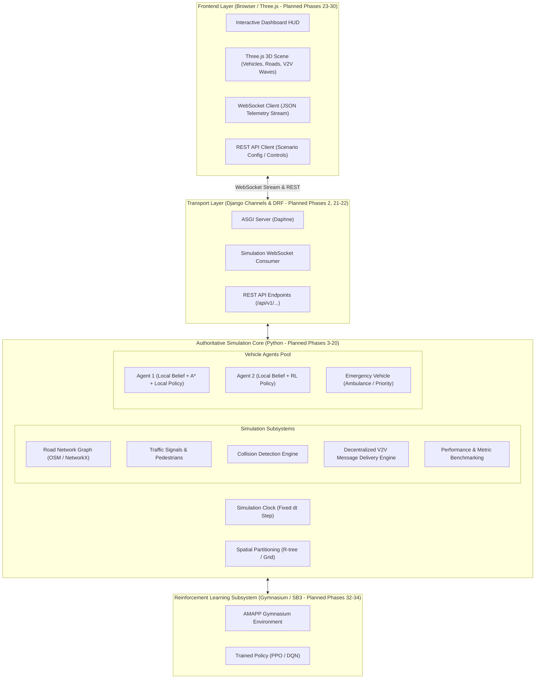
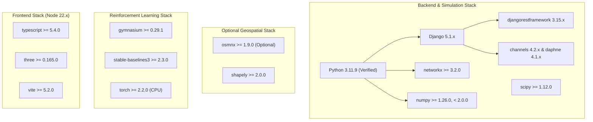
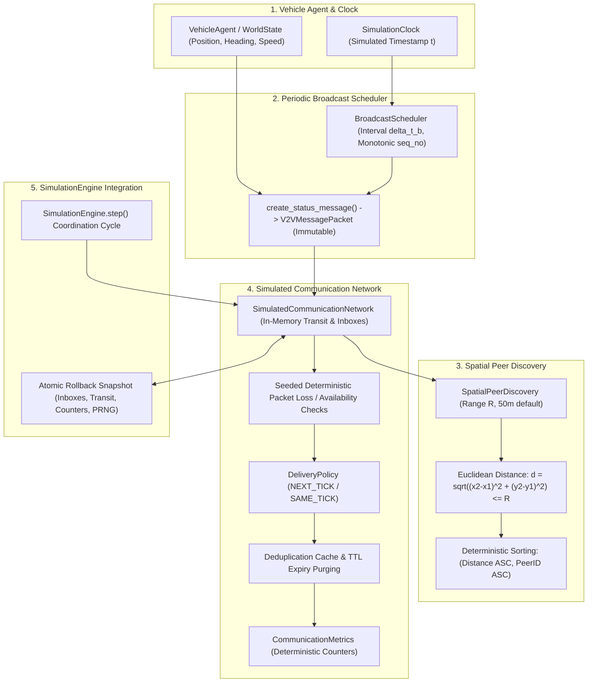

# ARCHITECTURE: Adaptive Multi-Agent Path Planning for Autonomous Vehicles (AMAPP)

> **Document Status:** Implementation Blueprint (Phase 01)  
> **Component Implementation Status:** **PROPOSED / SPECIFICATION ONLY** (No runtime application code implemented yet)

---

## 1. System Overview & Component Status

The **Adaptive Multi-Agent Path Planning (AMAPP)** simulation platform is a decentralized multi-agent autonomous vehicle research environment. It simulates autonomous vehicles navigating real-world or synthetic road networks with dynamic traffic, pedestrians, signalized intersections, emergency vehicles, and decentralized Vehicle-to-Vehicle (V2V) communications under realistic channel constraints (range attenuation, delay, packet loss).

### Component Status Summary
- **Backend Scaffold & Health API (`backend/`, `apps.core`):** **IMPLEMENTED & TESTED** in Phase 02 (Django 5.1.x, DRF 3.15.x, ASGI/WSGI entrypoints, `GET /api/v1/health/`, automated pytest suite passing).
- **Simulation Domain Layer (`backend/apps/core/domain/`):** **IMPLEMENTED & TESTED** in Phase 03 (Typed dataclasses for 10 domain models, 3 immutable value types, 9 enumerations, validation boundaries, and JSON serialization contracts).
- **Road Graph & Synthetic City (`backend/apps/core/graph/`):** **IMPLEMENTED & TESTED** in Phase 04 (`RoadGraph` wrapping NetworkX `DiGraph`, `CityGridConfig`, `generate_synthetic_city_grid`, weak/strong connectivity analysis, traffic signal integration, 151 tests passing).
- **OSM Acquisition & Normalization (`backend/apps/core/graph/`):** **IMPLEMENTED & TESTED** in Phase 05 (`BoundingBox`, `LocalPlanarProjector`, `normalize_osm_graph`, `import_osm_road_network`, 211 tests passing).
- **Route Planning Baseline (`backend/apps/core/routing/`):** **IMPLEMENTED & TESTED** in Phase 06 (`RoutePlanner`, Dijkstra, custom A*, distance/travel-time cost modes, closed edges, 257 tests passing).
- **Vehicle Kinematics & Agent Lifecycle (`backend/apps/core/kinematics/`):** **IMPLEMENTED & TESTED** in Phase 07 (`VehicleAgent`, constant-acceleration motion, lifecycle states, route following, 318 tests passing).
- **Simulation Clock & World State (`backend/apps/core/simulation/`):** **IMPLEMENTED & TESTED** in Phase 08 (`SimulationClock`, `WorldState`, `SimulationEngine`, atomic rollback, pause/resume/single-step, 377 tests passing).
- **Traffic Signals & Intersection Management (`backend/apps/core/signals/`):** **IMPLEMENTED & TESTED** in Phase 09 (`TrafficSignalController`, cyclic phase progression, spatial edge lookup, 441 tests passing).
- **Scenario Orchestration & Configuration (`backend/apps/core/scenarios/`):** **IMPLEMENTED & TESTED** in Phase 10 (`ScenarioDefinition`, `ScenarioBuilder`, `ScenarioRunner`, deterministic replay, 485 tests passing).
- **V2V Protocol & Dynamic Neighbor Tables (`backend/apps/core/communication/`):** **IMPLEMENTED & TESTED** in Phase 11 & 12 (`V2VMessagePacket`, `SpatialPeerDiscovery`, `SimulatedCommunicationNetwork`, `BroadcastScheduler`, `NeighborTable`, `NeighborManager`, 624 tests passing).
- **Decentralized V2V Coordination (`backend/apps/core/coordination/`):** **IMPLEMENTED & TESTED** in Phase 13 (`CongestionReport`, `RoadClosureReport`, `HazardReport`, `VehicleKnowledgeStore`, `InformationFusion`, `DisseminationManager`, `CoordinationManager`, order-invariant belief fusion, multi-hop dissemination, atomic rollback, 676 tests passing).
- **Communication Failures and Latency Recovery (`backend/apps/core/communication/`):** **PLANNED** (Phase 14).
- **Transport Streaming & Advanced REST (`backend/channels/`, etc.):** **PLANNED** (Phases 21–22).
- **Reinforcement Learning (`rl_engine/*`):** **PLANNED** (Phases 32–34).
- **Frontend Dashboard (`frontend/*`):** **PLANNED** (Phases 23–30).

---

## 2. Core Architectural Principles

### 2.1 Authoritative Simulation Core vs. Decentralized Agent Autonomy
A fundamental requirement of AMAPP is the strict separation between global ground truth and local agent perception:

1. **Global Ground-Truth State ($\mathcal{S}_{\text{global}}$):**
   - Maintained exclusively by the authoritative simulation engine (`sim_engine/`).
   - Contains exact 2D/3D coordinates $(x, y, z)$, true heading $\theta$, actual velocity $v$, active obstacles, actual collision events, signal phases, and message packet positions in flight.
   - **Agents have NO direct access to $\mathcal{S}_{\text{global}}$.**

2. **Direct Local Observations ($\mathcal{O}_i(t)$):**
   - Emulates onboard vehicle sensors (radar/LiDAR range $R_{\text{sens}}$, forward-facing camera, lane sensors).
   - Generates observations strictly within line-of-sight and physical sensor horizons.

3. **Received V2V Messages ($\mathcal{M}_i(t)$):**
   - Peer-to-peer messages received from neighboring agents within communication radius $R_{\text{comm}}$, subject to simulated transmission latency, packet loss, and message expiration.

4. **Private Local Knowledge Base / Belief State ($\mathcal{K}_i(t)$):**
   - Each vehicle maintains its own private belief state:
     $$\mathcal{K}_i(t) = \mathcal{O}_i(t) \cup \mathcal{M}_i(t) \cup \mathcal{G}_{\text{static\_map}}$$
   - Each agent independently computes its route adaptation, collision avoidance, and yielding maneuvers using solely its local belief $\mathcal{K}_i(t)$.
   - **The simulation scheduler/engine manages physical stepping and message transport, but NEVER secretly computes or overrides route decisions for agents.**

### 2.2 Deterministic Execution & Reproducibility
- The simulation loop advances using a discrete, fixed timestep $\Delta t = 0.1\,\text{s}$ (10 Hz).
- All stochastic processes (agent spawn distributions, packet loss triggers, pedestrian crossings) are governed by explicit, seedable pseudorandom generators (`RandomState(seed)`).
- Identical scenario configurations and seeds produce bit-identical simulation trajectories.

### 2.3 Headless Testability & Layer Decoupling
- The core simulation engine is 100% pure Python and has zero runtime dependencies on Django, Channels, WebSockets, or browser DOM.
- It can be initialized, stepped, inspected, and benchmarked headlessly via automated `pytest` suites and Gymnasium RL environments in milliseconds.

---

## 3. Subsystem Layer Specifications

### 3.0 Domain Layer & Simulation Contracts (`backend/apps/core/domain/` — IMPLEMENTED & TESTED in Phase 03)
- **Decoupled Architecture:** Pure Python typed dataclasses completely decoupled from Django ORM database tables and migrations.
- **10 Core Domain Entities:**
  - `RoadNode`: Unique identifier, planar `Position2D`, optional WGS84 `GeoCoordinate`, metadata attributes.
  - `RoadEdge`: Unique identifier, start/end node references (self-loops prohibited), length ($m > 0$), speed limit ($m/s > 0$), lane count ($\ge 1$).
  - `Route`: Unique identifier, ordered sequence of at least 2 node IDs, optional edge sequence, cached distance and duration metrics.
  - `Vehicle`: Unique identifier, 2D position, speed ($0 \le v \le v_{\max}$), heading normalized to $[0, 2\pi)$, state enum, classification enum, physical dimensions.
  - `Pedestrian`: Unique identifier, 2D position, state enum (WAITING, CROSSING, SAFE), speed bounds, optional crossing crosswalk node.
  - `TrafficSignal`: Unique identifier, controlling intersection node reference, signal phase (RED, YELLOW, GREEN), cycle duration and remaining phase duration.
  - `Obstacle`: Unique identifier, 2D position, obstacle type enum, physical footprint dimensions, optional edge reference.
  - `Incident`: Unique identifier, 2D position, incident type enum, severity enum, resolution status enum, reporting timestamp.
  - `V2VMessage`: Unique packet ID, sender ID, optional target recipient (None for broadcast), message type enum, emission timestamp, expiration timestamp, sender position, structured payload.
  - `SimulationConfig`: Discrete timestep duration ($\Delta t \in [0.001, 2.0]\,s$), deterministic random seed, communication radius ($m$), time horizon, vehicle capacity limit.
- **3 Value Types (Immutable `frozen=True`):** `Position2D`, `GeoCoordinate`, `Dimensions2D`.
- **Validation Boundaries:** Invariants enforced strictly at construction (`__post_init__`), raising `DomainValidationError`.
- **Serialization:** Full JSON round-trip serialization (`to_dict`, `from_dict`, `to_json`, `from_json`) with enum string mappings and clear error handling via `SerializationError`.

### 3.1 Simulation Core (`backend/apps/core/simulation/` — IMPLEMENTED & TESTED in Phase 08)
- **Phase 8 Implementation Status:** **COMPLETED & TESTED**. The simulation core coordinates discrete time progression, world-state ownership, multi-agent stepping, and atomic rollback guarantees.
- **Module Architecture (`backend/apps/core/simulation/`):**
  - `clock.py`: Authoritative discrete simulation clock (`SimulationClock`) tracking integer tick count $k$ and fixed step duration $\Delta t \in [0.0001, 10.0]\,\text{s}$. Eliminates floating-point drift by deriving simulated time as $t = \text{round}(k \cdot \Delta t, 9)$. Independent of wall-clock time.
  - `world.py`: Centralized container (`WorldState`) owning the `RoadGraph`, authoritative `SimulationClock`, and registered `VehicleAgent` instances. Enforces unique agent identifiers (`DuplicateAgentIdError`), validates agent-graph compatibility (`IncompatibleAgentGraphError`), enumerates agents in stable identifier order (`sorted by vehicle.id`), captures initial registration baselines, and restores state on reset.
  - `engine.py`: Execution sequencer (`SimulationEngine`) coordinating clock ticks and vehicle stepping. Ensures identical $\Delta t$ distribution across all agents, provides idempotent pause/resume, allows explicit single-stepping while paused, and enforces atomic rollback on stepping failures.
  - `models.py`: Value objects and snapshot models (`EngineStatus`, `VehicleSnapshot`, `WorldSnapshot`, `TickResult`).
  - `exceptions.py`: Typed exception hierarchy (`SimulationError`, `InvalidTimeStepError`, `ClockStateError`, `DuplicateAgentIdError`, `AgentNotFoundError`, `IncompatibleAgentGraphError`, `EngineStateError`, `TickExecutionError`).
- **Atomic Tick Semantics & Rollback Guarantees:**
  - Before advancing agents, pre-tick rollback snapshots of all registered agents are captured.
  - If any agent raises an exception during stepping, all agents revert immediately to their pre-tick state, the clock does not advance, and the engine enters `FAILED` status, preventing partial or corrupted simulation states.
- **Single-Step & Paused Execution:**
  - When paused, calling `step()` acts as an explicit single-step advancing exactly one tick while maintaining the engine's paused status. Calling `run()` while paused raises `EngineStateError`.
- **Reset Invariants:**
  - `reset()` restores clock tick count to 0, elapsed time to 0.0, engine status to `INITIALIZED`, and restores all agents to their baseline registration states without recreating the road graph.
- **Strict Boundary Decoupling:**
  - Does NOT yet implement vehicle stopping/braking behavior at red lights (Phase 16), scenario scheduling (Phase 10), V2V messaging (Phase 11), or collision avoidance (Phase 16).

### 3.2 Traffic Signals and Intersection Management (`backend/apps/core/signals/` — IMPLEMENTED & TESTED in Phase 09)
- **Phase 9 Implementation Status:** **COMPLETED & TESTED**. The traffic signal subsystem provides deterministic, clock-synchronized intersection control and approach-edge queries.
- **Module Architecture (`backend/apps/core/signals/`):**
  - `models.py`: Validated cycle configurations (`SignalCycleConfig`), immutable point-in-time snapshots (`SignalSnapshot`), and vehicle query contracts (`SignalQueryResult`).
  - `controller.py`: State machine (`TrafficSignalController`) executing deterministic cyclic transitions ($\text{RED} \to \text{GREEN} \to \text{YELLOW} \to \text{RED}$) synchronized with authoritative simulation clock.
  - `exceptions.py`: Signal error hierarchy (`SignalError`, `InvalidSignalCycleError`, `DuplicateSignalError`, `SignalNotFoundError`, `InvalidIntersectionAssociationError`).
- **Timing & Progression Mathematics:**
  - Cycle period $T = d_{\text{red}} + d_{\text{green}} + d_{\text{yellow}}$.
  - Instantaneous phase position $\tau = (t_{\text{sim}} + t_{\text{offset}}) \pmod T$, eliminating accumulated floating-point drift.
  - Strictly cyclic non-overlapping half-open intervals: $\text{RED} \in [0, d_{\text{red}})$, $\text{GREEN} \in [d_{\text{red}}, d_{\text{red}} + d_{\text{green}})$, $\text{YELLOW} \in [d_{\text{red}} + d_{\text{green}}, T)$.
- **Intersection & Approach Associations:**
  - Signals govern specific intersection nodes and incoming road approach edges ($e \in \text{incoming}(n)$).
  - Validation ensures controlled edges terminate at the signal's node and graph consistency is maintained.
- **Engine & WorldState Integration:**
  - `WorldState` manages a centralized signal registry, $O(1)$ lookups by signal ID, node ID, and incoming edge ID, auto-registers signals from `RoadGraph`, captures snapshots, and executes resets.
  - `SimulationEngine` advances signals on clock ticks, includes `signal_states` in `TickResult`, provides atomic rollback alongside vehicles upon stepping errors, and exposes `query_signal` and `query_signal_for_edge` APIs.
- **Strict Boundary Decoupling:**
  - Does NOT implement vehicle stopping/braking behavior at red lights (Phase 16), intersection collision resolution, or adaptive signal timing.

### 3.3 Vehicle Kinematics & Agent Lifecycle (`backend/apps/core/kinematics/` — IMPLEMENTED & TESTED in Phase 07)
- **Responsibilities:** Individual vehicle lifecycle, deterministic point-mass kinematic motion along planned routes, speed and acceleration limits, heading orientation updates, segment transitions, overshoot prevention, and pure mathematical integration.
- **Module Architecture (`backend/apps/core/kinematics/`):**
  - `models.py`: Validated configuration (`KinematicsConfig`) and step result contract (`MotionStepResult`).
  - `motion.py`: Pure mathematical integration (`integrate_motion`), heading calculation (`compute_heading`), and planar interpolation (`interpolate_position`).
  - `vehicle_agent.py`: Individual vehicle lifecycle and route-following coordinator (`VehicleAgent`).
  - `exceptions.py`: Typed exceptions (`KinematicsError`, `InvalidKinematicsConfigError`, `InvalidMotionInputError`, `InvalidRouteError`, `InvalidLifecycleTransitionError`).
- **Kinematic Motion Model:**
  - *Equations of Motion:*
    $$v(t) = v_0 + a \Delta t$$
    $$d(t) = v_0 \Delta t + \frac{1}{2} a \Delta t^2$$
  - *Acceleration & Braking Limits:* Applied acceleration is clamped to $[-b_{\max}, a_{\max}]$:
    $$a_{\text{applied}} = \max(-config.\text{max\_deceleration\_mps2}, \min(a_{\text{cmd}}, config.\text{max\_acceleration\_mps2}))$$
  - *Mid-Step Stopping:* If braking stops the vehicle mid-step ($t_{\text{stop}} = v_0 / |a_{\text{applied}}| < \Delta t$), distance is clamped to $d = \frac{v_0^2}{2 |a_{\text{applied}}|}$ and speed becomes $0.0$; no reverse motion occurs.
  - *Mid-Step Speed Capping:* If accelerating reaches $v_{\text{cap}}$ mid-step ($t_{\text{sat}} < \Delta t$), motion integrates acceleration up to $t_{\text{sat}}$ and constant-speed cruise for the remainder.
  - *Destination Arrival & Overshoot Prevention:* Distance is clamped by remaining route distance ($d \le d_{\text{rem}}$). Reaching destination transitions vehicle to `ARRIVED` and brings speed to $0.0$.
  - *Multi-Segment Progression:* Large time steps traverse intermediate segment endpoints without losing traveled distance.
- **Lifecycle State Machine:**
  - `IDLE`: Initial parked state. Stepping produces zero movement. Starting requires an assigned route.
  - `EN_ROUTE`: Actively advancing along route segments.
  - `BLOCKED` / `STOPPED`: Paused/waiting state. Speed is $0.0$. Position and progress along segment are preserved. Stepping produces zero movement. Calling `resume()` restores `EN_ROUTE`.
  - `ARRIVED`: Final destination reached. Speed is $0.0$. Repeated stepping produces zero movement. Resuming requires explicit `reset()`.
- **Explicit Boundaries:** Operates on an individual vehicle without a global clock, collision avoidance, traffic signal obedience, or multi-agent negotiation (deferred to Phases 8, 9, 11, 16).

### 3.3 Road Graph & Synthetic City Generator (`backend/apps/core/graph/` — IMPLEMENTED & TESTED in Phase 04)
- **Responsibilities:** Directed road network graph representation $G = (V, E)$ wrapping NetworkX (`nx.DiGraph`); authoritative storage of typed `RoadNode` and `RoadEdge` domain entities; deterministic synthetic city grid generation; topological queries and reachability analysis.
- **Implementation Components:**
  - `RoadGraph`: Wrapper around `nx.DiGraph` enforcing unique node/edge IDs, valid endpoints, directed forward/reverse edge separation, self-loop prevention, traffic signal indexing, and export to JSON-compatible dictionary structures.
  - `CityGridConfig`: Validated parameter set defining grid rows, columns, inter-intersection spacing in meters, base speed limits in m/s, lane counts, traffic signal locations, and deterministic pseudorandom seed.
  - `generate_synthetic_city_grid`: Deterministic city network generator producing connected road grids with planar Cartesian coordinates, edge lengths agreeing with Euclidean node spacing, alternative paths, and signalized internal junctions. Fully offline with zero external network or map service dependencies.
- **Topological Invariants & Connectivity:**
  - *Weak Connectivity:* Underlying undirected graph is connected.
  - *Strong Connectivity:* Every intersection is mutually reachable via directed paths (guaranteed in bidirectional grid mode).
  - *Alternative Paths:* Grid topology provides multiple distinct paths between non-adjacent intersections for dynamic rerouting.

### 3.4 OpenStreetMap Import & Normalization (`backend/apps/core/graph/` — IMPLEMENTED & TESTED in Phase 05)
- **Responsibilities:** Geographic bounding-box acquisition via OSMnx, WGS84-to-planar Cartesian coordinate projection, normalization into `RoadNode` and `RoadEdge` domain entities, directed road topology preservation, and deterministic offline fallback to synthetic city grids.
- **Implementation Components:**
  - `BoundingBox`: Strictly validated geographic bounding box with coordinate range checks ($[-90, 90]$, $[-180, 180]$), orientation verification (`north > south`, `east > west`), and area span limits ($\le 0.25^\circ$).
  - `LocalPlanarProjector`: Conformal equirectangular planar projection converting WGS84 $(\text{lat}, \text{lon})$ to local Cartesian meters $(\text{Position2D})$ relative to the southwest origin $(x \ge 0, y \ge 0)$ with bidirectional round-trip support.
  - `normalize_osm_graph`: Normalizes external NetworkX `MultiDiGraph` into internal `RoadGraph`. Generates deterministic IDs (`osm_node_{id}`, `osm_edge_{u}_{v}`), computes Euclidean lengths, parses speed limits and lane counts, separates one-way from bidirectional ways, and skips self-loops and duplicate parallel edges.
  - `acquire_osm_graph`: Defensive acquisition adapter querying Overpass via OSMnx with timeout and error classification (`OSMTimeoutError`, `OSMServiceUnavailableError`, `OSMEmptyGraphError`, `OSMNotInstalledError`).
  - `import_osm_road_network`: High-level orchestration service. If acquisition fails or OSMnx is absent and `allow_fallback=True`, seamlessly falls back to a deterministic synthetic city grid, preserving error diagnostics in structured metadata.
- **Fallback Policy:** Invalid geographic bounds immediately raise `InvalidBoundingBoxError` and are never disguised by synthetic fallback. Synthetic fallback is engaged only when acquisition/dependency errors occur and fallback is explicitly enabled.

### 3.5 Route Planning Baseline & Adaptive Rerouting (`backend/apps/core/routing/` — Phase 6 IMPLEMENTED; Phase 15 Planned)
- **Phase 6 Implementation Status:** **COMPLETED & TESTED**. The baseline route planning subsystem operates over the directed `RoadGraph` abstraction, supporting both Dijkstra and custom A* search, distance and travel-time objectives, non-mutating edge closures, and typed result contracts.
- **Module Architecture (`backend/apps/core/routing/`):**
  - `costs.py`: Pure cost computation (`calculate_edge_cost`, `calculate_route_metrics`, `is_edge_traversable`).
  - `heuristics.py`: Admissibility analyzer (`check_heuristic_admissibility`) and heuristic builder (`get_heuristic_function`).
  - `dijkstra.py`: Authoritative Dijkstra search (`dijkstra_search`) with deterministic tie-breaking.
  - `astar.py`: Custom A* priority queue search (`astar_search`) with stale entry pruning and secondary tie-breaking.
  - `planner.py`: High-level facade (`RoutePlanner`, `find_route`) caching admissibility checks.
  - `models.py`: Value objects (`CostMode`, `RoutingAlgorithm`, `RoutingRequest`, `RoutingResult`).
  - `exceptions.py`: Typed hierarchy (`RoutingError`, `RoutingNodeNotFoundError`, `NoPathFoundError`, `InvalidRoutingRequestError`).
- **Cost Formulation & Units:**
  1. *Shortest Distance:* $\text{Cost}_{\text{dist}}(e) = e.\text{length\_m}$ [meters].
  2. *Fastest Travel Time:* $\text{Cost}_{\text{time}}(e) = e.\text{length\_m} / e.\text{speed\_limit\_mps}$ [seconds].
- **Heuristic Admissibility & Consistency:**
  - *Distance Heuristic:* $h_{\text{dist}}(n) = \text{EuclideanDistance}(n, \text{dest})$. Admissible when $e.\text{length\_m} \ge \text{EuclideanDistance}(u, v) - 10^{-5}$ for all edges.
  - *Travel Time Heuristic:* $h_{\text{time}}(n) = \text{EuclideanDistance}(n, \text{dest}) / V_{\max}$ where $V_{\max} = \max_{e \in E}(e.\text{speed\_limit\_mps})$.
  - *Safety Fallback ($h=0$):* If the graph violates Euclidean edge bounds or has non-positive speed limits, `get_heuristic_function` automatically falls back to $h=0.0$, guaranteeing search optimality without failure.
- **Road Closures:** Closed edge IDs are filtered during search without mutating `RoadGraph`. Unknown closed edge IDs are safely ignored.
- **Start == Destination Policy:** Returning $0.0$ cost, $0$ expanded nodes, and `route=None` to preserve `Route` domain invariants ($\ge 2$ nodes).
- **Future Adaptive Rerouting (Phase 15):** Dynamic congestion factors, incident penalty weights, and re-planning cooldown timers will be layered over this baseline in Phase 15.

### 3.6 V2V Communication & Dynamic Neighbor Subsystem (`backend/apps/core/communication/` — Implemented in Phases 11 & 12)
- **Responsibilities:** Peer-to-peer and broadcast message protocol, spatial proximity detection ($d \le R_{\text{comm}}$), transmission latency, packet loss ($P_{\text{loss}}$), message expiration, deduplication, dynamic neighbor tables, heartbeats, and neighbor loss detection.
- **Physical Peer vs. Known Neighbor Semantics:**
  - *Physical Peer:* A vehicle currently located within spatial transmission radius $R_{\text{comm}}$ of another vehicle.
  - *Discovered Peer:* A vehicle detected by spatial proximity query ($d \le R_{\text{comm}}$).
  - *Known Neighbor:* A vehicle from which the local vehicle has received a valid, verified message. Physical proximity alone does NOT populate a neighbor record without valid communication.
  - *Stale Neighbor:* A previously known neighbor whose latest accepted heartbeat timestamp exceeds timeout ($t_{\text{now}} - t_{\text{last\_hb}} \ge T_{\text{timeout}}$).
  - *Removed Neighbor:* A stale neighbor that has exceeded the configured grace period ($T_{\text{timeout}} + T_{\text{grace}}$) and is purged from the table.
- **Message Types:**
  - `HEARTBEAT`: Periodic status broadcast serving as periodic heartbeat (telemetry, position, speed, heading, sequence number).
  - `HAZARD_ALERT`: Event-driven alert (incident location, closure, congestion level; Phase 13).
  - `EMERGENCY_PRIORITY`: Priority corridor clearance beacon (Phase 18).
- **Engine Tick Sequencing & Rollback Guarantees:**
  - Network advancement moves transit packets to inboxes for `NEXT_TICK` delivery.
  - Receiver inboxes are ingested into local neighbor tables; distance is calculated from local vehicle coordinates at reception time.
  - Heartbeat maintenance detects stale neighbors and purges expired entries deterministically.
  - Periodic status broadcasts execute.
  - Atomic rollback: A failed engine tick restores pre-tick neighbor tables, sequence counters, transit queues, and metrics without double-counting.

### 3.7 Safety, Collisions & Traffic Rules (`sim_engine/safety/` — Planned Phases 16–18)
- **Responsibilities:** Bounding-box and circle intersection checks, Time-To-Collision (TTC) calculations, Intelligent Driver Model (IDM) car-following, pedestrian crosswalk yielding, signal phase obedience, emergency corridor formation.

### 3.8 AI & Reinforcement Learning (`sim_engine/policies/` & `rl_engine/` — Planned Phases 19, 32–34)
- **Interpretable Decision Policy (Phase 19):** Transparent, weighted scoring baseline evaluating travel time, congestion, risk, and communication confidence:
  $$\text{Score}(\text{route}) = w_1 \cdot \text{Time} + w_2 \cdot \text{Congestion} + w_3 \cdot \text{Risk} - w_4 \cdot \text{Confidence}$$
- **Gymnasium Environment (Phase 32):** Standard RL interface providing bounded vector observations and discrete/continuous action spaces for route selection.
- **Stable-Baselines3 Model (Phases 33–34):** PPO agent trained on route selection with bounded training budget, fully decoupled from the baseline policy.

### 3.9 Web Backend & Transport (`backend/` — Planned Phases 2, 21–22, 35)
- **Responsibilities:** Django REST Framework API for scenario discovery, simulation lifecycle control (play/pause/step/reset), metrics querying, and experiment history persistence.
- **Django Channels (ASGI / Daphne):** Streams authoritative simulation snapshots and V2V events over WebSockets at bounded frequencies (10–30 Hz).

### 3.10 Frontend & Visualization (`frontend/` — Planned Phases 23–30)
- **Responsibilities:** TypeScript + Three.js application rendering 3D road networks, vehicles, pedestrians, traffic signals, communication range rings, and hazard indicators.
- **Strict Rendering Boundary:** The frontend never computes physics or invents simulation state; it strictly interpolates authoritative state received from WebSockets.

---

## 4. Top-Level Module Blueprint

| Module Path | Responsibility | Intro Phase | Dependencies | Public Contract | Test Suite | Forbidden Dependencies |
|---|---|---|---|---|---|---|
| `backend/apps/core/domain/` | Typed domain dataclasses, value objects, enums, units, validation, serialization | Phase 03 (IMPLEMENTED & TESTED) | Python Standard Library (`dataclasses`, `enum`, `typing`, `json`, `math`) | 10 Domain Models (`Vehicle`, `RoadNode`, `RoadEdge`, `Route`, `Pedestrian`, `TrafficSignal`, `Obstacle`, `Incident`, `V2VMessage`, `SimulationConfig`), 3 Value Types (`Position2D`, `GeoCoordinate`, `Dimensions2D`), `to_dict`, `from_dict`, `to_json`, `from_json` | `backend/apps/core/tests/test_domain_*.py` | Must NOT depend on Django ORM, Channels, or external geometry packages |
| `backend/apps/core/graph/` | Directed road graph abstraction, synthetic city grid generator, OSM road-network acquisition and normalization, offline fallback | Phase 04 & 05 (IMPLEMENTED & TESTED) | NetworkX, `backend/apps/core/domain/`, optional OSMnx | `RoadGraph`, `CityGridConfig`, `generate_synthetic_city_grid`, `BoundingBox`, `OSMImportConfig`, `OSMImportResult`, `LocalPlanarProjector`, `normalize_osm_graph`, `import_osm_road_network` | `backend/apps/core/tests/test_road_graph.py`, `backend/apps/core/tests/test_city_generator.py`, `backend/apps/core/tests/test_osm_*.py` | Must NOT depend on vehicle kinematics, routing, or web layer |
| `backend/apps/core/routing/` | Baseline shortest-path planning (Dijkstra, A*), distance/travel-time cost modes, road closures, heuristic admissibility | Phase 06 (IMPLEMENTED & TESTED) | NetworkX, `backend/apps/core/domain/`, `backend/apps/core/graph/` | `RoutePlanner`, `find_route`, `dijkstra_search`, `astar_search`, `CostMode`, `RoutingAlgorithm`, `RoutingRequest`, `RoutingResult` | `backend/apps/core/tests/test_routing_*.py` | Must NOT depend on vehicle kinematics, global clock, or web endpoints |
| `backend/apps/core/simulation/` | Authoritative simulation clock, fixed-step execution sequencer, world-state container, atomic rollback, pause/resume/step | Phase 08 (IMPLEMENTED & TESTED) | `backend/apps/core/domain/`, `backend/apps/core/graph/`, `backend/apps/core/kinematics/` | `SimulationEngine`, `SimulationClock`, `WorldState`, `EngineStatus`, `WorldSnapshot`, `TickResult` | `backend/apps/core/tests/test_simulation_*.py` | Must NOT depend on Django views or WebSocket consumers |
| `backend/apps/core/communication/` | Typed V2V messages, spatial discovery ($d \le R$), simulated network, broadcast scheduling, dynamic neighbor tables, heartbeats & timeout loss detection, atomic rollback | Phase 11 & 12 (IMPLEMENTED & TESTED) | `backend/apps/core/domain/` | `V2VMessagePacket`, `SpatialPeerDiscovery`, `SimulatedCommunicationNetwork`, `BroadcastScheduler`, `NeighborTable`, `NeighborManager`, `NeighborRecord`, `NeighborStatus`, `StaleNeighborPolicy` | `backend/apps/core/tests/test_communication_*.py` | Must NOT open real network sockets, use wall-clock timers, or execute collision avoidance/rerouting |
| `backend/apps/core/coordination/` | Decentralized V2V coordination, vehicle-private knowledge stores, typed traffic reports (congestion, closure, hazard), deterministic order-invariant belief fusion, multi-hop dissemination & loop prevention, atomic rollback | Phase 13 (IMPLEMENTED & TESTED) | `backend/apps/core/domain/`, `backend/apps/core/communication/` | `CongestionReport`, `RoadClosureReport`, `HazardReport`, `VehicleKnowledgeStore`, `InformationFusion`, `DisseminationManager`, `CoordinationManager`, `BeliefRecord`, `CoordinationConfig`, `CoordinationMetrics` | `backend/apps/core/tests/test_coordination_*.py` | Must NOT modify authoritative road graphs, execute automatic route changes, or leak private knowledge across vehicles |
| `sim_engine/safety/` | Collision detection, IDM, signals, pedestrian yielding | Phase 16 | `sim_engine/domain/`, NumPy | `CollisionDetector`, `IDMController`, `TrafficSignalController` | `tests/unit/test_safety.py` | Must NOT depend on frontend rendering |
| `backend/` | Django project, settings, ASGI/WSGI, health check API (scaffold: Phase 02; full APIs: Phase 21) | Phase 02, 21 | Django, DRF, Channels, Daphne | Health check (`/api/v1/health/`), future REST API & WebSockets | `backend/apps/core/tests/test_health.py` | Core simulation must run without `backend/` |
| `rl_engine/` | Gymnasium environment, SB3 PPO training, model evaluation | Phase 32 | Gymnasium, Stable-Baselines3, PyTorch | `AMAPPEnv`, `train_ppo()`, `evaluate_policy()` | `tests/unit/test_gym_env.py` | Core simulation must function if SB3 is absent |
| `frontend/` | TypeScript + Three.js 3D dashboard & HUD | Phase 23 | Node.js, Vite, Three.js | Browser UI, WebSocket client, Canvas renderer | Frontend test runner (Vitest/ESLint) | Must NOT compute authoritative vehicle movements |

---

## 5. Dependency Strategy & Compatibility Matrix

### Dependency Groupings & Version Pinning Strategy

1. **Core Simulation & Numerical Computing (Phases 3–20):**
   - `python`: 3.11.9 (Verified host runtime)
   - `networkx`: ~3.3 (Graph topology, A* algorithm)
   - `numpy`: ~1.26.4 (Spatial coordinates, vector math, bounded < 2.0.0 for library stability)
   - `scipy`: ~1.13.0 (Spatial distance computations, KDTree proximity queries)

2. **Web Backend & Transport (Phases 2, 21–22):**
   - `django`: ~5.1.2 (LTS/current stable release)
   - `djangorestframework`: ~3.15.2 (REST serializers, views)
   - `channels`: ~4.2.0 (ASGI WebSocket routing)
   - `daphne`: ~4.1.2 (ASGI production server)
   - `channels-redis`: ~4.2.0 (Optional Redis channel layer, with in-memory fallback)

3. **Optional Geospatial (Phase 5):**
   - `osmnx`: ~1.9.4
   - `shapely`: ~2.0.4
   - *Compatibility Guard:* OSMnx requires underlying C-libraries (GEOS/GDAL). Phase 5 will implement strict defensive imports: if OSMnx is uninstalled or fails on Windows, the system transparently utilizes the deterministic synthetic grid without crashing.

4. **Reinforcement Learning (Phases 32–34):**
   - `gymnasium`: ~0.29.1
   - `stable-baselines3`: ~2.3.2
   - `torch`: ~2.2.2+cpu (CPU-only build to keep installation lightweight and CI fast)

5. **Testing & Code Quality (Phases 1–40):**
   - `pytest`: ~8.2.0
   - `pytest-cov`: ~5.0.0
   - `pytest-django`: ~4.8.0
   - `pytest-asyncio`: ~0.23.6
   - `ruff`: ~0.4.4

6. **Frontend Stack (Phases 23–30):**
   - Node.js: 22.18.0 (Verified host runtime)
   - npm: 10.9.3
   - `three`: ~0.165.0
   - `@types/three`: ~0.165.0
   - `vite`: ~5.2.11
   - `typescript`: ~5.4.5
   - `eslint`: ~8.57.0

---

## 6. Technical Risks & Mitigation Strategies

| Risk ID | Description | Severity | Mitigation Strategy |
|---|---|---|---|
| **TR-01** | Geospatial dependency installation failures (GDAL/GEOS with OSMnx on Windows) | Medium | Make OSMnx strictly optional via dynamic import guards; provide a complete offline synthetic grid as primary fallback. |
| **TR-02** | PyTorch / SB3 CI runtime weight and build slowdown | Medium | Use CPU-only PyTorch wheels; confine model training to isolated bounded jobs (Phase 33), using small observation spaces. |
| **TR-03** | High-frequency WebSocket streaming saturating browser thread | High | Decouple simulation tick rate from client frame rate; implement snapshot throttling (10–20 Hz) and client-side interpolation. |
| **TR-04** | Route oscillation during multi-agent dynamic rerouting | High | Implement re-planning cooldown timers, hysteresis margins ($\Delta C > 15\%$), and staggered update intervals. |
| **TR-05** | State desynchronization between backend physics and frontend 3D rendering | Critical | Backend is authoritative for all coordinates, states, and collisions. Frontend strictly interpolates backend snapshots and never creates collision events. |
| **TR-06** | Flaky or non-deterministic tests in CI | High | Mandate fixed pseudorandom seeds across all unit, integration, and scenario tests; avoid wall-clock sleeps. |

---

## 7. Scenario Orchestration and Simulation Configuration (Phase 10)

Phase 10 introduces the dedicated scenario orchestration subsystem (`apps.core.scenarios`), establishing a strict separation between immutable declarative scenario configurations and mutable runtime simulation engines.

```mermaid
flowchart TD
    subgraph Declaration["1. Declarative Scenario Definition"]
        Meta["ScenarioMetadata (ID, Name, Version)"]
        RN["RoadNetworkDefinition (Synthetic / Supplied / OSM)"]
        VehDefs["VehicleScenarioDefinition[] (ID, Start, Dest, Algo, Kinematics)"]
        SigDefs["TrafficSignalScenarioDefinition[] (ID, Node, CycleConfig)"]
        SimCfg["Simulation Config (dt, max_ticks, seed, policy)"]
    end

    subgraph Validation["2. Validation Boundary"]
        ValFn["validate_scenario() & validate_graph_compatibility()"]
    end

    subgraph Assembly["3. ScenarioBuilder Assembly"]
        GraphRes["Graph Resolution (CityGridConfig / Supplied / OSM)"]
        WorldInit["WorldState & SimulationClock Construction"]
        SigReg["Signal Registration & Phase Offset Synchronization"]
        PlannerInit["RoutePlanner Planning (Dijkstra / A*)"]
        AgentInit["VehicleAgent Instantiation (agent.start() -> EN_ROUTE)"]
        BaselineCap["Baseline Capture (world.save_baseline())"]
        EngineInit["SimulationEngine Construction"]
    end

    subgraph Execution["4. ScenarioRunner Orchestration"]
        StepEngine["SimulationEngine.step() (Deterministic Ordering & Atomic Rollback)"]
        TermEval["Termination Evaluation (ALL_ARRIVED, MAX_TICKS, TARGET_TICKS, PAUSED, FAILED)"]
        ResultGen["ScenarioExecutionResult Generation"]
        ResetFn["runner.reset() -> Bit-Identical Replay"]
    end

    Declaration --> Validation
    Validation --> Assembly
    Assembly --> Execution
```

### 7.1 Configuration vs Runtime Decoupling
Scenario configurations (`ScenarioDefinition`) are pure, frozen dataclasses containing zero mutable execution state:
- **`RoadNetworkDefinition`**: Declaratively references a synthetic city configuration, an existing supplied `RoadGraph`, or an OpenStreetMap bounding box with fallback policies.
- **`VehicleScenarioDefinition`**: Defines agent deployment parameters without instantiating `VehicleAgent` runtime instances prematurely.
- **`TrafficSignalScenarioDefinition`**: Defines explicit signal cycle timing and incoming approach edge geometry without coupling to a running controller.

### 7.2 Strict Builder Lifecycle
The `ScenarioBuilder` executes a deterministic 10-step assembly process:
1. Structural and semantic validation via `validate_scenario()`.
2. `RoadGraph` resolution without network downloads in test suites.
3. Graph compatibility verification (`validate_graph_compatibility()`).
4. Initializing the single unified `RoutePlanner` instance over the resolved graph.
5. Constructing the authoritative `SimulationClock` and `WorldState`.
6. Registering signals, preventing duplicate registrations.
7. Planning initial vehicle routes in sorted vehicle ID order using Phase 6 routing contracts. Unreachable destinations follow an explicit policy: strict rejection (`UnreachableDestinationError`) or explicit exclusion.
8. Instantiating `Vehicle` and `VehicleAgent` instances, calling `agent.start()` so agents enter `EN_ROUTE`.
9. Capturing initial baseline state (`world.save_baseline()`) for clean deterministic reset.
10. Constructing `SimulationEngine` and returning the immutable `ScenarioRunContext`.

### 7.3 Runner Execution and Termination Semantics
`ScenarioRunner` orchestrates execution via the authoritative `SimulationEngine.step()`:
- **`ALL_ARRIVED`**: Triggers when all registered vehicles reach their destination nodes.
- **`MAX_TICKS_REACHED`**: Triggers when the simulation clock reaches the scenario's effective max ticks.
- **`TARGET_TICKS_COMPLETED`**: Triggers when a partial run request (`runner.run(ticks=N)`) finishes.
- **`PAUSED` / `STOPPED`**: Detected and returned without advancing elapsed simulated time.
- **`FAILED`**: Catches unrecoverable runtime faults and preserves atomic rollback diagnostic context.
- **`reset()`**: Restores all agents, clock, and signals to initial registration baseline for 100% bit-identical replay.

### 7.4 Architectural Boundaries with Future Phases
- **Phase 10 Boundary:** Orchestrates static deployment, initial routing, kinematics advancement, and signal state.
- **Phase 11 (V2V Protocol):** Introduces typed peer-to-peer message models, spatial peer discovery, periodic broadcasts, in-memory networking, and atomic rollback.
- **Phase 12–14 (Decentralized V2V Coordination & Fault Recovery):** Peer-to-peer data synchronization, congestion sharing, and recovery from communication dropouts are layered in subsequent phases.
- **Phase 15 (Adaptive Rerouting):** Vehicles follow their initial pre-planned static routes; dynamic mid-simulation cost rerouting is strictly deferred to Phase 15.
- **Phase 16 (Collision Avoidance):** Vehicles do not execute evasive maneuvers, emergency braking, or spatial collision avoidance in response to received messages.

---

## 8. V2V Communication Protocol & Spatial Peer Discovery (Phase 11)

Phase 11 establishes a pure Python, deterministic, in-memory Vehicle-to-Vehicle (V2V) communication subsystem (`backend/apps/core/communication/`). It provides simulated wireless communication between vehicles based on physical spatial proximity, strict schema validation, periodic status broadcasting, and seamless integration with the discrete simulation engine.

### 8.1 Typed V2V Message Protocol & Validation Contracts
The message protocol defines strictly validated, immutable dataclasses:
- **`V2VMessagePacket`**: Authoritative transmission container holding:
  - `protocol_version`: String identifier (default `"1.0"`).
  - `message_id`: Unique non-empty string identifier.
  - `message_type`: `V2VMessageType` enum (`VEHICLE_STATUS`, `HAZARD_ALERT`, `TRAFFIC_PROBE`, `ROUTE_ADVISORY`).
  - `sender_id`: Non-empty vehicle identifier.
  - `recipient_id`: Optional target vehicle identifier (`None` represents broadcast).
  - `sequence_number`: Strictly non-negative integer ($\ge 0$), strictly increasing per sender.
  - `timestamp_s`: Simulation clock timestamp at packet generation ($t \ge 0.0$, finite).
  - `expiry_timestamp_s`: Optional simulation clock timestamp at which packet becomes stale.
  - `sender_position`: `Position2D` coordinate in meters.
  - `sender_heading_rad`: Bounded yaw angle ($-\pi \le \theta \le \pi$).
  - `sender_speed_mps`: Non-negative forward speed ($v \ge 0.0$).
  - `payload`: Typed message payload (e.g., `VehicleStatusPayload`).
  - `correlation_id`: Optional trace identifier.
- **`VehicleStatusPayload`**: Primary periodic telemetry payload containing current edge ID, destination node ID, and vehicle dimensions.
- **Factory & Codecs**:
  - `create_status_message()` extracts authoritative telemetry from `VehicleAgent` or `VehicleSnapshot` without mutating vehicle state.
  - `serialize_message()` and `deserialize_message()` provide deterministic JSON round-trip conversions without dependency on external networking or memory addresses.

### 8.2 Spatial Peer Discovery ($d \le R$)
`SpatialPeerDiscovery` identifies communicating neighbors within a configured transmission radius $R$:
- **Distance Formula:** Planar Cartesian Euclidean distance:
  $$d = \sqrt{(x_2 - x_1)^2 + (y_2 - y_1)^2}$$
- **Boundary Inclusion:** Eligible peers satisfy $d \le R + 10^{-7}$ meters. Points precisely on the boundary are included.
- **Self-Exclusion:** The sender vehicle is strictly excluded from its own peer list.
- **Deterministic Ordering:** Discovered peers are sorted deterministically by primary key `distance` ascending, with secondary tie-breaking by `peer_id` ascending.
- **Brute-Force Reference Parity:** Validated against an independent brute-force reference implementation.

### 8.3 Simulated Communication Network & Delivery Semantics
`SimulatedCommunicationNetwork` simulates an in-memory packet transmission medium:
- **Delivery Policies:**
  - `NEXT_TICK` (Default): Broadcasts and unicasts are held in `_transit_queue` until the next simulation clock advancement, completely eliminating execution order dependency among agents during sequential stepping.
  - `SAME_TICK`: Immediate in-memory delivery to receiver inboxes during the same tick.
- **Deduplication & Expiry:**
  - Message IDs are recorded in a per-vehicle deduplication set (`_received_message_ids`). Repeated receipts of the same `message_id` are dropped with reason `DUPLICATE`.
  - Stale packets ($t_{\text{sim}} > t_{\text{expiry}}$) are purged at dispatch, during transit flush, and upon inbox inspection.
- **Deterministic Failure Modeling:**
  - **Endpoint Availability:** Individual vehicle transmitters/receivers can be marked unavailable via `set_participant_availability(vid, False)`.
  - **Deterministic Packet Loss:** Controlled by `packet_loss_rate` ($[0.0, 1.0]$) evaluated via an isolated seeded `random.Random` instance, preserving 100% deterministic test repeatability without affecting Python's global random state.

### 8.4 Periodic Broadcast Scheduling
`BroadcastScheduler` triggers vehicle status transmissions at discrete simulated-time intervals:
- **Time Synchronization:** Governed strictly by the authoritative `SimulationClock` ($t_{\text{sim}}$). Zero use of wall-clock timers, threads, or `time.sleep`.
- **Monotonic Sequence Numbers:** Sequence numbers increment monotonically ($0, 1, 2, \dots$) per vehicle.
- **Boundary Precision:** Prevents duplicate broadcasts at the exact same scheduled boundary and accurately handles non-divisible time step intervals.

### 8.5 Simulation Engine Integration & Atomic Rollback
Communication is embedded in the discrete stepping loop of `SimulationEngine.step()`:
1. **Pre-Tick Snapshot:** `network.capture_state()` and `scheduler.capture_state()` preserve pre-tick communication state.
2. **Transit Delivery:** Inboxes are populated from prior transit queues for the new tick.
3. **Scheduled Broadcasting:** Eligible vehicles broadcast status messages if their scheduled interval is due.
4. **Kinematic Stepping:** Vehicles advance along their assigned routes.
5. **Atomic Rollback on Error:** If any agent raises an exception during kinematics or signal updates, `engine.step()` catches `Exception`, rolls back `world`, `signals`, `network`, and `scheduler` to their exact pre-tick baselines, ensuring zero partial mutations or corrupted metric counters.

### 8.6 Architectural Boundaries with Future Phases
- **Phase 11 & 12 Scope:** In-memory V2V message contracts, serialization, spatial peer discovery, broadcast scheduling, delivery semantics, dynamic neighbor tables, heartbeats, loss detection, and atomic simulation engine integration.
- **Strictly Deferred to Future Phases:**
  - **No Adaptive Rerouting (Phase 15):** Received messages do not trigger path recalculation.
  - **No Collision Avoidance / Braking (Phase 16):** Received messages do not alter vehicle kinematics, acceleration, or target speeds.

---

## 9. Decentralized V2V Coordination & Shared Traffic Knowledge (Phase 13)

### 9.1 Core Architectural Principles & Information Boundary
Phase 13 establishes the peer-to-peer traffic information-sharing subsystem in `apps.core.coordination`. The system strictly separates four distinct concepts:
1. **Authoritative Ground Truth:** Maintained by `RoadGraph`, `SimulationEngine`, and `WorldState`. Agents are forbidden from querying global truth directly.
2. **Local Observation:** Information directly measured or detected by a vehicle (e.g., congestion or road obstruction on a traversed edge).
3. **Received Report:** An immutable payload communicated over V2V message envelopes (`V2VMessagePacket`) from another vehicle.
4. **Local Belief State:** A vehicle's private, synthesized interpretation of all valid received and locally generated reports.

**CRITICAL INVARIANT:** Receiving a report updates only that vehicle's private knowledge store and derived beliefs. It **NEVER** mutates the authoritative road graph or triggers automatic rerouting/maneuver changes in this phase.

### 9.2 Typed Traffic Reports
- **`CongestionReport`**: Bounded congestion scale (`LOW`, `MODERATE`, `HIGH`, `SEVERE`), numeric congestion score $[0.0, 1.0]$, estimated speed factor, edge ID, timestamp, and expiry.
- **`RoadClosureReport`**: Edge closure status (`CLOSED`, `REOPENED`, `WITHDRAWN`), reason code, reporting vehicle, timestamp, and expiry.
- **`HazardReport`**: Typed hazard category (`OBSTACLE`, `ACCIDENT`, `DEBRIS`, `SLIPPERY_ROAD`, `CONSTRUCTION`, `UNKNOWN`), severity (`LOW`, `MEDIUM`, `HIGH`, `CRITICAL`), coordinate position and/or edge reference.
- **Validation**: Strict boundary rules reject non-finite timestamps, negative confidence ($0.0 \le c \le 1.0$), invalid IDs, expired timestamps, or invalid edge references.

### 9.3 Vehicle-Private Knowledge Stores
Each vehicle manages an isolated `VehicleKnowledgeStore`:
- **Private Isolation:** Vehicles cannot access each other's stores directly.
- **Query Indices:** Spatial index (`edge_index`) and categorical index (`type_index`) provide efficient $O(1)$ lookups with deterministic key ordering.
- **Deduplication:** Duplicate report IDs are detected and rejected without state mutation.
- **Expiry:** Reports and beliefs past simulation time are purged deterministically during periodic maintenance.

### 9.4 Deterministic Information Fusion & Conflict Resolution
- **Order Invariance:** `InformationFusion.fuse_report_history` sorts evidence canonically `(timestamp_s, sequence_number, confidence, reporting_vehicle_id, report_id)` before fusion, guaranteeing bit-identical belief outcomes regardless of message arrival or ingestion ordering.
- **Corroboration Boost:** Independent confirming reports deterministically increase belief confidence toward 1.0 by 5% of remaining headroom ($c' = c + (1.0 - c) \times 0.05$). Duplicate forwards of the same report ID produce zero confidence inflation.
- **Safety-First Road Closure Conflicts:** Conflicting `CLOSED` vs `REOPENED` reports with identical timestamps or disputing evidence are flagged as `BeliefStatus.DISPUTED` with an explicit reason string, avoiding arbitrary last-write-wins semantics.

### 9.5 Multi-Hop Dissemination & Loop Prevention
- **Bounded Propagation:** Forwarded packets increment hop counts ($h' = h + 1$) and enforce `max_forwarding_hops`.
- **Relay Path Tracking:** The relay sequence $[v_1, v_2, \dots]$ is tracked in packet metadata. If the receiving vehicle is already in the relay path, forwarding is immediately suppressed, completely preventing cycles.
- **Forwarding Cache:** Vehicles cache forwarded report IDs in `_forwarded_report_ids`, preventing infinite repeat broadcasts.

### 9.6 Simulation Engine Integration & Atomic Rollback
Coordination hooks into the authoritative `SimulationEngine.step()` sequence:
1. **Pre-Tick Snapshot:** `coordination_manager.capture_state()` captures deep copy snapshots of all vehicle knowledge stores, sequences, and metrics.
2. **Inbox Processing:** Received V2V packets with coordination payloads are ingested into recipient stores.
3. **Multi-Hop Dissemination:** Eligible newly ingested reports are forwarded to current dynamic neighbors within range.
4. **Maintenance:** Expired reports and beliefs are cleaned up deterministically.
5. **Atomic Rollback:** If any error occurs during kinematics or tick execution, the coordination manager is fully restored to its pre-tick snapshot with zero metric distortion or dangling knowledge state.

