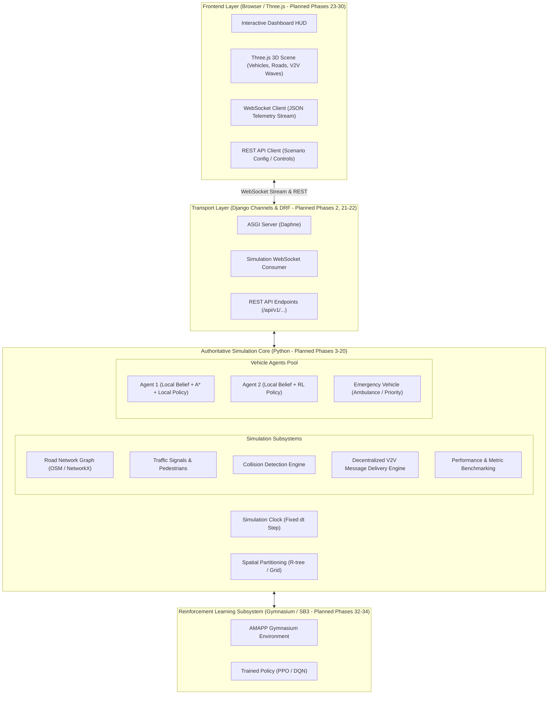
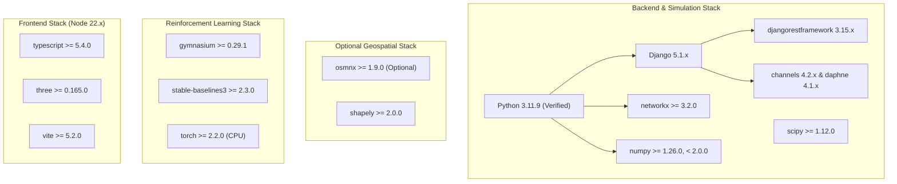
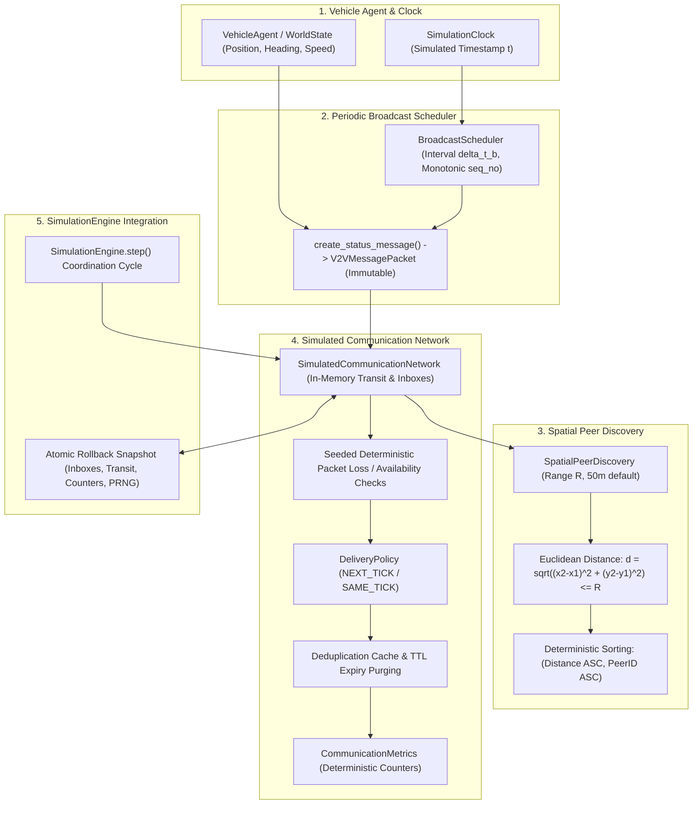
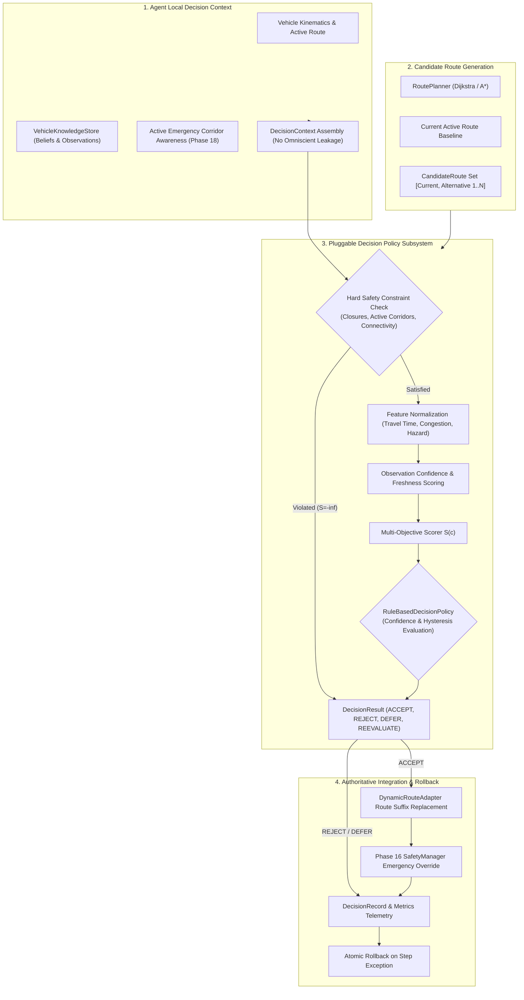
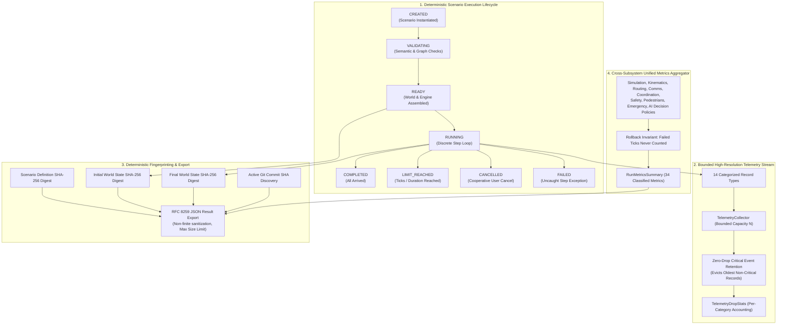

# ARCHITECTURE: Adaptive Multi-Agent Path Planning for Autonomous Vehicles (AMAPP)

> **Document Status:** Implementation Blueprint (Phase 01)  
> **Component Implementation Status:** **PROPOSED / SPECIFICATION ONLY** (No runtime application code implemented yet)

---

## 1. System Overview & Component Status

The **Adaptive Multi-Agent Path Planning (AMAPP)** simulation platform is a decentralized multi-agent autonomous vehicle research environment. It simulates autonomous vehicles navigating real-world or synthetic road networks with dynamic traffic, pedestrians, signalized intersections, emergency vehicles, and decentralized Vehicle-to-Vehicle (V2V) communications under realistic channel constraints (range attenuation, delay, packet loss).



### Component Status Summary
- **Backend Scaffold & Health API (`backend/`, `apps.core`):** **IMPLEMENTED & TESTED** in Phase 02 (Django 5.1.x, DRF 3.15.x, ASGI/WSGI entrypoints, `GET /api/v1/health/`, automated pytest suite passing).
- **Simulation Domain Layer (`backend/apps/core/domain/`):** **IMPLEMENTED & TESTED** in Phase 03 (Typed dataclasses for 10 domain models, 3 immutable value types, 9 enumerations, validation boundaries, and JSON serialization contracts).
- **Road Graph & Synthetic City (`backend/apps/core/graph/`):** **IMPLEMENTED & TESTED** in Phase 04 (`RoadGraph` wrapping NetworkX `DiGraph`, `CityGridConfig`, `generate_synthetic_city_grid`, weak/strong connectivity analysis, traffic signal integration, 151 tests passing).
- **OSM Acquisition & Normalization (`backend/apps/core/graph/`):** **IMPLEMENTED & TESTED** in Phase 05 (`BoundingBox`, `LocalPlanarProjector`, `normalize_osm_graph`, `import_osm_road_network`, 211 tests passing).
- **Route Planning Baseline (`backend/apps/core/routing/`):** **IMPLEMENTED & TESTED** in Phase 06 (`RoutePlanner`, Dijkstra, custom A*, distance/travel-time cost modes, closed edges, 257 tests passing).
- **Vehicle Kinematics & Agent Lifecycle (`backend/apps/core/kinematics/`):** **IMPLEMENTED & TESTED** in Phase 07 (`VehicleAgent`, constant-acceleration motion, lifecycle states, route following, 318 tests passing).
- **Simulation Clock & World State (`backend/apps/core/simulation/`):** **IMPLEMENTED & TESTED** in Phase 08 (`SimulationClock`, `WorldState`, `SimulationEngine`, atomic rollback, pause/resume/single-step, 377 tests passing).
- **Traffic Signals & Intersection Management (`backend/apps/core/signals/`):** **IMPLEMENTED & TESTED** in Phase 09 (`TrafficSignalController`, cyclic phase progression, spatial edge lookup, 441 tests passing).
- **Scenario Orchestration & Configuration (`backend/apps/core/scenarios/`):** **IMPLEMENTED & TESTED** in Phase 10 (`ScenarioDefinition`, `ScenarioBuilder`, `ScenarioRunner`, deterministic replay, 485 tests passing).
- **V2V Protocol & Dynamic Neighbor Tables (`backend/apps/core/communication/`):** **IMPLEMENTED & TESTED** in Phase 11 & 12 (`V2VMessagePacket`, `SpatialPeerDiscovery`, `SimulatedCommunicationNetwork`, `BroadcastScheduler`, `NeighborTable`, `NeighborManager`, 624 tests passing).
- **Decentralized V2V Coordination (`backend/apps/core/coordination/`):** **IMPLEMENTED & TESTED** in Phase 13 (`CongestionReport`, `RoadClosureReport`, `HazardReport`, `VehicleKnowledgeStore`, `InformationFusion`, `DisseminationManager`, `CoordinationManager`, order-invariant belief fusion, multi-hop dissemination, atomic rollback, 676 tests passing).
- **Communication Failures and Latency Recovery (`backend/apps/core/communication/`):** **IMPLEMENTED & TESTED** in Phase 14 (Multi-tick transit queues, deterministic latency, distance loss, Gilbert-Elliott burst loss, outages, links, partitions, 709 tests passing).
- **Adaptive Rerouting & Dynamic Route Adjustment (`backend/apps/core/routing/`):** **IMPLEMENTED & TESTED** in Phase 15 (`DynamicEdgeCostEvaluator`, `DynamicRouteAdapter`, `AdaptiveRoutingConfig`, `AdaptiveRoutingMetrics`, safe route suffix replacement, hysteresis & cooldown, engine integration & rollback, 760 tests passing).
- **Transport Streaming & Advanced REST (`backend/channels/`, etc.):** **PLANNED** (Phases 21–22).
- **Reinforcement Learning (`rl_engine/*`):** **PLANNED** (Phases 32–34).
- **Frontend Dashboard (`frontend/*`):** **PLANNED** (Phases 23–30).

---

## 2. Core Architectural Principles

### 2.1 Authoritative Simulation Core vs. Decentralized Agent Autonomy
A fundamental requirement of AMAPP is the strict separation between global ground truth and local agent perception:

1. **Global Ground-Truth State ($\mathcal{S}_{\text{global}}$):**
   - Maintained exclusively by the authoritative simulation engine (`sim_engine/`).
   - Contains exact 2D/3D coordinates $(x, y, z)$, true heading $\theta$, actual velocity $v$, active obstacles, actual collision events, signal phases, and message packet positions in flight.
   - **Agents have NO direct access to $\mathcal{S}_{\text{global}}$.**

2. **Direct Local Observations ($\mathcal{O}_i(t)$):**
   - Emulates onboard vehicle sensors (radar/LiDAR range $R_{\text{sens}}$, forward-facing camera, lane sensors).
   - Generates observations strictly within line-of-sight and physical sensor horizons.

3. **Received V2V Messages ($\mathcal{M}_i(t)$):**
   - Peer-to-peer messages received from neighboring agents within communication radius $R_{\text{comm}}$, subject to simulated transmission latency, packet loss, and message expiration.

4. **Private Local Knowledge Base / Belief State ($\mathcal{K}_i(t)$):**
   - Each vehicle maintains its own private belief state:
     $$\mathcal{K}_i(t) = \mathcal{O}_i(t) \cup \mathcal{M}_i(t) \cup \mathcal{G}_{\text{static\_map}}$$
   - Each agent independently computes its route adaptation, collision avoidance, and yielding maneuvers using solely its local belief $\mathcal{K}_i(t)$.
   - **The simulation scheduler/engine manages physical stepping and message transport, but NEVER secretly computes or overrides route decisions for agents.**

### 2.2 Deterministic Execution & Reproducibility
- The simulation loop advances using a discrete, fixed timestep $\Delta t = 0.1\,\text{s}$ (10 Hz).
- All stochastic processes (agent spawn distributions, packet loss triggers, pedestrian crossings) are governed by explicit, seedable pseudorandom generators (`RandomState(seed)`).
- Identical scenario configurations and seeds produce bit-identical simulation trajectories.

### 2.3 Headless Testability & Layer Decoupling
- The core simulation engine is 100% pure Python and has zero runtime dependencies on Django, Channels, WebSockets, or browser DOM.
- It can be initialized, stepped, inspected, and benchmarked headlessly via automated `pytest` suites and Gymnasium RL environments in milliseconds.

---

## 3. Subsystem Layer Specifications

### 3.0 Domain Layer & Simulation Contracts (`backend/apps/core/domain/` — IMPLEMENTED & TESTED in Phase 03)
- **Decoupled Architecture:** Pure Python typed dataclasses completely decoupled from Django ORM database tables and migrations.
- **10 Core Domain Entities:**
  - `RoadNode`: Unique identifier, planar `Position2D`, optional WGS84 `GeoCoordinate`, metadata attributes.
  - `RoadEdge`: Unique identifier, start/end node references (self-loops prohibited), length ($m > 0$), speed limit ($m/s > 0$), lane count ($\ge 1$).
  - `Route`: Unique identifier, ordered sequence of at least 2 node IDs, optional edge sequence, cached distance and duration metrics.
  - `Vehicle`: Unique identifier, 2D position, speed ($0 \le v \le v_{\max}$), heading normalized to $[0, 2\pi)$, state enum, classification enum, physical dimensions.
  - `Pedestrian`: Unique identifier, 2D position, state enum (WAITING, CROSSING, SAFE), speed bounds, optional crossing crosswalk node.
  - `TrafficSignal`: Unique identifier, controlling intersection node reference, signal phase (RED, YELLOW, GREEN), cycle duration and remaining phase duration.
  - `Obstacle`: Unique identifier, 2D position, obstacle type enum, physical footprint dimensions, optional edge reference.
  - `Incident`: Unique identifier, 2D position, incident type enum, severity enum, resolution status enum, reporting timestamp.
  - `V2VMessage`: Unique packet ID, sender ID, optional target recipient (None for broadcast), message type enum, emission timestamp, expiration timestamp, sender position, structured payload.
  - `SimulationConfig`: Discrete timestep duration ($\Delta t \in [0.001, 2.0]\,s$), deterministic random seed, communication radius ($m$), time horizon, vehicle capacity limit.
- **3 Value Types (Immutable `frozen=True`):** `Position2D`, `GeoCoordinate`, `Dimensions2D`.
- **Validation Boundaries:** Invariants enforced strictly at construction (`__post_init__`), raising `DomainValidationError`.
- **Serialization:** Full JSON round-trip serialization (`to_dict`, `from_dict`, `to_json`, `from_json`) with enum string mappings and clear error handling via `SerializationError`.

### 3.1 Simulation Core (`backend/apps/core/simulation/` — IMPLEMENTED & TESTED in Phase 08)
- **Phase 8 Implementation Status:** **COMPLETED & TESTED**. The simulation core coordinates discrete time progression, world-state ownership, multi-agent stepping, and atomic rollback guarantees.
- **Module Architecture (`backend/apps/core/simulation/`):**
  - `clock.py`: Authoritative discrete simulation clock (`SimulationClock`) tracking integer tick count $k$ and fixed step duration $\Delta t \in [0.0001, 10.0]\,\text{s}$. Eliminates floating-point drift by deriving simulated time as $t = \text{round}(k \cdot \Delta t, 9)$. Independent of wall-clock time.
  - `world.py`: Centralized container (`WorldState`) owning the `RoadGraph`, authoritative `SimulationClock`, and registered `VehicleAgent` instances. Enforces unique agent identifiers (`DuplicateAgentIdError`), validates agent-graph compatibility (`IncompatibleAgentGraphError`), enumerates agents in stable identifier order (`sorted by vehicle.id`), captures initial registration baselines, and restores state on reset.
  - `engine.py`: Execution sequencer (`SimulationEngine`) coordinating clock ticks and vehicle stepping. Ensures identical $\Delta t$ distribution across all agents, provides idempotent pause/resume, allows explicit single-stepping while paused, and enforces atomic rollback on stepping failures.
  - `models.py`: Value objects and snapshot models (`EngineStatus`, `VehicleSnapshot`, `WorldSnapshot`, `TickResult`).
  - `exceptions.py`: Typed exception hierarchy (`SimulationError`, `InvalidTimeStepError`, `ClockStateError`, `DuplicateAgentIdError`, `AgentNotFoundError`, `IncompatibleAgentGraphError`, `EngineStateError`, `TickExecutionError`).
- **Atomic Tick Semantics & Rollback Guarantees:**
  - Before advancing agents, pre-tick rollback snapshots of all registered agents are captured.
  - If any agent raises an exception during stepping, all agents revert immediately to their pre-tick state, the clock does not advance, and the engine enters `FAILED` status, preventing partial or corrupted simulation states.
- **Single-Step & Paused Execution:**
  - When paused, calling `step()` acts as an explicit single-step advancing exactly one tick while maintaining the engine's paused status. Calling `run()` while paused raises `EngineStateError`.
- **Reset Invariants:**
  - `reset()` restores clock tick count to 0, elapsed time to 0.0, engine status to `INITIALIZED`, and restores all agents to their baseline registration states without recreating the road graph.
- **Strict Boundary Decoupling:**
  - Does NOT yet implement vehicle stopping/braking behavior at red lights (Phase 16), scenario scheduling (Phase 10), V2V messaging (Phase 11), or collision avoidance (Phase 16).

### 3.2 Traffic Signals and Intersection Management (`backend/apps/core/signals/` — IMPLEMENTED & TESTED in Phase 09)
- **Phase 9 Implementation Status:** **COMPLETED & TESTED**. The traffic signal subsystem provides deterministic, clock-synchronized intersection control and approach-edge queries.
- **Module Architecture (`backend/apps/core/signals/`):**
  - `models.py`: Validated cycle configurations (`SignalCycleConfig`), immutable point-in-time snapshots (`SignalSnapshot`), and vehicle query contracts (`SignalQueryResult`).
  - `controller.py`: State machine (`TrafficSignalController`) executing deterministic cyclic transitions ($\text{RED} \to \text{GREEN} \to \text{YELLOW} \to \text{RED}$) synchronized with authoritative simulation clock.
  - `exceptions.py`: Signal error hierarchy (`SignalError`, `InvalidSignalCycleError`, `DuplicateSignalError`, `SignalNotFoundError`, `InvalidIntersectionAssociationError`).
- **Timing & Progression Mathematics:**
  - Cycle period $T = d_{\text{red}} + d_{\text{green}} + d_{\text{yellow}}$.
  - Instantaneous phase position $\tau = (t_{\text{sim}} + t_{\text{offset}}) \pmod T$, eliminating accumulated floating-point drift.
  - Strictly cyclic non-overlapping half-open intervals: $\text{RED} \in [0, d_{\text{red}})$, $\text{GREEN} \in [d_{\text{red}}, d_{\text{red}} + d_{\text{green}})$, $\text{YELLOW} \in [d_{\text{red}} + d_{\text{green}}, T)$.
- **Intersection & Approach Associations:**
  - Signals govern specific intersection nodes and incoming road approach edges ($e \in \text{incoming}(n)$).
  - Validation ensures controlled edges terminate at the signal's node and graph consistency is maintained.
- **Engine & WorldState Integration:**
  - `WorldState` manages a centralized signal registry, $O(1)$ lookups by signal ID, node ID, and incoming edge ID, auto-registers signals from `RoadGraph`, captures snapshots, and executes resets.
  - `SimulationEngine` advances signals on clock ticks, includes `signal_states` in `TickResult`, provides atomic rollback alongside vehicles upon stepping errors, and exposes `query_signal` and `query_signal_for_edge` APIs.
- **Strict Boundary Decoupling:**
  - Does NOT implement vehicle stopping/braking behavior at red lights (Phase 16), intersection collision resolution, or adaptive signal timing.

### 3.3 Vehicle Kinematics & Agent Lifecycle (`backend/apps/core/kinematics/` — IMPLEMENTED & TESTED in Phase 07)
- **Responsibilities:** Individual vehicle lifecycle, deterministic point-mass kinematic motion along planned routes, speed and acceleration limits, heading orientation updates, segment transitions, overshoot prevention, and pure mathematical integration.
- **Module Architecture (`backend/apps/core/kinematics/`):**
  - `models.py`: Validated configuration (`KinematicsConfig`) and step result contract (`MotionStepResult`).
  - `motion.py`: Pure mathematical integration (`integrate_motion`), heading calculation (`compute_heading`), and planar interpolation (`interpolate_position`).
  - `vehicle_agent.py`: Individual vehicle lifecycle and route-following coordinator (`VehicleAgent`).
  - `exceptions.py`: Typed exceptions (`KinematicsError`, `InvalidKinematicsConfigError`, `InvalidMotionInputError`, `InvalidRouteError`, `InvalidLifecycleTransitionError`).
- **Kinematic Motion Model:**
  - *Equations of Motion:*
    $$v(t) = v_0 + a \Delta t$$
    $$d(t) = v_0 \Delta t + \frac{1}{2} a \Delta t^2$$
  - *Acceleration & Braking Limits:* Applied acceleration is clamped to $[-b_{\max}, a_{\max}]$:
    $$a_{\text{applied}} = \max(-config.\text{max\_deceleration\_mps2}, \min(a_{\text{cmd}}, config.\text{max\_acceleration\_mps2}))$$
  - *Mid-Step Stopping:* If braking stops the vehicle mid-step ($t_{\text{stop}} = v_0 / |a_{\text{applied}}| < \Delta t$), distance is clamped to $d = \frac{v_0^2}{2 |a_{\text{applied}}|}$ and speed becomes $0.0$; no reverse motion occurs.
  - *Mid-Step Speed Capping:* If accelerating reaches $v_{\text{cap}}$ mid-step ($t_{\text{sat}} < \Delta t$), motion integrates acceleration up to $t_{\text{sat}}$ and constant-speed cruise for the remainder.
  - *Destination Arrival & Overshoot Prevention:* Distance is clamped by remaining route distance ($d \le d_{\text{rem}}$). Reaching destination transitions vehicle to `ARRIVED` and brings speed to $0.0$.
  - *Multi-Segment Progression:* Large time steps traverse intermediate segment endpoints without losing traveled distance.
- **Lifecycle State Machine:**
  - `IDLE`: Initial parked state. Stepping produces zero movement. Starting requires an assigned route.
  - `EN_ROUTE`: Actively advancing along route segments.
  - `BLOCKED` / `STOPPED`: Paused/waiting state. Speed is $0.0$. Position and progress along segment are preserved. Stepping produces zero movement. Calling `resume()` restores `EN_ROUTE`.
  - `ARRIVED`: Final destination reached. Speed is $0.0$. Repeated stepping produces zero movement. Resuming requires explicit `reset()`.
- **Explicit Boundaries:** Operates on an individual vehicle without a global clock, collision avoidance, traffic signal obedience, or multi-agent negotiation (deferred to Phases 8, 9, 11, 16).

### 3.3 Road Graph & Synthetic City Generator (`backend/apps/core/graph/` — IMPLEMENTED & TESTED in Phase 04)
- **Responsibilities:** Directed road network graph representation $G = (V, E)$ wrapping NetworkX (`nx.DiGraph`); authoritative storage of typed `RoadNode` and `RoadEdge` domain entities; deterministic synthetic city grid generation; topological queries and reachability analysis.
- **Implementation Components:**
  - `RoadGraph`: Wrapper around `nx.DiGraph` enforcing unique node/edge IDs, valid endpoints, directed forward/reverse edge separation, self-loop prevention, traffic signal indexing, and export to JSON-compatible dictionary structures.
  - `CityGridConfig`: Validated parameter set defining grid rows, columns, inter-intersection spacing in meters, base speed limits in m/s, lane counts, traffic signal locations, and deterministic pseudorandom seed.
  - `generate_synthetic_city_grid`: Deterministic city network generator producing connected road grids with planar Cartesian coordinates, edge lengths agreeing with Euclidean node spacing, alternative paths, and signalized internal junctions. Fully offline with zero external network or map service dependencies.
- **Topological Invariants & Connectivity:**
  - *Weak Connectivity:* Underlying undirected graph is connected.
  - *Strong Connectivity:* Every intersection is mutually reachable via directed paths (guaranteed in bidirectional grid mode).
  - *Alternative Paths:* Grid topology provides multiple distinct paths between non-adjacent intersections for dynamic rerouting.

### 3.4 OpenStreetMap Import & Normalization (`backend/apps/core/graph/` — IMPLEMENTED & TESTED in Phase 05)
- **Responsibilities:** Geographic bounding-box acquisition via OSMnx, WGS84-to-planar Cartesian coordinate projection, normalization into `RoadNode` and `RoadEdge` domain entities, directed road topology preservation, and deterministic offline fallback to synthetic city grids.
- **Implementation Components:**
  - `BoundingBox`: Strictly validated geographic bounding box with coordinate range checks ($[-90, 90]$, $[-180, 180]$), orientation verification (`north > south`, `east > west`), and area span limits ($\le 0.25^\circ$).
  - `LocalPlanarProjector`: Conformal equirectangular planar projection converting WGS84 $(\text{lat}, \text{lon})$ to local Cartesian meters $(\text{Position2D})$ relative to the southwest origin $(x \ge 0, y \ge 0)$ with bidirectional round-trip support.
  - `normalize_osm_graph`: Normalizes external NetworkX `MultiDiGraph` into internal `RoadGraph`. Generates deterministic IDs (`osm_node_{id}`, `osm_edge_{u}_{v}`), computes Euclidean lengths, parses speed limits and lane counts, separates one-way from bidirectional ways, and skips self-loops and duplicate parallel edges.
  - `acquire_osm_graph`: Defensive acquisition adapter querying Overpass via OSMnx with timeout and error classification (`OSMTimeoutError`, `OSMServiceUnavailableError`, `OSMEmptyGraphError`, `OSMNotInstalledError`).
  - `import_osm_road_network`: High-level orchestration service. If acquisition fails or OSMnx is absent and `allow_fallback=True`, seamlessly falls back to a deterministic synthetic city grid, preserving error diagnostics in structured metadata.
- **Fallback Policy:** Invalid geographic bounds immediately raise `InvalidBoundingBoxError` and are never disguised by synthetic fallback. Synthetic fallback is engaged only when acquisition/dependency errors occur and fallback is explicitly enabled.

### 3.5 Route Planning Baseline & Adaptive Rerouting (`backend/apps/core/routing/` — Phase 6 IMPLEMENTED; Phase 15 Planned)
- **Phase 6 Implementation Status:** **COMPLETED & TESTED**. The baseline route planning subsystem operates over the directed `RoadGraph` abstraction, supporting both Dijkstra and custom A* search, distance and travel-time objectives, non-mutating edge closures, and typed result contracts.
- **Module Architecture (`backend/apps/core/routing/`):**
  - `costs.py`: Pure cost computation (`calculate_edge_cost`, `calculate_route_metrics`, `is_edge_traversable`).
  - `heuristics.py`: Admissibility analyzer (`check_heuristic_admissibility`) and heuristic builder (`get_heuristic_function`).
  - `dijkstra.py`: Authoritative Dijkstra search (`dijkstra_search`) with deterministic tie-breaking.
  - `astar.py`: Custom A* priority queue search (`astar_search`) with stale entry pruning and secondary tie-breaking.
  - `planner.py`: High-level facade (`RoutePlanner`, `find_route`) caching admissibility checks.
  - `models.py`: Value objects (`CostMode`, `RoutingAlgorithm`, `RoutingRequest`, `RoutingResult`).
  - `exceptions.py`: Typed hierarchy (`RoutingError`, `RoutingNodeNotFoundError`, `NoPathFoundError`, `InvalidRoutingRequestError`).
- **Cost Formulation & Units:**
  1. *Shortest Distance:* $\text{Cost}_{\text{dist}}(e) = e.\text{length\_m}$ [meters].
  2. *Fastest Travel Time:* $\text{Cost}_{\text{time}}(e) = e.\text{length\_m} / e.\text{speed\_limit\_mps}$ [seconds].
- **Heuristic Admissibility & Consistency:**
  - *Distance Heuristic:* $h_{\text{dist}}(n) = \text{EuclideanDistance}(n, \text{dest})$. Admissible when $e.\text{length\_m} \ge \text{EuclideanDistance}(u, v) - 10^{-5}$ for all edges.
  - *Travel Time Heuristic:* $h_{\text{time}}(n) = \text{EuclideanDistance}(n, \text{dest}) / V_{\max}$ where $V_{\max} = \max_{e \in E}(e.\text{speed\_limit\_mps})$.
  - *Safety Fallback ($h=0$):* If the graph violates Euclidean edge bounds or has non-positive speed limits, `get_heuristic_function` automatically falls back to $h=0.0$, guaranteeing search optimality without failure.
- **Road Closures:** Closed edge IDs are filtered during search without mutating `RoadGraph`. Unknown closed edge IDs are safely ignored.
- **Start == Destination Policy:** Returning $0.0$ cost, $0$ expanded nodes, and `route=None` to preserve `Route` domain invariants ($\ge 2$ nodes).
- **Future Adaptive Rerouting (Phase 15):** Dynamic congestion factors, incident penalty weights, and re-planning cooldown timers will be layered over this baseline in Phase 15.

### 3.6 V2V Communication & Dynamic Neighbor Subsystem (`backend/apps/core/communication/` — Implemented in Phases 11 & 12)
- **Responsibilities:** Peer-to-peer and broadcast message protocol, spatial proximity detection ($d \le R_{\text{comm}}$), transmission latency, packet loss ($P_{\text{loss}}$), message expiration, deduplication, dynamic neighbor tables, heartbeats, and neighbor loss detection.
- **Physical Peer vs. Known Neighbor Semantics:**
  - *Physical Peer:* A vehicle currently located within spatial transmission radius $R_{\text{comm}}$ of another vehicle.
  - *Discovered Peer:* A vehicle detected by spatial proximity query ($d \le R_{\text{comm}}$).
  - *Known Neighbor:* A vehicle from which the local vehicle has received a valid, verified message. Physical proximity alone does NOT populate a neighbor record without valid communication.
  - *Stale Neighbor:* A previously known neighbor whose latest accepted heartbeat timestamp exceeds timeout ($t_{\text{now}} - t_{\text{last\_hb}} \ge T_{\text{timeout}}$).
  - *Removed Neighbor:* A stale neighbor that has exceeded the configured grace period ($T_{\text{timeout}} + T_{\text{grace}}$) and is purged from the table.
- **Message Types:**
  - `HEARTBEAT`: Periodic status broadcast serving as periodic heartbeat (telemetry, position, speed, heading, sequence number).
  - `HAZARD_ALERT`: Event-driven alert (incident location, closure, congestion level; Phase 13).
  - `EMERGENCY_PRIORITY`: Priority corridor clearance beacon (Phase 18).
- **Engine Tick Sequencing & Rollback Guarantees:**
  - Network advancement moves transit packets to inboxes for `NEXT_TICK` delivery.
  - Receiver inboxes are ingested into local neighbor tables; distance is calculated from local vehicle coordinates at reception time.
  - Heartbeat maintenance detects stale neighbors and purges expired entries deterministically.
  - Periodic status broadcasts execute.
  - Atomic rollback: A failed engine tick restores pre-tick neighbor tables, sequence counters, transit queues, and metrics without double-counting.


### 3.7 Collision Detection, Safe Separation, and Avoidance Subsystem (`backend/apps/core/safety/` — IMPLEMENTED & TESTED in Phase 16)
- **Responsibilities:** Deterministic vehicle-to-vehicle collision detection, minimum safe separation checking, Time-To-Collision (TTC) estimation, multi-tier risk classification, controlled deceleration/emergency braking overrides, conservative conflict resolution, and atomic rollback integration.
- **Module Architecture (`backend/apps/core/safety/`):**
  - `geometry.py`: 2D Oriented Bounding Box (`OrientedBoundingBox2D`) defined by center $(x, y)$, length, width, and heading angle $\theta$. Exact polygon separation distance (`compute_obb_separation_distance`) and Separating Axis Theorem overlap testing (`check_obb_overlap_sat`) with configurable boundary touching semantics.
  - `detection.py`: Relative motion analysis (`compute_closing_speed`), safe separation policy (`compute_safe_separation_distance`), Time-To-Collision estimation (`estimate_time_to_collision`), risk classification (`classify_collision_risk`), and canonical sorted pair evaluation (`CollisionDetector`).
  - `policy.py`: Safety policy decision-maker (`SafetyPolicy`) resolving multiple candidate braking requests conservatively (selecting the strongest deceleration magnitude within kinematic constraints).
  - `metrics.py`: Deterministic safety metrics (`SafetyMetrics`) tracking pair checks, collisions, near-misses, TTC violations, separation violations, and control overrides.
  - `manager.py`: High-level facade (`SafetyManager`) coordinating pairwise detection, policy resolution, vehicle override application, structured event logging (`SafetyEvent`), and atomic state rollback.
  - `models.py`: Enums (`CollisionRiskLevel`, `SafetyActionType`, `SafetyEventType`), configuration (`SafetyConfig`), and event records (`SafetyEvent`, `VehiclePairCollision`, `VehicleControlOverride`).
  - `exceptions.py`: Typed error hierarchy (`SafetyError`, `InvalidSafetyConfigError`, `GeometryValidationError`, `ControlApplicationError`).
- **Mathematical Formulations & Units:**
  1. *Oriented Bounding Box (OBB) & SAT Overlap:*
     Each vehicle is represented by a rectangle centered at $(x, y)$ with length $L$, width $W$, and heading $\theta$.
     Four projection axes are tested (normal to box edges). Two boxes overlap if and only if their 1D projected intervals overlap on all four axes.
  2. *Closing Speed:*
     $$v_{\text{closing}} = -(\mathbf{v}_B - \mathbf{v}_A) \cdot \frac{\mathbf{p}_B - \mathbf{p}_A}{\|\mathbf{p}_B - \mathbf{p}_A\|}$$
     strictly positive ($> 0$) only when vehicles are closing separation distance.
  3. *Minimum Safe Separation Distance:*
     $$d_{\text{safe}} = d_0 + v_{\text{rel}}^{+} T_r + \frac{v^2}{2 a_{\text{brake}}}$$
     where $d_0$ is static buffer (default 3.0m), $v_{\text{rel}}^{+} = \max(0, v_{\text{closing}})$, $T_r$ is response time (default 0.5s), and $a_{\text{brake}}$ is reference deceleration capability (default 4.0 m/s$^2$).
  4. *Time-To-Collision (TTC):*
     $$\text{TTC} = \frac{d_{\text{separation}}}{v_{\text{closing}}}$$
     Returns `None` if $v_{\text{closing}} \le 0$ (vehicles are receding or traveling at identical velocities).
  5. *5-Tier Risk Classification:*
     - `COLLISION`: Actual physical OBB geometric overlap ($d_{\text{separation}} = 0$).
     - `IMMINENT`: $\text{TTC} \le \text{TTC}_{\text{imminent}}$ (1.5s) or $d_{\text{separation}} < 0.5 \cdot d_0$. Triggers `EMERGENCY_BRAKE`.
     - `HIGH_RISK`: $\text{TTC} \le \text{TTC}_{\text{high\_risk}}$ (3.0s) or $d_{\text{separation}} < d_0$. Triggers `STRONG_BRAKE`.
     - `CAUTION`: $\text{TTC} \le \text{TTC}_{\text{caution}}$ (5.0s) or $d_{\text{separation}} < d_{\text{safe}}$. Triggers `GENTLE_BRAKE`.
     - `SAFE`: Safe separation maintained, no TTC violation. Triggers `NONE`.
- **Conservative Simultaneous Conflict Resolution:**
  When a vehicle participates in multiple simultaneous conflicts, the safety policy sorts candidate actions and selects the strongest valid deceleration magnitude, clamping target acceleration to vehicle kinematic limits ($a_{\min} \le a \le 0$). Pair iteration ordering does not influence results.
- **Engine Tick Sequencing & Rollback Guarantees:**
  In `SimulationEngine.step()`, safety evaluation executes after coordination and routing updates, from a frozen pre-tick snapshot of active vehicle positions and velocities. Overrides are staged and clamped to agent kinematics. If any step fails, `WorldState.restore_baseline()` restores vehicle positions, speeds, routing state, neighbor tables, and safety metrics atomically without double-counting.
- **Subsystem Boundary with Adaptive Rerouting:**
  Collision avoidance reacts to immediate physical proximity via braking overrides; it does not alter road-graph topology, replace active route plans, or divert vehicles onto unvalidated paths.

### 3.8 AI & Reinforcement Learning (`sim_engine/policies/` & `rl_engine/` — Planned Phases 19, 32–34)
- **Interpretable Decision Policy (Phase 19):** Transparent, weighted scoring baseline evaluating travel time, congestion, risk, and communication confidence:
  $$\text{Score}(\text{route}) = w_1 \cdot \text{Time} + w_2 \cdot \text{Congestion} + w_3 \cdot \text{Risk} - w_4 \cdot \text{Confidence}$$
- **Gymnasium Environment (Phase 32):** Standard RL interface providing bounded vector observations and discrete/continuous action spaces for route selection.
- **Stable-Baselines3 Model (Phases 33–34):** PPO agent trained on route selection with bounded training budget, fully decoupled from the baseline policy.

### 3.9 Web Backend & Transport (`backend/` — Planned Phases 2, 21–22, 35)
- **Responsibilities:** Django REST Framework API for scenario discovery, simulation lifecycle control (play/pause/step/reset), metrics querying, and experiment history persistence.
- **Django Channels (ASGI / Daphne):** Streams authoritative simulation snapshots and V2V events over WebSockets at bounded frequencies (10–30 Hz).

### 3.10 Frontend & Visualization (`frontend/` — Planned Phases 23–30)
- **Responsibilities:** TypeScript + Three.js application rendering 3D road networks, vehicles, pedestrians, traffic signals, communication range rings, and hazard indicators.
- **Strict Rendering Boundary:** The frontend never computes physics or invents simulation state; it strictly interpolates authoritative state received from WebSockets.

---

## 4. Top-Level Module Blueprint

| Module Path | Responsibility | Intro Phase | Dependencies | Public Contract | Test Suite | Forbidden Dependencies |
|---|---|---|---|---|---|---|
| `backend/apps/core/domain/` | Typed domain dataclasses, value objects, enums, units, validation, serialization | Phase 03 (IMPLEMENTED & TESTED) | Python Standard Library (`dataclasses`, `enum`, `typing`, `json`, `math`) | 10 Domain Models (`Vehicle`, `RoadNode`, `RoadEdge`, `Route`, `Pedestrian`, `TrafficSignal`, `Obstacle`, `Incident`, `V2VMessage`, `SimulationConfig`), 3 Value Types (`Position2D`, `GeoCoordinate`, `Dimensions2D`), `to_dict`, `from_dict`, `to_json`, `from_json` | `backend/apps/core/tests/test_domain_*.py` | Must NOT depend on Django ORM, Channels, or external geometry packages |
| `backend/apps/core/graph/` | Directed road graph abstraction, synthetic city grid generator, OSM road-network acquisition and normalization, offline fallback | Phase 04 & 05 (IMPLEMENTED & TESTED) | NetworkX, `backend/apps/core/domain/`, optional OSMnx | `RoadGraph`, `CityGridConfig`, `generate_synthetic_city_grid`, `BoundingBox`, `OSMImportConfig`, `OSMImportResult`, `LocalPlanarProjector`, `normalize_osm_graph`, `import_osm_road_network` | `backend/apps/core/tests/test_road_graph.py`, `backend/apps/core/tests/test_city_generator.py`, `backend/apps/core/tests/test_osm_*.py` | Must NOT depend on vehicle kinematics, routing, or web layer |
| `backend/apps/core/routing/` | Baseline shortest-path planning (Dijkstra, A*), distance/travel-time cost modes, dynamic edge weights, adaptive rerouting policy, safe route replacement | Phase 06 & 15 (IMPLEMENTED & TESTED) | NetworkX, `backend/apps/core/domain/`, `backend/apps/core/graph/` | `RoutePlanner`, `find_route`, `dijkstra_search`, `astar_search`, `CostMode`, `RoutingAlgorithm`, `RoutingRequest`, `RoutingResult`, `AdaptiveRoutingPolicy`, `DynamicRouteAdapter`, `AdaptiveRoutingConfig` | `backend/apps/core/tests/test_routing_*.py` | Must NOT mutate road graph topology or execute collision avoidance |
| `backend/apps/core/simulation/` | Authoritative simulation clock, fixed-step execution sequencer, world-state container, atomic rollback, pause/resume/step | Phase 08 (IMPLEMENTED & TESTED) | `backend/apps/core/domain/`, `backend/apps/core/graph/`, `backend/apps/core/kinematics/` | `SimulationEngine`, `SimulationClock`, `WorldState`, `EngineStatus`, `WorldSnapshot`, `TickResult` | `backend/apps/core/tests/test_simulation_*.py` | Must NOT depend on Django views or WebSocket consumers |
| `backend/apps/core/communication/` | Typed V2V messages, spatial discovery ($d \le R$), simulated network, broadcast scheduling, dynamic neighbor tables, heartbeats & timeout loss detection, atomic rollback | Phase 11 & 12 (IMPLEMENTED & TESTED) | `backend/apps/core/domain/` | `V2VMessagePacket`, `SpatialPeerDiscovery`, `SimulatedCommunicationNetwork`, `BroadcastScheduler`, `NeighborTable`, `NeighborManager`, `NeighborRecord`, `NeighborStatus`, `StaleNeighborPolicy` | `backend/apps/core/tests/test_communication_*.py` | Must NOT open real network sockets, use wall-clock timers, or execute collision avoidance/rerouting |
| `backend/apps/core/coordination/` | Decentralized V2V coordination, vehicle-private knowledge stores, typed traffic reports (congestion, closure, hazard), deterministic order-invariant belief fusion, multi-hop dissemination & loop prevention, atomic rollback | Phase 13 (IMPLEMENTED & TESTED) | `backend/apps/core/domain/`, `backend/apps/core/communication/` | `CongestionReport`, `RoadClosureReport`, `HazardReport`, `VehicleKnowledgeStore`, `InformationFusion`, `DisseminationManager`, `CoordinationManager`, `BeliefRecord`, `CoordinationConfig`, `CoordinationMetrics` | `backend/apps/core/tests/test_coordination_*.py` | Must NOT modify authoritative road graphs, execute automatic route changes, or leak private knowledge across vehicles |
| `backend/apps/core/safety/` | 2D OBB SAT collision detection, safe separation distance, TTC estimation, 5-tier risk classification, controlled deceleration/emergency braking, deterministic conflict resolution, atomic rollback | Phase 16 (IMPLEMENTED & TESTED) | Python Standard Library (`math`, `dataclasses`, `enum`, `typing`), `backend/apps/core/domain/` | `OrientedBoundingBox2D`, `check_obb_overlap_sat`, `compute_obb_separation_distance`, `CollisionDetector`, `SafetyPolicy`, `SafetyManager`, `SafetyMetrics`, `SafetyConfig`, `SafetyEvent` | `backend/apps/core/tests/test_safety_*.py` | Must NOT mutate road graph topology, compute route plans, or depend on external physics engines |
| `backend/` | Django project, settings, ASGI/WSGI, health check API (scaffold: Phase 02; full APIs: Phase 21) | Phase 02, 21 | Django, DRF, Channels, Daphne | Health check (`/api/v1/health/`), future REST API & WebSockets | `backend/apps/core/tests/test_health.py` | Core simulation must run without `backend/` |
| `rl_engine/` | Gymnasium environment, SB3 PPO training, model evaluation | Phase 32 | Gymnasium, Stable-Baselines3, PyTorch | `AMAPPEnv`, `train_ppo()`, `evaluate_policy()` | `tests/unit/test_gym_env.py` | Core simulation must function if SB3 is absent |
| `frontend/` | TypeScript + Three.js 3D dashboard & HUD | Phase 23 | Node.js, Vite, Three.js | Browser UI, WebSocket client, Canvas renderer | Frontend test runner (Vitest/ESLint) | Must NOT compute authoritative vehicle movements |
| `backend/` | Django project, settings, ASGI/WSGI, health check API (scaffold: Phase 02; full APIs: Phase 21) | Phase 02, 21 | Django, DRF, Channels, Daphne | Health check (`/api/v1/health/`), future REST API & WebSockets | `backend/apps/core/tests/test_health.py` | Core simulation must run without `backend/` |
| `rl_engine/` | Gymnasium environment, SB3 PPO training, model evaluation | Phase 32 | Gymnasium, Stable-Baselines3, PyTorch | `AMAPPEnv`, `train_ppo()`, `evaluate_policy()` | `tests/unit/test_gym_env.py` | Core simulation must function if SB3 is absent |
| `frontend/` | TypeScript + Three.js 3D dashboard & HUD | Phase 23 | Node.js, Vite, Three.js | Browser UI, WebSocket client, Canvas renderer | Frontend test runner (Vitest/ESLint) | Must NOT compute authoritative vehicle movements |

---

## 5. Dependency Strategy & Compatibility Matrix



### Dependency Groupings & Version Pinning Strategy

1. **Core Simulation & Numerical Computing (Phases 3–20):**
   - `python`: 3.11.9 (Verified host runtime)
   - `networkx`: ~3.3 (Graph topology, A* algorithm)
   - `numpy`: ~1.26.4 (Spatial coordinates, vector math, bounded < 2.0.0 for library stability)
   - `scipy`: ~1.13.0 (Spatial distance computations, KDTree proximity queries)

2. **Web Backend & Transport (Phases 2, 21–22):**
   - `django`: ~5.1.2 (LTS/current stable release)
   - `djangorestframework`: ~3.15.2 (REST serializers, views)
   - `channels`: ~4.2.0 (ASGI WebSocket routing)
   - `daphne`: ~4.1.2 (ASGI production server)
   - `channels-redis`: ~4.2.0 (Optional Redis channel layer, with in-memory fallback)

3. **Optional Geospatial (Phase 5):**
   - `osmnx`: ~1.9.4
   - `shapely`: ~2.0.4
   - *Compatibility Guard:* OSMnx requires underlying C-libraries (GEOS/GDAL). Phase 5 will implement strict defensive imports: if OSMnx is uninstalled or fails on Windows, the system transparently utilizes the deterministic synthetic grid without crashing.

4. **Reinforcement Learning (Phases 32–34):**
   - `gymnasium`: ~0.29.1
   - `stable-baselines3`: ~2.3.2
   - `torch`: ~2.2.2+cpu (CPU-only build to keep installation lightweight and CI fast)

5. **Testing & Code Quality (Phases 1–40):**
   - `pytest`: ~8.2.0
   - `pytest-cov`: ~5.0.0
   - `pytest-django`: ~4.8.0
   - `pytest-asyncio`: ~0.23.6
   - `ruff`: ~0.4.4

6. **Frontend Stack (Phases 23–30):**
   - Node.js: 22.18.0 (Verified host runtime)
   - npm: 10.9.3
   - `three`: ~0.165.0
   - `@types/three`: ~0.165.0
   - `vite`: ~5.2.11
   - `typescript`: ~5.4.5
   - `eslint`: ~8.57.0

---

## 6. Technical Risks & Mitigation Strategies

| Risk ID | Description | Severity | Mitigation Strategy |
|---|---|---|---|
| **TR-01** | Geospatial dependency installation failures (GDAL/GEOS with OSMnx on Windows) | Medium | Make OSMnx strictly optional via dynamic import guards; provide a complete offline synthetic grid as primary fallback. |
| **TR-02** | PyTorch / SB3 CI runtime weight and build slowdown | Medium | Use CPU-only PyTorch wheels; confine model training to isolated bounded jobs (Phase 33), using small observation spaces. |
| **TR-03** | High-frequency WebSocket streaming saturating browser thread | High | Decouple simulation tick rate from client frame rate; implement snapshot throttling (10–20 Hz) and client-side interpolation. |
| **TR-04** | Route oscillation during multi-agent dynamic rerouting | High | Implement re-planning cooldown timers, hysteresis margins ($\Delta C > 15\%$), and staggered update intervals. |
| **TR-05** | State desynchronization between backend physics and frontend 3D rendering | Critical | Backend is authoritative for all coordinates, states, and collisions. Frontend strictly interpolates backend snapshots and never creates collision events. |
| **TR-06** | Flaky or non-deterministic tests in CI | High | Mandate fixed pseudorandom seeds across all unit, integration, and scenario tests; avoid wall-clock sleeps. |

---

## 7. Scenario Orchestration and Simulation Configuration (Phase 10)

Phase 10 introduces the dedicated scenario orchestration subsystem (`apps.core.scenarios`), establishing a strict separation between immutable declarative scenario configurations and mutable runtime simulation engines.

```mermaid
flowchart TD
    subgraph Declaration["1. Declarative Scenario Definition"]
        Meta["ScenarioMetadata (ID, Name, Version)"]
        RN["RoadNetworkDefinition (Synthetic / Supplied / OSM)"]
        VehDefs["VehicleScenarioDefinition[] (ID, Start, Dest, Algo, Kinematics)"]
        SigDefs["TrafficSignalScenarioDefinition[] (ID, Node, CycleConfig)"]
        SimCfg["Simulation Config (dt, max_ticks, seed, policy)"]
    end

    subgraph Validation["2. Validation Boundary"]
        ValFn["validate_scenario() & validate_graph_compatibility()"]
    end

    subgraph Assembly["3. ScenarioBuilder Assembly"]
        GraphRes["Graph Resolution (CityGridConfig / Supplied / OSM)"]
        WorldInit["WorldState & SimulationClock Construction"]
        SigReg["Signal Registration & Phase Offset Synchronization"]
        PlannerInit["RoutePlanner Planning (Dijkstra / A*)"]
        AgentInit["VehicleAgent Instantiation (agent.start() -> EN_ROUTE)"]
        BaselineCap["Baseline Capture (world.save_baseline())"]
        EngineInit["SimulationEngine Construction"]
    end

    subgraph Execution["4. ScenarioRunner Orchestration"]
        StepEngine["SimulationEngine.step() (Deterministic Ordering & Atomic Rollback)"]
        TermEval["Termination Evaluation (ALL_ARRIVED, MAX_TICKS, TARGET_TICKS, PAUSED, FAILED)"]
        ResultGen["ScenarioExecutionResult Generation"]
        ResetFn["runner.reset() -> Bit-Identical Replay"]
    end

    Declaration --> Validation
    Validation --> Assembly
    Assembly --> Execution
```



### 7.1 Configuration vs Runtime Decoupling
Scenario configurations (`ScenarioDefinition`) are pure, frozen dataclasses containing zero mutable execution state:
- **`RoadNetworkDefinition`**: Declaratively references a synthetic city configuration, an existing supplied `RoadGraph`, or an OpenStreetMap bounding box with fallback policies.
- **`VehicleScenarioDefinition`**: Defines agent deployment parameters without instantiating `VehicleAgent` runtime instances prematurely.
- **`TrafficSignalScenarioDefinition`**: Defines explicit signal cycle timing and incoming approach edge geometry without coupling to a running controller.

### 7.2 Strict Builder Lifecycle
The `ScenarioBuilder` executes a deterministic 10-step assembly process:
1. Structural and semantic validation via `validate_scenario()`.
2. `RoadGraph` resolution without network downloads in test suites.
3. Graph compatibility verification (`validate_graph_compatibility()`).
4. Initializing the single unified `RoutePlanner` instance over the resolved graph.
5. Constructing the authoritative `SimulationClock` and `WorldState`.
6. Registering signals, preventing duplicate registrations.
7. Planning initial vehicle routes in sorted vehicle ID order using Phase 6 routing contracts. Unreachable destinations follow an explicit policy: strict rejection (`UnreachableDestinationError`) or explicit exclusion.
8. Instantiating `Vehicle` and `VehicleAgent` instances, calling `agent.start()` so agents enter `EN_ROUTE`.
9. Capturing initial baseline state (`world.save_baseline()`) for clean deterministic reset.
10. Constructing `SimulationEngine` and returning the immutable `ScenarioRunContext`.

### 7.3 Runner Execution and Termination Semantics
`ScenarioRunner` orchestrates execution via the authoritative `SimulationEngine.step()`:
- **`ALL_ARRIVED`**: Triggers when all registered vehicles reach their destination nodes.
- **`MAX_TICKS_REACHED`**: Triggers when the simulation clock reaches the scenario's effective max ticks.
- **`TARGET_TICKS_COMPLETED`**: Triggers when a partial run request (`runner.run(ticks=N)`) finishes.
- **`PAUSED` / `STOPPED`**: Detected and returned without advancing elapsed simulated time.
- **`FAILED`**: Catches unrecoverable runtime faults and preserves atomic rollback diagnostic context.
- **`reset()`**: Restores all agents, clock, and signals to initial registration baseline for 100% bit-identical replay.

### 7.4 Architectural Boundaries with Future Phases
- **Phase 10 Boundary:** Orchestrates static deployment, initial routing, kinematics advancement, and signal state.
- **Phase 11 (V2V Protocol):** Introduces typed peer-to-peer message models, spatial peer discovery, periodic broadcasts, in-memory networking, and atomic rollback.
- **Phase 12–14 (Decentralized V2V Coordination & Fault Recovery):** Peer-to-peer data synchronization, congestion sharing, and recovery from communication dropouts are layered in subsequent phases.
- **Phase 15 (Adaptive Rerouting):** Vehicles follow their initial pre-planned static routes; dynamic mid-simulation cost rerouting is strictly deferred to Phase 15.
- **Phase 16 (Collision Avoidance):** Vehicles do not execute evasive maneuvers, emergency braking, or spatial collision avoidance in response to received messages.

---

## 8. V2V Communication Protocol & Spatial Peer Discovery (Phase 11)

Phase 11 establishes a pure Python, deterministic, in-memory Vehicle-to-Vehicle (V2V) communication subsystem (`backend/apps/core/communication/`). It provides simulated wireless communication between vehicles based on physical spatial proximity, strict schema validation, periodic status broadcasting, and seamless integration with the discrete simulation engine.



### 8.1 Typed V2V Message Protocol & Validation Contracts
The message protocol defines strictly validated, immutable dataclasses:
- **`V2VMessagePacket`**: Authoritative transmission container holding:
  - `protocol_version`: String identifier (default `"1.0"`).
  - `message_id`: Unique non-empty string identifier.
  - `message_type`: `V2VMessageType` enum (`VEHICLE_STATUS`, `HAZARD_ALERT`, `TRAFFIC_PROBE`, `ROUTE_ADVISORY`).
  - `sender_id`: Non-empty vehicle identifier.
  - `recipient_id`: Optional target vehicle identifier (`None` represents broadcast).
  - `sequence_number`: Strictly non-negative integer ($\ge 0$), strictly increasing per sender.
  - `timestamp_s`: Simulation clock timestamp at packet generation ($t \ge 0.0$, finite).
  - `expiry_timestamp_s`: Optional simulation clock timestamp at which packet becomes stale.
  - `sender_position`: `Position2D` coordinate in meters.
  - `sender_heading_rad`: Bounded yaw angle ($-\pi \le \theta \le \pi$).
  - `sender_speed_mps`: Non-negative forward speed ($v \ge 0.0$).
  - `payload`: Typed message payload (e.g., `VehicleStatusPayload`).
  - `correlation_id`: Optional trace identifier.
- **`VehicleStatusPayload`**: Primary periodic telemetry payload containing current edge ID, destination node ID, and vehicle dimensions.
- **Factory & Codecs**:
  - `create_status_message()` extracts authoritative telemetry from `VehicleAgent` or `VehicleSnapshot` without mutating vehicle state.
  - `serialize_message()` and `deserialize_message()` provide deterministic JSON round-trip conversions without dependency on external networking or memory addresses.

### 8.2 Spatial Peer Discovery ($d \le R$)
`SpatialPeerDiscovery` identifies communicating neighbors within a configured transmission radius $R$:
- **Distance Formula:** Planar Cartesian Euclidean distance:
  $$d = \sqrt{(x_2 - x_1)^2 + (y_2 - y_1)^2}$$
- **Boundary Inclusion:** Eligible peers satisfy $d \le R + 10^{-7}$ meters. Points precisely on the boundary are included.
- **Self-Exclusion:** The sender vehicle is strictly excluded from its own peer list.
- **Deterministic Ordering:** Discovered peers are sorted deterministically by primary key `distance` ascending, with secondary tie-breaking by `peer_id` ascending.
- **Brute-Force Reference Parity:** Validated against an independent brute-force reference implementation.

### 8.3 Simulated Communication Network & Delivery Semantics
`SimulatedCommunicationNetwork` simulates an in-memory packet transmission medium:
- **Delivery Policies:**
  - `NEXT_TICK` (Default): Broadcasts and unicasts are held in `_transit_queue` until the next simulation clock advancement, completely eliminating execution order dependency among agents during sequential stepping.
  - `SAME_TICK`: Immediate in-memory delivery to receiver inboxes during the same tick.
- **Deduplication & Expiry:**
  - Message IDs are recorded in a per-vehicle deduplication set (`_received_message_ids`). Repeated receipts of the same `message_id` are dropped with reason `DUPLICATE`.
  - Stale packets ($t_{\text{sim}} > t_{\text{expiry}}$) are purged at dispatch, during transit flush, and upon inbox inspection.
- **Deterministic Failure Modeling:**
  - **Endpoint Availability:** Individual vehicle transmitters/receivers can be marked unavailable via `set_participant_availability(vid, False)`.
  - **Deterministic Packet Loss:** Controlled by `packet_loss_rate` ($[0.0, 1.0]$) evaluated via an isolated seeded `random.Random` instance, preserving 100% deterministic test repeatability without affecting Python's global random state.

### 8.4 Periodic Broadcast Scheduling
`BroadcastScheduler` triggers vehicle status transmissions at discrete simulated-time intervals:
- **Time Synchronization:** Governed strictly by the authoritative `SimulationClock` ($t_{\text{sim}}$). Zero use of wall-clock timers, threads, or `time.sleep`.
- **Monotonic Sequence Numbers:** Sequence numbers increment monotonically ($0, 1, 2, \dots$) per vehicle.
- **Boundary Precision:** Prevents duplicate broadcasts at the exact same scheduled boundary and accurately handles non-divisible time step intervals.

### 8.5 Simulation Engine Integration & Atomic Rollback
Communication is embedded in the discrete stepping loop of `SimulationEngine.step()`:
1. **Pre-Tick Snapshot:** `network.capture_state()` and `scheduler.capture_state()` preserve pre-tick communication state.
2. **Transit Delivery:** Inboxes are populated from prior transit queues for the new tick.
3. **Scheduled Broadcasting:** Eligible vehicles broadcast status messages if their scheduled interval is due.
4. **Kinematic Stepping:** Vehicles advance along their assigned routes.
5. **Atomic Rollback on Error:** If any agent raises an exception during kinematics or signal updates, `engine.step()` catches `Exception`, rolls back `world`, `signals`, `network`, and `scheduler` to their exact pre-tick baselines, ensuring zero partial mutations or corrupted metric counters.

### 8.6 Architectural Boundaries with Future Phases
- **Phase 11 & 12 Scope:** In-memory V2V message contracts, serialization, spatial peer discovery, broadcast scheduling, delivery semantics, dynamic neighbor tables, heartbeats, loss detection, and atomic simulation engine integration.
- **Strictly Deferred to Future Phases:**
  - **No Adaptive Rerouting (Phase 15):** Received messages do not trigger path recalculation.
  - **No Collision Avoidance / Braking (Phase 16):** Received messages do not alter vehicle kinematics, acceleration, or target speeds.

---

## 9. Decentralized V2V Coordination & Shared Traffic Knowledge (Phase 13)

### 9.1 Core Architectural Principles & Information Boundary
Phase 13 establishes the peer-to-peer traffic information-sharing subsystem in `apps.core.coordination`. The system strictly separates four distinct concepts:
1. **Authoritative Ground Truth:** Maintained by `RoadGraph`, `SimulationEngine`, and `WorldState`. Agents are forbidden from querying global truth directly.
2. **Local Observation:** Information directly measured or detected by a vehicle (e.g., congestion or road obstruction on a traversed edge).
3. **Received Report:** An immutable payload communicated over V2V message envelopes (`V2VMessagePacket`) from another vehicle.
4. **Local Belief State:** A vehicle's private, synthesized interpretation of all valid received and locally generated reports.

**CRITICAL INVARIANT:** Receiving a report updates only that vehicle's private knowledge store and derived beliefs. It **NEVER** mutates the authoritative road graph or triggers automatic rerouting/maneuver changes in this phase.

### 9.2 Typed Traffic Reports
- **`CongestionReport`**: Bounded congestion scale (`LOW`, `MODERATE`, `HIGH`, `SEVERE`), numeric congestion score $[0.0, 1.0]$, estimated speed factor, edge ID, timestamp, and expiry.
- **`RoadClosureReport`**: Edge closure status (`CLOSED`, `REOPENED`, `WITHDRAWN`), reason code, reporting vehicle, timestamp, and expiry.
- **`HazardReport`**: Typed hazard category (`OBSTACLE`, `ACCIDENT`, `DEBRIS`, `SLIPPERY_ROAD`, `CONSTRUCTION`, `UNKNOWN`), severity (`LOW`, `MEDIUM`, `HIGH`, `CRITICAL`), coordinate position and/or edge reference.
- **Validation**: Strict boundary rules reject non-finite timestamps, negative confidence ($0.0 \le c \le 1.0$), invalid IDs, expired timestamps, or invalid edge references.

### 9.3 Vehicle-Private Knowledge Stores
Each vehicle manages an isolated `VehicleKnowledgeStore`:
- **Private Isolation:** Vehicles cannot access each other's stores directly.
- **Query Indices:** Spatial index (`edge_index`) and categorical index (`type_index`) provide efficient $O(1)$ lookups with deterministic key ordering.
- **Deduplication:** Duplicate report IDs are detected and rejected without state mutation.
- **Expiry:** Reports and beliefs past simulation time are purged deterministically during periodic maintenance.

### 9.4 Deterministic Information Fusion & Conflict Resolution
- **Order Invariance:** `InformationFusion.fuse_report_history` sorts evidence canonically `(timestamp_s, sequence_number, confidence, reporting_vehicle_id, report_id)` before fusion, guaranteeing bit-identical belief outcomes regardless of message arrival or ingestion ordering.
- **Corroboration Boost:** Independent confirming reports deterministically increase belief confidence toward 1.0 by 5% of remaining headroom ($c' = c + (1.0 - c) \times 0.05$). Duplicate forwards of the same report ID produce zero confidence inflation.
- **Safety-First Road Closure Conflicts:** Conflicting `CLOSED` vs `REOPENED` reports with identical timestamps or disputing evidence are flagged as `BeliefStatus.DISPUTED` with an explicit reason string, avoiding arbitrary last-write-wins semantics.

### 9.5 Multi-Hop Dissemination & Loop Prevention
- **Bounded Propagation:** Forwarded packets increment hop counts ($h' = h + 1$) and enforce `max_forwarding_hops`.
- **Relay Path Tracking:** The relay sequence $[v_1, v_2, \dots]$ is tracked in packet metadata. If the receiving vehicle is already in the relay path, forwarding is immediately suppressed, completely preventing cycles.
- **Forwarding Cache:** Vehicles cache forwarded report IDs in `_forwarded_report_ids`, preventing infinite repeat broadcasts.

### 9.6 Simulation Engine Integration & Atomic Rollback
Coordination hooks into the authoritative `SimulationEngine.step()` sequence:
1. **Pre-Tick Snapshot:** `coordination_manager.capture_state()` captures deep copy snapshots of all vehicle knowledge stores, sequences, and metrics.
2. **Inbox Processing:** Received V2V packets with coordination payloads are ingested into recipient stores.
3. **Multi-Hop Dissemination:** Eligible newly ingested reports are forwarded to current dynamic neighbors within range.
4. **Maintenance:** Expired reports and beliefs are cleaned up deterministically.
5. **Atomic Rollback:** If any error occurs during kinematics or tick execution, the coordination manager is fully restored to its pre-tick snapshot with zero metric distortion or dangling knowledge state.

---

## 10. Communication Latency, Packet Loss, Network Degradation, and Recovery (Phase 14)

### 10.1 Multi-Tick Packet Transit Queues & Delivery Scheduling
Phase 14 extends `SimulatedCommunicationNetwork` with multi-tick in-transit packet queuing to model propagation and transmission latency:
- **`InTransitPacket`**: Envelopes `V2VMessagePacket` with `receiver_id`, `send_timestamp_s`, `scheduled_delivery_time_s`, `delivery_status`, and `drop_reason`.
- **Deterministic Delivery Boundary Policy**:
  - A packet scheduled for delivery at $t_{\text{delivery}} = t_{\text{send}} + L$ is delivered at the first discrete simulation tick boundary where $t_{\text{sim}} \ge t_{\text{delivery}}$.
  - A packet is **never delivered early** ($t_{\text{sim}} < t_{\text{delivery}}$).
  - Sub-tick positive latency ($0 < L < \Delta t$) delivers at the immediate subsequent tick boundary ($\lceil (t_{\text{send}} + L) / \Delta t \rceil \Delta t$).
  - Zero latency ($L = 0.0$) with `DeliveryPolicy.SAME_TICK` delivers directly to recipient inboxes within the current tick; with `NEXT_TICK`, it delivers at the next immediate tick, preserving 100% backward compatibility with Phases 11–13.
- **Canonical Queue Ordering**: In-transit packets are sorted deterministically before delivery by `sort_key = (round(scheduled_delivery_time_s, 6), sequence_number, sender_id, receiver_id, message_id)`.

### 10.2 Deterministic Packet Loss Models
- **Uniform Packet Loss**: Configurable loss probability $P_{\text{loss}} \in [0.0, 1.0]$ driven by an isolated seeded generator `_packet_loss_rng`.
  - Rate $0.0$: exactly zero probabilistic drops.
  - Rate $1.0$: drops 100% of packets subject to loss checks.
  - Isolated from Python's global `random` state. Identical seeds and sequence histories produce bit-identical drop traces.
- **Distance-Dependent Loss**: Optional physically motivated planar attenuation model:
  $$P_{\text{loss}}(d) = \left(\frac{d}{R}\right)^{\gamma} \quad \text{for } d \le R$$
  where $R = \text{range\_m}$, $d$ is Euclidean distance, and $\gamma = \text{distance\_loss\_exponent}$ (default: 2.0). Packets beyond $R$ are dropped by spatial peer discovery (`OUT_OF_RANGE`).
- **Gilbert-Elliott Burst Loss**: Two-state Markov channel model:
  - States: `ChannelState.GOOD` (normal) and `ChannelState.BAD` (degraded).
  - Transition Probabilities: $p_{GB} = \text{burst\_loss\_p\_gb}$ (Good $\to$ Bad), $p_{BG} = \text{burst\_loss\_p\_bg}$ (Bad $\to$ Good).
  - Configurable loss rates per state: `burst_loss_rate_good` (default 0.0), `burst_loss_rate_bad` (default 1.0).
  - Driven by isolated PRNG `_burst_loss_rng`. Transitions occur at discrete tick boundaries during `advance_tick()`.

### 10.3 Temporary Outages, Link Outages & Network Partitions
- **Temporary Participant Outages (`TemporaryOutage`)**: Time-bounded blackouts $[t_{\text{start}}, t_{\text{end}}]$ during which the target vehicle cannot transmit (`SENDER_UNAVAILABLE`) or receive (`RECEIVER_UNAVAILABLE`).
- **Link Outages (`TemporaryLinkOutage`)**: Directed or bidirectional transmission blackouts between specific pairs of vehicles, leaving remaining peer links unaffected (`LINK_UNAVAILABLE`).
- **Network Partitions (`set_partitions`)**: Groups of vehicle IDs that can communicate with one another. Cross-partition transmissions are blocked with `PARTITION_BLOCKED`.
- **Delivery Boundary Re-Evaluation**: Packets in transit are re-checked at their delivery boundary: if the receiver entered an outage, the link failed, or a partition was established while the packet was in flight, the packet is cleanly dropped with the appropriate `DropReason`.
- **Recovery Semantics**: When connectivity returns, future valid packets flow normally. Expired packets remain dropped. Existing vehicle knowledge stores are strictly preserved and never wiped on disconnection.

### 10.4 Metrics & Status Tracking
- **Statuses**: `DeliveryStatus.DELIVERED`, `QUEUED_PENDING_LATENCY`, `DROPPED`.
- **Detailed Drop Reasons**: `DropReason.BURST_LOSS`, `LINK_UNAVAILABLE`, `PARTITION_BLOCKED` alongside existing `OUT_OF_RANGE`, `PACKET_LOSS`, `SENDER_UNAVAILABLE`, `RECEIVER_UNAVAILABLE`, `EXPIRED`, `DUPLICATE`, `INVALID_MESSAGE`.
- **Deterministic Metrics**: `packets_queued_latency`, `packets_delivered_latency`, `dropped_burst_loss`, `dropped_link_outage`, `dropped_partition`.

### 10.5 Simulation Engine Integration & Atomic Rollback
All mutable network impairment state participates in `capture_state()` and `restore_state()`:
- `in_transit_packets` (multi-tick pending queues and scheduled delivery timestamps)
- `_packet_loss_rng`, `_latency_rng`, `_burst_loss_rng` PRNG states
- `_burst_channel_state` (Gilbert-Elliott Markov state)
- `_temporary_outages`, `_temporary_link_outages`, `_disabled_links`, `_partitions`
- All communication metrics and deduplication sets
If any failure occurs during agent stepping or signal progression, `engine.step()` catches `Exception` and restores the communication network to its exact pre-tick snapshot. Stepping retry does not advance PRNGs or duplicate-deliver packets.

### 10.6 Coordination and Neighbor Subsystem Interaction
- **Neighbor Tables & Heartbeats**: Delayed heartbeats ($t_{\text{now}} - t_{\text{last\_hb}} \ge T_{\text{timeout}}$) transition neighbors to `STALE`. Dropped heartbeats do not refresh tables. Recovered heartbeats successfully transition stale neighbors back to `ACTIVE`.
- **Decentralized Coordination**: Coordination reports traverse the multi-tick transit queue and respect packet loss, link outages, and partitions. Vehicles never learn reports whose packets were dropped.
- **Strict Boundary**: Phase 14 models network degradation and recovery only. Route planning and vehicle motion remain strictly untouched.

---

## 11. Adaptive Rerouting and Dynamic Route Adjustment (Phase 15)

### 11.1 Core Architectural Principles & Separation of Policy
Phase 15 integrates decentralized adaptive rerouting into `apps.core.routing` while strictly preserving the separation between shortest-path algorithms and adaptive policy:
- **Planner Separation**: Underlying algorithms (`DijkstraRouter`, `AStarRouter`) continue answering graph reachability and path minimization given edge weight functions.
- **Policy Decoupling**: Rerouting decisions, evaluation conditions, benefit hysteresis, repeat suppression, and cooldowns are encapsulated in `DynamicRouteAdapter`. Vehicle agents do not embed policy rules or duplicate route planning logic.
- **Private Knowledge Invariant**: Route evaluations are computed strictly against the evaluating vehicle's isolated `VehicleKnowledgeStore`. Vehicles never inspect or query ground-truth `WorldState` or another vehicle's knowledge store.

### 11.2 Deterministic Vehicle-Specific Edge Cost Evaluator
`DynamicEdgeCostEvaluator` combines baseline road graph topology with an individual vehicle's local belief state:
- **Cost Formula**:
  $$C_v(e) = C_0(e) \cdot M_{\text{congestion}}(e) + P_{\text{hazard}}(e)$$
  where:
  - $C_0(e)$ is the positive baseline traversal cost (travel time or distance).
  - $M_{\text{congestion}}(e) \ge 1.0$ is the validated congestion multiplier derived from qualitative congestion levels or direct `travel_time_factor`.
  - $P_{\text{hazard}}(e) \ge 0.0$ is the additive hazard penalty for localized obstacles, debris, or accidents associated with edge $e$.
- **Road Closures**: Closed edges return $C_v(e) = \infty$. When all alternative paths are closed, planners explicitly return a no-route outcome (`NO_ALTERNATIVE_ROUTE`).
- **Disputed Closures**: Under the default `"conservative"` policy, disputed closure beliefs are treated as closed edges for safety.
- **Belief Freshness & Expiry**: Expired beliefs ($t_{\text{sim}} \ge t_{\text{expiry}}$) or beliefs below `min_confidence_threshold` are ignored, restoring baseline traversal costs without permanent edge restriction.

### 11.3 Current-Route Evaluation & Remaining Route Pro-Rating
Before replacing a route, the vehicle's remaining route is evaluated under the identical dynamic cost model:
- **Progress Pro-Rating**: The cost of the vehicle's current edge is scaled by remaining traversal distance:
  $$C_{\text{current\_edge\_remaining}} = C_v(e_{\text{curr}}) \cdot \left(1 - \frac{d_{\text{traversed}}}{L(e_{\text{curr}})}\right)$$
- **Downstream Obstruction**: If any downstream edge along the current route is closed, the remaining route cost evaluates to $\infty$, prompting immediate candidate recalculation.

### 11.4 Adaptive Policy, Benefit Thresholds, Cooldowns & Hysteresis
To prevent computational churn and route flapping, `DynamicRouteAdapter` enforces deterministic acceptance criteria:
- **Benefit Hysteresis**: A candidate route replaces the active route only if:
  $$\Delta C = C_{\text{current}} - C_{\text{candidate}} \ge \max(\Delta C_{\min}, \rho C_{\text{current}})$$
  where $\Delta C_{\min}$ is `min_absolute_benefit` and $\rho$ is `min_relative_benefit`.
- **Rerouting Cooldown**: Recalculation is suppressed if $t_{\text{now}} - t_{\text{last\_reroute}} < \Delta t_{\text{cooldown}}$ (`COOLDOWN_ACTIVE`).
- **Repeat Suppression**: If local traffic beliefs and vehicle route progress have not changed since the last evaluation, graph search is suppressed (`INSUFFICIENT_BENEFIT`).
- **Structured Decisions**: Evaluations yield `RerouteDecision` with structured types (`NO_CHANGE`, `REROUTE_ACCEPTED`, `INSUFFICIENT_BENEFIT`, `COOLDOWN_ACTIVE`, `NO_ALTERNATIVE_ROUTE`, `DESTINATION_REACHED`, `CURRENT_ROUTE_INVALID`).

### 11.5 Safe Active-Route Suffix Replacement
Route replacement is centralized through `VehicleAgent.replace_remaining_route()`:
- **`finish_edge` Continuation**: The vehicle completes traversal of its active edge toward the edge endpoint (`resume_node_id`), where the candidate route suffix is seamlessly spliced.
- **Kinematic Continuity**: The vehicle's physical position $(x, y)$, speed $v$, heading $\theta$, and destination node remain unaltered. No vehicle teleportation or sudden velocity jumps occur.
- **Origin Replacement**: If the vehicle has not yet begun moving along its first edge, route replacement safely begins directly from the origin start node.
- **History Preservation**: Completed route segments are preserved in agent history.

### 11.6 Simulation Engine Integration & Atomic Rollback
Adaptive rerouting is integrated directly into `SimulationEngine.step()`:
1. **Pre-Tick Snapshot**: Captures agent route instances, segment lists, total route distance, adapter metrics, cooldown timestamps, and belief fingerprints.
2. **Delivery & Fusion**: V2V inboxes are processed and knowledge stores are updated.
3. **Adaptive Routing Evaluation**: Adapter steps agents in deterministic sorted `vehicle_id` order.
4. **Kinematic Stepping**: Vehicles advance along their active routes.
5. **Atomic Rollback on Error**: If any failure occurs during agent stepping or signal progression, all route replacements, adapter cooldowns, and metrics are cleanly restored to their exact pre-tick state.

### 11.7 Scope Boundaries with Future Phases
- **Phase 15 Scope**: Vehicle-private dynamic costs, congestion/closure/hazard route evaluation, cooldown/hysteresis prevention of route flapping, safe active route replacement, and atomic rollback.
- **Strictly Deferred**:
  - **No Emergency Priority (Phase 18)**: Emergency vehicle corridor creation and yielding remain deferred.

---

## 12. Collision Detection, Safe Separation, and Collision Avoidance (Phase 16)

### 12.1 Core Architectural Principles
Phase 16 establishes the safety subsystem (`apps.core.safety`), providing:
- **2D Oriented Bounding Box (OBB) & SAT Overlap Detection**: Uses the Separating Axis Theorem (SAT) over 4 normal projection axes to evaluate polygon intersection with exact geometric separation distance.
- **Kinematic Relative Motion & Closing Speed**: Vector projection of relative velocity along displacement to classify closing, receding, and parallel agents.
- **Safe Separation Distance Policy**: Headway calculated as $d_{\text{safe}} = d_0 + v_{\text{rel}}^{+} T_r + \frac{v^2}{2 a_{\text{brake}}}$.
- **Time-to-Collision (TTC) Estimation**: Deterministic $\text{TTC} = d_{\text{separation}} / v_{\text{closing}}$.
- **5-Tier Risk Classification**: Deterministically categorizes conflicts into `COLLISION`, `IMMINENT` ($\text{TTC} \le 1.5\text{s}$), `HIGH_RISK` ($\text{TTC} \le 3.0\text{s}$), `CAUTION` ($\text{TTC} \le 5.0\text{s}$), and `SAFE`.
- **Conservative Simultaneous Conflict Resolution**: Strongest deceleration override wins when vehicles face multiple conflicts, obeying acceleration and deceleration physical bounds.
- **SimulationEngine Integration & Atomic Rollback**: Pre-tick snapshots capture vehicle state and safety metrics; failure restores all states atomically.

---

## 13. Pedestrian Agents, Crosswalks, and Traffic-Signal Interaction (Phase 17)

### 13.1 Pedestrian Agent State Machine and Lifecycle
Phase 17 introduces typed pedestrian agents in `apps.core.pedestrians` governed by a validated finite-state machine (`PedestrianLifecycleState`):
- `IDLE`: Initialized, waiting to begin journey.
- `APPROACHING_CROSSWALK`: Moving toward crosswalk entry waiting area.
- `WAITING_TO_CROSS`: Positioned at waiting area, yielding to opposing traffic signal (`DONT_WALK`).
- `CROSSING`: Permitted to cross under `WALK` or clearing under active clearance policy.
- `WALKING`: Traversing sidewalk or unsignalized corridor.
- `ARRIVED`: Reached final destination curb or node; halted.
- `BLOCKED`: Traversal physically prevented.

Transitions are validated via `validate_pedestrian_transition(from_state, to_state)` ensuring illegal jumps (e.g. `ARRIVED` to `CROSSING`) raise `InvalidPedestrianStateError`.

### 13.2 Pedestrian Kinematics & Bounded Walking Velocity
Pedestrians execute bounded, goal-directed 2D planar motion:
- **Kinematic Bounds**: Speed $v \in [v_{\min}, v_{\max}]$ with standard default $1.2\text{ m/s}$ (bounded in $[0.5, 2.5]\text{ m/s}$).
- **Target Stepping & Overshoot Prevention**: Given current position $\mathbf{p}_t$, destination $\mathbf{p}_{\text{dest}}$, and step duration $\Delta t$, distance to target $d = \|\mathbf{p}_{\text{dest}} - \mathbf{p}_t\|$. If $v \Delta t \ge d$, the pedestrian snaps precisely to $\mathbf{p}_{\text{dest}}$ and transitions to `ARRIVED`, eliminating positional overshoot or oscillating stepping artifacts.

### 13.3 Crosswalk Corridor Model & 2D Vector Projection
Crosswalks (`Crosswalk`) are modeled as geometric rectangular corridors connecting entry point $\mathbf{p}_{\text{entry}}$ to exit point $\mathbf{p}_{\text{exit}}$ with width $W$ (default $4.0\text{m}$) and curb waiting radius $R_{\text{wait}}$ (default $2.5\text{m}$):
- **Corridor Vector**: Unit longitudinal direction $\hat{\mathbf{u}} = (\mathbf{p}_{\text{exit}} - \mathbf{p}_{\text{entry}}) / L$.
- **Lateral Unit Vector**: $\hat{\mathbf{w}} = (-\hat{u}_y, \hat{u}_x)$.
- **Corridor Bounds**: A 2D point $\mathbf{p}$ lies inside the crosswalk if:
  $$s_{\text{long}} = (\mathbf{p} - \mathbf{p}_{\text{entry}}) \cdot \hat{\mathbf{u}} \in [0, L] \quad \text{and} \quad |s_{\text{lat}}| = |(\mathbf{p} - \mathbf{p}_{\text{entry}}) \cdot \hat{\mathbf{w}}| \le W / 2$$
- **Waiting Area**: A pedestrian is at the waiting area if $\|\mathbf{p} - \mathbf{p}_{\text{entry}}\| \le R_{\text{wait}}$.

### 13.4 Signal Integration & Clearance Policy
Crosswalks optionally bind to an intersection `TrafficSignal` via `signal_id` or `node_id`:
- **Indication Mapping**:
  - Vehicle Signal `RED` $\longrightarrow$ Pedestrian `WALK` (crossing permitted).
  - Vehicle Signal `YELLOW` $\longrightarrow$ Pedestrian `CLEARANCE` (flashing don't walk).
  - Vehicle Signal `GREEN` $\longrightarrow$ Pedestrian `DONT_WALK` (crossing prohibited).
  - Unsignalized Crosswalk $\longrightarrow$ Always `WALK`.
- **Clearance Policy**: When a pedestrian is already in the `CROSSING` state within the crosswalk corridor and the traffic signal transitions to `CLEARANCE` or `DONT_WALK`, the pedestrian **continues walking across the corridor to the exit curb**. They are never stranded, teleported, or abruptly set to `BLOCKED` mid-street.
- **Entry Policy**: Pedestrians in `WAITING_TO_CROSS` or `APPROACHING_CROSSWALK` state enter the crosswalk only when the pedestrian indication is strictly `WALK`.

### 13.5 Vehicle-Pedestrian Conflict Detection & Braking Overrides
Vehicle–pedestrian interactions are integrated into the Phase 16 SAT OBB safety subsystem:
- **Pedestrian Bounding Box**: Pedestrians are modeled as oriented bounding boxes with length $0.6\text{m}$, width $0.6\text{m}$, and heading along their velocity vector (`OrientedBoundingBox2D.from_pedestrian`).
- **Vehicle-Pedestrian Evaluation (`CollisionDetector.evaluate_vehicle_pedestrian`)**:
  - Evaluates geometric separation distance $d_{\text{sep}}$ and closing velocity $v_{\text{closing}}$.
  - Detects physical overlap (`COLLISION`) and computes TTC.
  - Classifies risk levels (`IMMINENT`, `HIGH_RISK`, `CAUTION`, `SAFE`).
  - Recommends controlled strong braking (`STRONG_BRAKE`) or emergency stop (`EMERGENCY_BRAKE`).
- **SafetyManager Integration**: Evaluates all vehicle–pedestrian pairs alongside vehicle–vehicle pairs, applies conservative braking overrides to vehicles, and logs immutable `SafetyEvent` records referencing `pedestrian_id`.

### 13.6 Authoritative Single-Clock Execution Sequence in SimulationEngine
`SimulationEngine.step()` enforces a strictly deterministic execution sequence per tick:
1. **Safety Pre-Tick Evaluation**: Evaluates pairwise vehicle–vehicle and vehicle–pedestrian conflicts based on initial tick positions; stages braking overrides.
2. **Pre-Tick Rollback Snapshot**: Captures state for all vehicles, routes, communication networks, coordination stores, adaptive routers, traffic signals, safety metrics, and pedestrian agents.
3. **Adaptive Rerouting & V2V Processing**: Inboxes processed, beliefs updated, routes adapted.
4. **Pedestrian Stepping**: Each pedestrian observes current crosswalk signal state, executes lifecycle transitions, advances along their trajectory, and updates pedestrian metrics.
5. **Vehicle Kinematics Stepping**: Vehicles advance along their routes subject to safety braking overrides and speed limits.
6. **Traffic Signal Progression**: Signal controllers advance cycle elapsed time according to the single simulation clock.
7. **Post-Tick Metric Aggregation & Snapshot Capture**: `WorldSnapshot` and `TickResult` assembled with vehicle, pedestrian, signal, and crosswalk states.

### 13.7 Atomic Rollback Guarantees
If an exception occurs during stepping:
- Every pedestrian agent is restored via `restore_state(snapshot)`.
- All vehicle kinematics, routes, V2V networks, knowledge stores, safety overrides, and pedestrian metrics are restored to the exact pre-tick baseline.
- `SimulationEngine` re-raises `SimulationStepError` ensuring zero partial-state corruption.

### 13.8 Pedestrian Cumulative and Point-in-Time Metrics
`PedestrianMetrics` tracks:
- `active_pedestrians`, `waiting_pedestrians`, `crossing_pedestrians`, `arrived_pedestrians`, `blocked_pedestrians`.
- `total_distance_m`, `total_waiting_time_s`, `total_crossing_time_s`.
- `completed_crossings`, `crosswalk_conflicts`, `near_misses`, `collisions`.

---

## 14. Emergency Vehicle Priority, Yielding Policies, and Dynamic Emergency Corridors (Phase 18)

Phase 18 establishes authoritative emergency vehicle management (`apps.core.emergency`), integrating high-priority routing, cooperative yielding, dynamic corridors, and traffic-signal priority overrides.

```mermaid
flowchart TD
    subgraph EmergencyAgent["1. Emergency Agent Lifecycle"]
        Inactive["INACTIVE"] -->|activate_emergency()| Req["REQUESTING_PRIORITY"]
        Req -->|plan_and_commit_corridor()| Active["PRIORITY_ACTIVE"]
        Active -->|cancel_priority()| Cancelling["CANCELLING"]
        Active -->|destination reached| Completed["COMPLETED"]
        Cancelling --> Inactive
        Completed --> Inactive
    end

    subgraph Manager["2. Authoritative Priority Management"]
        EPM["EmergencyPriorityManager"]
        TieBreak["Tie-Breaking: (priority_level, creation_time_s, vehicle_id)"]
        ResTable["Corridor Reservations (TTL, Preemption)"]
        V2VCodec["V2V Emergency Broadcasts & Awareness Ingestion"]
    end

    subgraph Yielding["3. Cooperative Vehicle Yielding"]
        Policy["YieldingPolicy"]
        Decel["Kinematic Deceleration (<= max_decel)"]
        RedSig["Red Signal Stop Invariant"]
        CrosswalkSafety["Crossing Pedestrian Invariant"]
        SafetySupremacy["Phase 16 SafetyManager Absolute Override"]
    end

    subgraph SignalIntegration["4. Traffic Signal Priority"]
        SigCtrl["TrafficSignalController.apply_priority_override()"]
        GreenHold["Hold GREEN along Corridor"]
        PedProtection["Denied if Pedestrian in CROSSING State"]
    end

    EmergencyAgent --> Manager
    Manager --> Yielding
    Manager --> SignalIntegration
```

### 14.1 Emergency Vehicle Models & Lifecycle FSM
- **Emergency Types & Priority Levels**:
  - `FIRE_ENGINE` (Default priority level = 1, highest authority).
  - `AMBULANCE` (Default priority level = 2).
  - `POLICE` (Default priority level = 3).
  - *Invariant*: Lower numeric value represents strictly higher priority authority.
- **Deterministic Tie-Breaking**: When two emergency vehicles contend for identical resources:
  1. `priority_level` (lower integer wins).
  2. `creation_time_s` (earlier request wins).
  3. `vehicle_id` (lexicographical comparison as final tie-breaker).
- **Lifecycle FSM**: Validated transitions enforce `INACTIVE` $\to$ `REQUESTING_PRIORITY` $\to$ `PRIORITY_ACTIVE` $\to$ `CANCELLING` / `COMPLETED` $\to$ `INACTIVE`.

### 14.2 Authoritative Dynamic Corridor Planning & Reservations
- **Non-Mutating Graph Routing**: Corridors are planned over the existing immutable `RoadGraph` without graph mutation.
- **Corridor Reservations**: Reserves edges and intermediate nodes along the emergency path with bounded time-to-live (`ttl_s`).
- **Conflict Policies**:
  - `STRICT_PRIORITY`: Higher priority requests preempt existing reservations from lower priority vehicles.
  - `FIRST_COME_FIRST_SERVED`: Prior reservations block competing requests regardless of authority.

### 14.3 V2V Awareness and Information Isolation
- Emergency announcements (`EMERGENCY_ACTIVATED`, `PRIORITY_REQUEST`, `CORRIDOR_PROPOSED`, `YIELD_REQUEST`, `PRIORITY_CANCELLED`, `EMERGENCY_COMPLETED`) are disseminated via `SimulatedCommunicationNetwork`.
- Packets are subject to physical communication constraints (range, latency, packet loss, outages).
- Non-recipient vehicles experience zero omniscient leakage; decisions rely purely on local awareness stores.

### 14.4 Cooperative Yielding Policy
Non-emergency vehicles approaching an active emergency corridor calculate cooperative deceleration:
1. **Kinematic Bounds**: Deceleration respects physical vehicle deceleration limits.
2. **Red Signal Protection**: A yielding vehicle **never violates a RED traffic signal** to yield.
3. **Crosswalk Protection**: A yielding vehicle **never enters an occupied crosswalk** with crossing pedestrians.
4. **Safety Subsystem Supremacy**: Phase 16 `SafetyManager` collision avoidance braking overrides maintain absolute supreme authority over yielding deceleration.

### 14.5 Traffic-Signal Priority Override & Absolute Pedestrian Protection
- Active corridors request GREEN phases at approaching signalized intersections.
- **Pedestrian Protection Invariant**: If a pedestrian is in the `CROSSING` state at an intersection crosswalk, signal priority is **strictly denied** (`SignalPriorityOverride.is_granted = False`), incrementing `signal_priority_denials` and allowing pedestrian clearance.

### 14.6 Atomic Rollback & State Restoration
If a simulation step fails, `EmergencyPriorityManager.capture_state()` and `restore_state()` restore active requests, reservations, corridors, yield requests, signal overrides, awareness records, and metrics back to the exact pre-tick baseline.

### 14.7 Educational Disclaimer
This simulation is developed solely for educational and research purposes and is NOT certified for physical vehicle deployment.

---

## 15. Pluggable AI Decision Policies for Autonomous Vehicle Agents (Phase 19)

Phase 19 introduces a typed, modular decision-policy subsystem (`apps.core.decision`) that evaluates alternative candidate routes against current trajectories before committing route modifications.



### 15.1 Pluggable Policy Interface & Baseline Protocol
- **`DecisionPolicy` Protocol**: Python `@runtime_checkable` protocol with signature:
  ```python
  def evaluate(self, context: DecisionContext, candidates: Sequence[CandidateRoute]) -> DecisionResult: ...
  ```
- **Interchangeability**: Custom heuristic or learned policy strategies can be injected without altering graph structures or simulation engine stepping loops.
- **`RuleBasedDecisionPolicy`**: Deterministic baseline implementing multi-objective weighted evaluation, strict hard-constraint enforcement, observation confidence thresholds, and route stability hysteresis.

### 15.2 Decision Context & Information Isolation Boundary
- **Information Boundary**: The decision context captures strictly what is available in the vehicle's local state, public graph topology, and received V2V communications:
  - Agent kinematics: current edge, destination, distance along segment.
  - Known closed edges: extracted exclusively from vehicle-private active beliefs.
  - Active emergency corridors: extracted from locally received V2V emergency awareness records.
  - Congestion beliefs: locally fused delay estimates and confidence ratings.
- **Decentralization Invariant**: No agent accesses the private knowledge store or private state of another agent. Omniscient global world state is strictly prohibited from leaking into the policy context.

### 15.3 Multi-Objective Candidate Scoring Formula
The normalized multi-objective scoring function balances travel time, congestion, risk, confidence, and route stability:
$$S(c) = -w_t \cdot T_{\text{norm}}(c) - w_g \cdot G_{\text{norm}}(c) - w_h \cdot H_{\text{norm}}(c) + w_c \cdot C(c) + w_r \cdot R(c)$$

Where:
- $T_{\text{norm}}(c) = \min(1.0, \text{travel\_time\_s} / T_{\text{max\_norm}})$: Normalized estimated travel time.
- $G_{\text{norm}}(c) = \min(1.0, \text{congestion\_cost} / G_{\text{max\_norm}})$: Normalized estimated local congestion delay.
- $H_{\text{norm}}(c) = \min(1.0, \text{hazard\_cost} / H_{\text{max\_norm}})$: Normalized hazard penalty cost.
- $C(c) \in [0.0, 1.0]$: Supporting observation confidence score.
- $R(c) \in \{0.0, 1.0\}$: Route stability bonus ($1.0$ if $c$ is the currently active route, else $0.0$).
- Configurable weights: $w_t, w_g, w_h, w_c, w_r \ge 0.0$ governed by `DecisionConfig`.

### 15.4 Hard Safety Constraints Precedence
Hard safety constraints are evaluated strictly prior to candidate scoring:
1. **Structural Feasibility**: Candidate must contain $\ge 2$ nodes and consecutive edge continuity.
2. **Known Road Closures**: Candidate traversing an edge confirmed closed by high-confidence local belief is marked invalid.
3. **Active Emergency Corridors**: Candidate traversing an edge currently reserved by an active emergency vehicle corridor (Phase 18) is marked invalid for non-emergency vehicles.
- **Invariant**: Any candidate violating a hard constraint is assigned $S(c) = -\infty$, `hard_constraint_violated = True`, and is **strictly prohibited from being accepted**, regardless of lower travel time.

### 15.5 4-Tier Deterministic Tie-Breaking Precedence
When ranking candidate routes, ties are resolved deterministically using:
1. Higher raw score $S(c)$ (descending).
2. Higher observation confidence $C(c)$ (descending).
3. Shorter estimated travel time $T(c)$ (ascending).
4. Candidate ID string lexicographical order (ascending).

### 15.6 Route Stability Hysteresis & Anti-Flapping
To prevent rapid high-frequency switching between routes of comparable cost:
- The currently active route receives stability bonus $w_r \cdot R(c)$.
- Alternative candidate routes must exceed the current route's score by at least `min_score_improvement` (default $+0.05$) to trigger an `ACCEPT` outcome.
- If an alternative fails to achieve this improvement margin, the decision returns `REJECT` with reason `INSUFFICIENT_IMPROVEMENT`, preserving route stability.

### 15.7 Decision Outcomes & Reason Taxonomy
Policy outcomes are strictly classified:
- `ACCEPT`: Alternative candidate satisfies hard constraints, meets confidence thresholds, and provides sufficient benefit over current route.
- `REJECT`: Candidate violates hard constraints or fails to exceed the stability threshold.
- `DEFER`: Information confidence is below `min_confidence_threshold` ($0.40$), deferring reroute.
- `REEVALUATE`: Explicit request to regenerate candidates upon sudden environment invalidation.
- Every outcome is annotated with a deterministic `DecisionReasonCode`.

### 15.8 Single-Clock Lifecycle Integration & Atomic Rollback
- Integrated directly into `DynamicRouteAdapter.evaluate_agent()` during `SimulationEngine.step()`.
- Pre-tick snapshot: `DecisionManager.capture_state()` saves metrics and evaluation history.
- On step failure: `DecisionManager.restore_state()` restores telemetry, guaranteeing atomic rollback.
- Telemetry: Populates `TickResult.decision_metrics` and `TickResult.decision_records`.

### 15.9 Educational Simulation Disclaimer
This simulation is developed solely for educational and research purposes and is NOT certified for physical vehicle deployment.

---

## 16. Backend Integration Expansion, Scenario Runner Enhancements, and Advanced Telemetry Streams (Phase 20)

Phase 20 delivers a comprehensive backend integration, execution lifecycle, deterministic reproducibility, and structured telemetry architecture for the AMAPP platform. It establishes a unified execution and observation layer wrapping `SimulationEngine` and all Phase 2–19 subsystems.



### 16.1 Deterministic Scenario Execution Lifecycle FSM
The execution lifecycle is governed by an explicit 8-state deterministic finite state machine (`RunLifecycleState`):
- `CREATED`: Raw scenario definition provided.
- `VALIDATING`: Semantic validation and road graph compatibility verification in progress.
- `READY`: All subsystems, road graph, clock, vehicles, and signals assembled and primed at tick 0.
- `RUNNING`: Simulation active and executing discrete time steps.
- `COMPLETED`: Terminal state reached when all vehicles arrive at destinations.
- `CANCELLED`: Terminal state reached when cooperative cancellation is requested.
- `FAILED`: Terminal state reached when an unhandled runtime error halts simulation.
- `LIMIT_REACHED`: Terminal state reached when configured `max_ticks` or `max_duration_s` is attained.
- **State Transition Guardrails**: Any attempt to perform an illegal state transition or resume execution of a terminal run raises `RunStateTransitionError`.

### 16.2 Cooperative, Idempotent Cancellation
- Cancellation can be requested cooperatively via `runner.cancel(reason=...)`.
- Execution halts cleanly at the current simulation tick boundary, preserving all world state, vehicle trajectories, and telemetry up to that tick.
- Repeated cancellation calls are safely idempotent.
- The cancellation reason is captured and preserved in the execution result diagnostics.

### 16.3 Execution Limits & Stop Conditions
- `RunConfig` defines strictly validated execution bounds:
  - `max_ticks`: Maximum discrete steps allowed ($\ge 1$).
  - `max_duration_s`: Maximum simulated time allowed ($> 0.0\text{s}$).
  - `time_step_s`: Discrete step duration ($> 0.0\text{s}$).
  - `stop_on_all_arrived`: Boolean flag terminating runs when all vehicles complete their routes.
  - `max_export_bytes`: Maximum allowed size for serialized result payloads.
- Limits are evaluated strictly at tick boundaries, returning `LIMIT_REACHED` with reason `MAX_TICKS_REACHED` or `DURATION_LIMIT_REACHED`.

### 16.4 Deterministic Reproducibility & Fingerprinting
To guarantee 100% replay reproducibility and experiment provenance:
1. **Scenario Definition Fingerprint (`scenario_fingerprint`)**: Canonical sorted JSON serialization of scenario configuration, stripping operational wall-clock timestamps before SHA-256 hashing.
2. **Initial World State Fingerprint (`initial_world_state_fingerprint`)**: SHA-256 digest of the pristine world snapshot at tick 0.
3. **Final World State Fingerprint (`final_world_state_fingerprint`)**: SHA-256 digest of the final world snapshot upon run completion.
4. **Git Commit SHA Discovery (`git_commit_sha`)**: Discovers active commit SHA via git plumbing or returns `None`. Never invents fake commit hashes.
- **Determinism Guarantee**: Executions of identical scenario definitions with identical seeds yield bit-identical initial and final fingerprints.

### 16.5 Structured High-Resolution Telemetry Stream
`TelemetryCollector` manages a bounded in-memory event stream:
- **14 Event Categories**: `RUN_STATE_CHANGE`, `TICK_SUMMARY`, `VEHICLE_STATE`, `PEDESTRIAN_STATE`, `TRAFFIC_SIGNAL_STATE`, `ROUTING_EVENT`, `COMMUNICATION_EVENT`, `COORDINATION_EVENT`, `SAFETY_EVENT`, `COLLISION_EVENT`, `EMERGENCY_CORRIDOR_EVENT`, `DECISION_EVENT`, `EXECUTION_LIMIT_REACHED`, `RUN_ERROR`.
- **Bounded Retention**: Fixed capacity `max_records`.
- **Zero-Drop Critical Event Retention**: Critical events (`SAFETY_EVENT`, `COLLISION_EVENT`, `RUN_ERROR`, `RUN_STATE_CHANGE`) evict the oldest non-critical record from the buffer when capacity is saturated.
- **Drop Statistics**: Detailed accounting of dropped records by category via `TelemetryDropStats`.
- **Querying & Filtering**: Multi-attribute filtering via `filter_records()` across category, tick range, simulation time, name, and entity ID.
- **Stream Closure**: `close()` freezes the stream and rejects subsequent emissions.

### 16.6 Cross-Subsystem Unified Metrics Aggregation
`MetricsAggregator` produces `RunMetricsSummary`, combining 34 classified metrics across all subsystems:
- **Classifications**: Cumulative counts, per-tick averages, observed extrema, derived ratios, and terminal snapshots.
- **Rollback Safety**: Failed ticks that were rolled back in `SimulationEngine.step()` are excluded from tick history and never double-counted in metric aggregations.
- **Robustness**: Safely handles zero-division edge cases (e.g., zero communication packets sent produces `packet_delivery_ratio = None`).

### 16.7 RFC 8259 Compliant JSON Result Export
- `runner.export_result(indent=2)` and `result.to_json(max_size_bytes=...)` serialize execution results.
- **Non-Finite Number Sanitization**: Automatically translates `-inf`, `inf`, and `nan` into compliant JSON string representations (`"-Infinity"`, `"Infinity"`, `"NaN"`).
- **Payload Size Limits**: Enforces `max_size_bytes`, raising `ExportSizeLimitExceededError` if exceeded.
- **Read-Only Invariance**: Exporting results never mutates the underlying simulation engine, world state, or tick history.

### 16.8 Educational Simulation Disclaimer
This simulation platform is developed solely for educational, academic, and research purposes in multi-agent coordination. It is NOT certified, verified, or suitable for deployment in physical autonomous vehicles.


