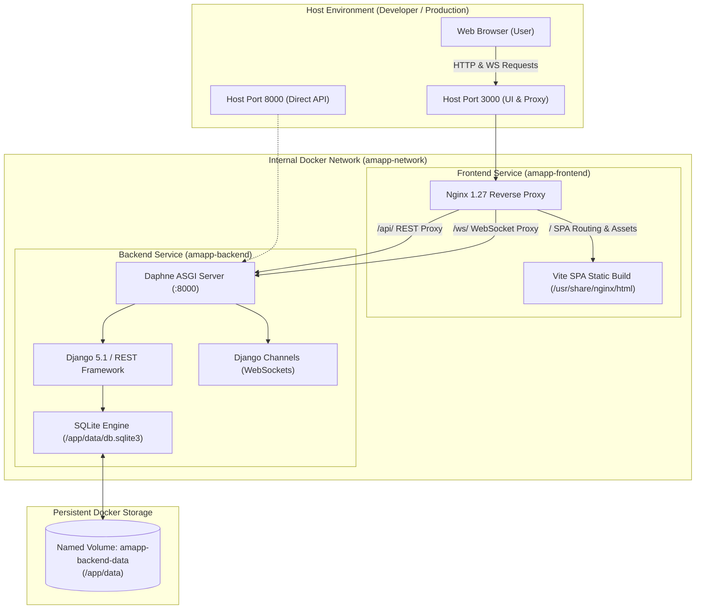

# AMAPP Containerized Deployment Guide (Phase 39)

This guide documents the production-grade, reproducible containerized deployment for the **Adaptive Multi-Agent Path Planning for Autonomous Vehicles (AMAPP)** simulation platform using Docker and Docker Compose.

---

## 1. System Deployment Architecture

The AMAPP containerized deployment consists of two coordinated services connected via a dedicated internal bridge network (`amapp-network`):



### Key Service Characteristics
1. **Frontend Service (`amapp-frontend`):**
   - Built via multi-stage Docker build: compiles TypeScript/React SPA with Node 22 and packages static assets into lightweight `nginx:1.27-alpine`.
   - Serves as the primary ingress entrypoint on host port `3000`.
   - Reverse-proxies `/api/` to `http://backend:8000/api/` and `/ws/` to `http://backend:8000/ws/` with HTTP/1.1 `Upgrade` and `Connection` headers.
   - Provides client-side SPA routing fallback (`try_files $uri $uri/ /index.html`).
   - Dedicated health check endpoint: `GET /healthz`.
2. **Backend Service (`amapp-backend`):**
   - Python 3.11 (`python:3.11-slim-bookworm`) executed under dedicated non-root user `amapp` (UID/GID 10001).
   - Serves both HTTP REST endpoints and Channels WebSockets concurrently via Daphne ASGI (`config.asgi:application`).
   - Uses zero-dependency `InMemoryChannelLayer` for single-worker streaming without requiring an external Redis container.
   - Dedicated health check endpoint: `GET /api/v1/health/` verifying database connectivity.
3. **Persistent Volume (`amapp-backend-data`):**
   - Mounted at `/app/data` to persist simulation runs, experiment metrics, and road graph caches across container teardowns and upgrades.

---

## 2. Prerequisites

- **Docker:** Version 24.0 or later
- **Docker Compose:** Version 2.20 or later (or Docker Compose v5+)
- Ports `3000` (frontend) and `8000` (backend direct access) available on host

---

## 3. Clean-Start Deployment Procedure

Follow these steps for a clean, deterministic deployment:

### Step 1: Clone Repository & Create Environment Configuration
```bash
# Navigate to project root
cd Adaptive-Multi-Agent-Path-Planning

# Copy template configuration
cp .env.example .env
```

### Step 2: Configure Production Secrets
Edit `.env` and set a secure secret key of at least 32 characters:
```bash
# Generate random key: openssl rand -base64 32
DJANGO_SECRET_KEY=y0ur-cryp70gr4ph1c4lly-53cur3-k3y-min-32-chars
DEBUG=False
ALLOWED_HOSTS=localhost,127.0.0.1,backend,frontend,web
CSRF_TRUSTED_ORIGINS=http://localhost:3000,http://127.0.0.1:3000
AMAPP_WS_ALLOWED_ORIGINS=http://localhost:3000,http://127.0.0.1:3000
PORT=3000
BACKEND_PORT=8000
AMAPP_DATA_DIR=/app/data
RUN_MIGRATIONS=true
```

### Step 3: Build and Start Services
```bash
# Build multi-stage images and start in background
docker compose up -d --build
```

### Step 4: Verify Container Health Status
```bash
# Check service health status
docker compose ps
```
Expected output:
```text
NAME             IMAGE                                COMMAND                  SERVICE    CREATED          STATUS                    PORTS
amapp-backend    adaptive-multi-agent-path-planning-backend    "/app/entrypoint.sh …"   backend    10 seconds ago   Up 9 seconds (healthy)    0.0.0.0:8000->8000/tcp
amapp-frontend   adaptive-multi-agent-path-planning-frontend   "/docker-entrypoint.…"   frontend   10 seconds ago   Up 9 seconds (healthy)    0.0.0.0:3000->80/tcp
```

### Step 5: Test Endpoints
```bash
# 1. Frontend container health
curl -f http://localhost:3000/healthz

# 2. Backend health via frontend reverse proxy
curl -f http://localhost:3000/api/v1/health/

# 3. Direct backend health
curl -f http://localhost:8000/api/v1/health/
```

### Step 6: Access Dashboard
Open your browser to:
[http://localhost:3000](http://localhost:3000)

---

## 4. Environment Variables Reference

| Variable | Default | Purpose |
| :--- | :--- | :--- |
| `DJANGO_SECRET_KEY` | *(Required in prod)* | Cryptographic signing key; must be $\ge 32$ characters when `DEBUG=False`. |
| `DEBUG` | `False` | Django debug mode; strictly `False` in production. |
| `ALLOWED_HOSTS` | `localhost,127.0.0.1,backend,frontend,web` | Host headers accepted by Django backend. |
| `CSRF_TRUSTED_ORIGINS` | `http://localhost:3000,http://127.0.0.1:3000` | Approved origins for CSRF POST requests. |
| `AMAPP_WS_ALLOWED_ORIGINS` | `http://localhost:3000,http://127.0.0.1:3000` | Approved origins for WebSocket connection upgrades. |
| `PORT` | `3000` | Host port mapped to frontend Nginx container. |
| `BACKEND_PORT` | `8000` | Host port mapped to backend Daphne ASGI container. |
| `AMAPP_DATA_DIR` | `/app/data` | Directory inside container for SQLite database and state persistence. |
| `RUN_MIGRATIONS` | `true` | When `true`, automatically applies pending database migrations on startup. |
| `REDIS_URL` | *(None)* | Optional external Redis channel layer URL (e.g. `redis://redis:6379/0`). |
| `DB_ENGINE` | `django.db.backends.sqlite3` | Database engine (e.g. `django.db.backends.postgresql`). |
| `DB_HOST` | *(None)* | Database host for external databases. |
| `DB_PORT` | *(None)* | Database port for external databases. |

---

## 5. Persistence, Backups & Maintenance

### Database Storage
All SQLite database records (`db.sqlite3`) and persistent files are stored in the named Docker volume `amapp-backend-data`, mapped to `/app/data`.

### Database Backup
To back up the SQLite database without stopping the application:
```bash
docker compose exec backend python manage.py dumpdata --natural-foreign --natural-primary -e contenttypes -e auth.Permission --indent 2 > backup.json
```
Or directly copy the database file:
```bash
docker cp amapp-backend:/app/data/db.sqlite3 ./amapp_backup_$(date +%Y%m%d).sqlite3
```

### Running Migrations Manually
If `RUN_MIGRATIONS` is set to `false`, apply migrations explicitly:
```bash
docker compose exec backend python manage.py migrate
```

### Resetting Deployment & Data
To tear down the containers and wipe persistent data for a fresh start:
```bash
docker compose down -v
```

---

## 6. Automated Deployment Smoke Verification

Run the automated smoke test script to verify all health endpoints, REST APIs, and WebSocket streaming against running containers:
```bash
python scripts/test_deployment_smoke.py --frontend-url http://localhost:3000 --backend-url http://localhost:8000 --ws-url ws://localhost:3000
```
