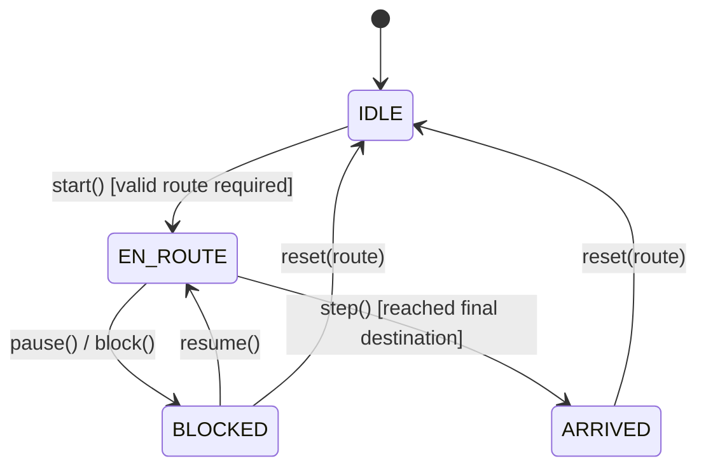

# Phase 07 Progress Report: Vehicle Kinematics and Agent Lifecycle

**Project:** Adaptive Multi-Agent Path Planning for Autonomous Vehicles (AMAPP)  
**Repository:** [https://github.com/Subash1904-in/Adaptive-Multi-Agent-Path-Planning](https://github.com/Subash1904-in/Adaptive-Multi-Agent-Path-Planning)  
**Previous Phase:** Phase 6 — Route Planning Baseline (Dijkstra, A* and Travel-Time Routing)  
**Starting Commit:** `3087e08`  
**Current Phase Status:** **COMPLETED**  
**Authoritative Acceptance Gate:** GitHub Actions CI  

---

## 1. Phase Objective & Acceptance Checklist

The primary goal of Phase 07 is to implement a deterministic, testable vehicle-motion subsystem that advances a `Vehicle` entity along a planned `Route` over a directed `RoadGraph` using bounded 2D point-mass kinematics and robust lifecycle management.

### Acceptance Checklist
- [x] **Pure Kinematics Integration:** Bounded constant-acceleration integration with acceleration ($a_{\max}$) and deceleration ($b_{\max}$) limits.
- [x] **Physical Constraints & Bounds:** Speed remains strictly non-negative ($v \ge 0.0$), capped at vehicle top speed and road speed limit ($v \le v_{\text{cap}}$).
- [x] **Segment Traversal & Orientation:** Dynamic tracking of active segment, planar position interpolation, and heading angle computation in radians ($[0, 2\pi)$).
- [x] **Continuous Multi-Segment Progression:** High-speed steps cross intermediate segment boundaries without losing traveled distance.
- [x] **Arrival & Overshoot Prevention:** Clamping at destination boundary when step distance exceeds remaining distance; arrival transitions vehicle to `ARRIVED` with $v=0.0$.
- [x] **Agent Lifecycle State Machine:** Explicit transitions between `IDLE`, `EN_ROUTE`, `BLOCKED` (paused), and `ARRIVED`.
- [x] **Preserved Progress on Block/Pause:** Stopping preserves position and segment progress; resuming continues smoothly.
- [x] **Strict Determinism:** Identical initial conditions and step durations produce bit-identical trajectories.
- [x] **Typed Result Contract:** `MotionStepResult` reporting complete step metrics, speeds, positions, and arrival flags.
- [x] **Comprehensive Test Suite:** 61 new unit and integration tests covering motion equations, lifecycle states, edge transitions, synthetic grids, and OSM networks.
- [x] **Full Regression Integrity:** All 257 Phase 2–6 regression tests remain active and passing (318 total tests passing).
- [x] **Authoritative Coverage Gate:** 96.51% line coverage maintained across `backend/apps/core` (exceeding the 80% CI minimum).
- [x] **No Premature Architecture:** Zero collision avoidance, global clocks, traffic signal controllers, or V2V protocols introduced.

---

## 2. Architecture & Design Decisions

### Package Organization (`backend/apps/core/kinematics/`)
1. **`exceptions.py`**:
   - `KinematicsError(DomainException)`: Base error.
   - `InvalidKinematicsConfigError`: Parameter validation failures.
   - `InvalidMotionInputError`: Non-finite or negative $\Delta t$, NaN/Inf inputs.
   - `InvalidRouteError`: Topology, connectivity, or endpoint mismatches.
   - `InvalidLifecycleTransitionError`: Illegal state machine actions.
2. **`models.py`**:
   - `KinematicsConfig`: Validated limits ($v_{\max}, a_{\max}, b_{\max}, v_{\min}$, road limit enforcement, tolerance).
   - `MotionStepResult`: Immutable dataclass reporting step diagnostics and state.
3. **`motion.py`**:
   - `validate_motion_inputs`: Pure finite/positive validation.
   - `compute_heading`: 2D planar angle calculation in $[0, 2\pi)$.
   - `interpolate_position`: Linear interpolation along segment endpoints.
   - `integrate_motion`: Bounded constant-acceleration numerical integration.
4. **`vehicle_agent.py`**:
   - `RouteSegment`: Internal segment representation with precomputed geometric endpoints, lengths, and headings.
   - `VehicleAgent`: Coordinator managing lifecycle transitions, route following, and synchronization with the `Vehicle` domain entity.

---

## 3. Motion Integration Model & Equations

The motion model implements 1D longitudinal progression along directed road segment centerlines using bounded constant-acceleration integration.

### Fundamental Equations
$$v(t) = v_0 + a_{\text{applied}} \cdot \Delta t$$
$$d(t) = v_0 \cdot \Delta t + \frac{1}{2} a_{\text{applied}} \cdot (\Delta t)^2$$

### Physical Constraints
1. **Acceleration & Braking Clamping:**
   $$a_{\text{applied}} = \max(-b_{\max}, \min(a_{\text{cmd}}, a_{\max}))$$
2. **Effective Speed Cap:**
   $$v_{\text{cap}} = \begin{cases} \min(v_{\max}, v_{\text{edge\_limit}}) & \text{if enforce\_road\_speed\_limits is True} \\ v_{\max} & \text{otherwise} \end{cases}$$
3. **Mid-Step Deceleration to Stop ($a_{\text{applied}} < 0$):**
   If $t_{\text{stop}} = v_0 / |a_{\text{applied}}| < \Delta t$:
   $$d = \frac{v_0^2}{2 |a_{\text{applied}}|}, \quad v_{\text{next}} = 0.0$$
   Reverse motion is strictly disallowed.
4. **Mid-Step Acceleration Saturation ($a_{\text{applied}} > 0$):**
   If $t_{\text{sat}} = (v_{\text{cap}} - v_0) / a_{\text{applied}} < \Delta t$:
   $$d = v_0 t_{\text{sat}} + \frac{1}{2} a_{\text{applied}} t_{\text{sat}}^2 + v_{\text{cap}} (\Delta t - t_{\text{sat}}), \quad v_{\text{next}} = v_{\text{cap}}$$
5. **Destination Clamping & Arrival:**
   If remaining route distance $d_{\text{rem}} \le d$:
   $$d = d_{\text{rem}}, \quad v_{\text{next}} = 0.0, \quad \text{state} \to \text{ARRIVED}$$

---

## 4. Vehicle Agent Lifecycle State Machine

- **IDLE:** Parked at start node. Zero distance traveled upon stepping.
- **EN_ROUTE:** Actively traversing consecutive directed road segments.
- **BLOCKED / STOPPED:** Temporarily halted ($v=0$). Progress along active segment is preserved.
- **ARRIVED:** Final destination node reached. Speed is $0.0$. Repeated stepping produces no further movement.

---

## 5. Files Created & Modified

### Created
- `backend/apps/core/kinematics/__init__.py`
- `backend/apps/core/kinematics/exceptions.py`
- `backend/apps/core/kinematics/models.py`
- `backend/apps/core/kinematics/motion.py`
- `backend/apps/core/kinematics/vehicle_agent.py`
- `backend/apps/core/tests/test_kinematics_motion.py`
- `backend/apps/core/tests/test_kinematics_vehicle_agent.py`
- `backend/apps/core/tests/test_kinematics_integration.py`
- `docs/progress/PHASE_07.md`

### Modified
- `backend/apps/core/domain/enums.py`: Added `BLOCKED = "blocked"` to `VehicleState`.
- `.github/workflows/ci.yml`: Updated hygiene checks to require `PHASE_07.md` and modernized step names.
- `ARCHITECTURE.md`: Documented Section 3.2 Vehicle Kinematics & Agent Lifecycle Subsystem; updated Section 4 blueprint table.
- `REQUIREMENTS_TRACEABILITY.md`: Updated Current Phase to Phase 7 and mapped kinematics to FR-02/FR-05.
- `README.md`: Added Section 6.9 Vehicle Kinematics and Agent Lifecycle usage guide.
- `docs/TESTING.md`: Documented kinematics test suites and updated test metrics.
- `PROJECT_STATUS.md`: Marked Phase 7 COMPLETED; set Phase 8 PENDING.

---

## 6. Test Results & Verification

All automated tests execute 100% offline without live internet access.

- **Kinematics Motion Integration (`test_kinematics_motion.py`):** 38 passed.
- **Vehicle Agent Lifecycle & Route Following (`test_kinematics_vehicle_agent.py`):** 19 passed.
- **Kinematics Grid & OSM Integration (`test_kinematics_integration.py`):** 4 passed.
- **Previous Regression Tests (Phases 2–6):** 257 passed.
- **Total Tests:** **318 passed, 0 failed in 2.92s**.
- **Coverage:** **96.51% total line coverage** across `backend/apps/core` (exceeding 80% CI minimum).
- **Ruff Linter:** 0 errors.
- **Django System Check:** 0 issues.

---

## 7. CI Workflow Verification

- **Commit SHA:** `e969c4f`
- **GitHub Actions Run ID:** `39374486188`
- **GitHub Actions Run URL:** [https://github.com/Subash1904-in/Adaptive-Multi-Agent-Path-Planning/actions/runs/39374486188](https://github.com/Subash1904-in/Adaptive-Multi-Agent-Path-Planning/actions/runs/39374486188)
- **Job Statuses:**
  - `Backend Lint, Test & Coverage`: **SUCCESS** (23s, Job ID: `118469439055`) — Full suite (318 tests) passed in 2.71s, 96.51% line coverage enforced against 80% CI minimum.
  - `Repository Hygiene & Documentation Integrity`: **SUCCESS** (5s, Job ID: `118469439381`) — All mandatory phase documentation verified present and clean.
  - `Frontend Lint, Typecheck & Build`: **SUCCESS** (8s, Job ID: `118469439258`) — Node 22 environment verified.
- **Authoritative Gate Result:** 100% checks passed cleanly.

---

## 8. Requirements Traceability Impact

- **FR-02 (Multi-Agent Autonomous Vehicle Environment):** Baseline single-agent kinematics model, lifecycle state machine, and route progression verified. Multi-agent coordination and concurrent scenario orchestration belong to Phase 10.
- **FR-05 (Motion Planning & Performance Benchmarking):** Trajectory generation along optimal routes generated by Phase 6 algorithms (Dijkstra and A*).
- **FR-07 (Adaptive Path Planning):** Route reassignment via `reset(route)` verified on active vehicle agents.

---

## 9. Phase 8 Handoff Instructions

Phase 7 is complete. No simulation clock, collision detection, or multi-agent negotiation logic has been introduced prematurely.

**Scope for Phase 08 (Simulation Clock and World State):**
1. Read `docs/progress/PHASE_07.md` and `ARCHITECTURE.md`.
2. Implement authoritative simulation clock with fixed discrete time steps ($\Delta t$).
3. Implement world state container managing collections of vehicle agents and the road graph.
4. Provide simulation stepping loop with pause, resume, step, and reset controls.
5. Preserve all 318 passing regression tests and the $\ge 80\%$ line coverage threshold.
